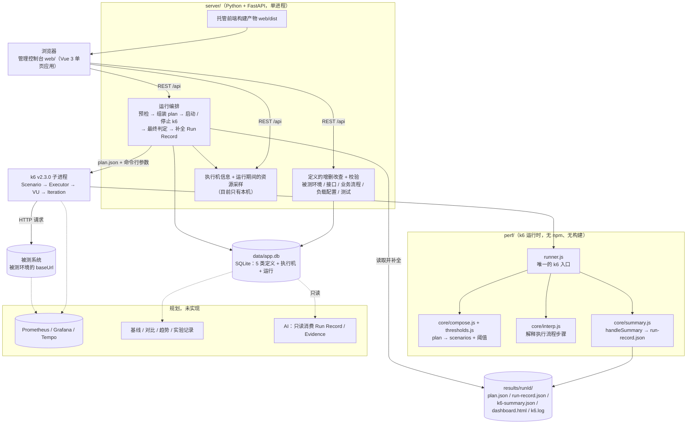
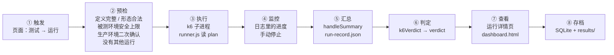
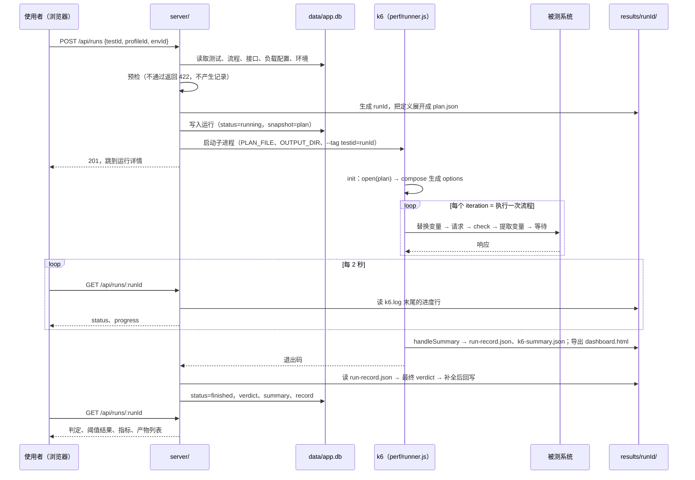
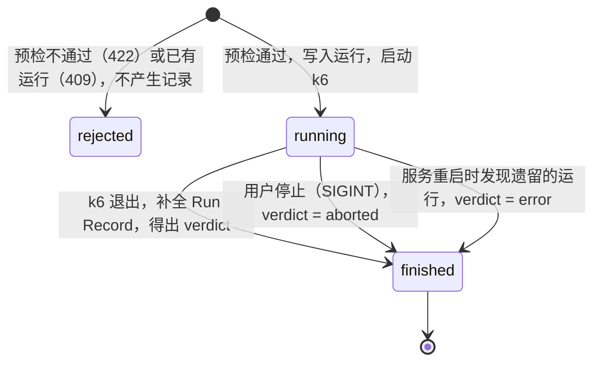
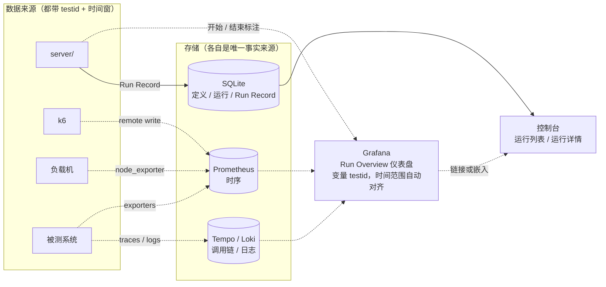
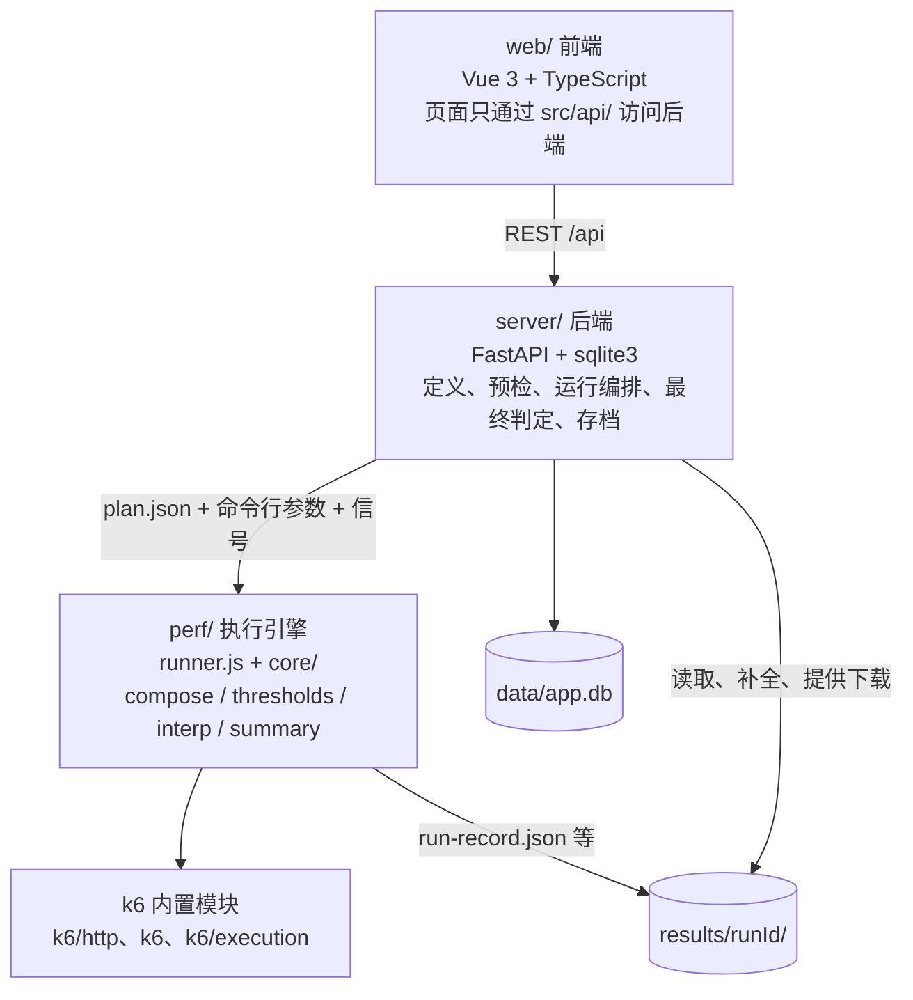
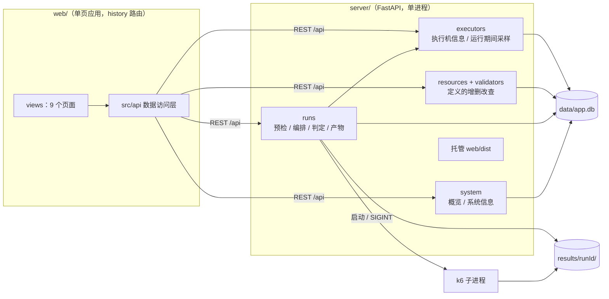
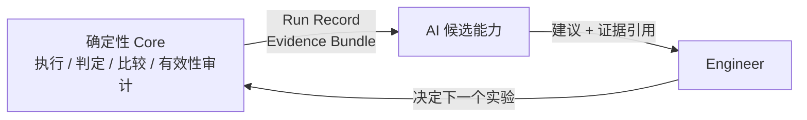

# AI Performance Engineering：架构与总体说明

> 本文是项目**唯一**的架构与总体说明文档。其他文档都是它的支撑材料（见 §13 文档分层）。
> 更新日期：2026-10-09 ｜ k6 基线：v2.3.0 ｜ 当前阶段：**MVP 已完成并可运行**（管理控制台 + 后端 + k6 执行引擎；决策见 ADR-005）
> 标注约定：**已实现** = 代码里有并且跑过；**规划，未实现** = Phase 0 的设计仍然有效，但还没有代码；**待重新设计** = 原设计的前提已被 MVP 改变，动手前要先重新设计。

---

## 1. 当前状态：能做什么 / 不能做什么

### 1.1 状态表

| 能力 | 状态 | 说明 |
|---|---|---|
| 研究结论（k6、性能工程、Observability、AI + 性能测试） | ✅ 已完成 | `research/` |
| 架构、边界、决策、路线图 | ✅ 已完成 | 本文、ADR-001–005、`plans/` |
| 在页面上维护定义：被测环境（含类型 dev / test / staging / prod）、接口、业务流程、负载配置、测试（含验收标准） | ✅ 已实现（MVP） | 增删改查，存 SQLite（§8.2） |
| 执行机（运行 k6 的机器）：查看主机、系统、资源、k6 / Python / uv 版本、项目目录、当前状态 | ✅ 已实现（MVP） | 只有运行后端的这一台；只能改名称和备注（§3.5） |
| 从页面发起、停止运行 | ✅ 已实现（MVP） | 同一时间只允许 1 个运行（§3.5） |
| 接口调试、业务流程试跑：用真实 k6 跑一次迭代，页面上看请求、响应、检查和变量；接口页为 Postman 式工作台；从 cURL 导入 | ✅ 已实现（2026-10-09） | 与压测共用执行代码；不留运行记录；与运行互斥（§3.5 调试） |
| 接口文件夹：可嵌套（项目 → 模块），接口页左栏是文件夹树，业务流程选接口时按文件夹分组 | ✅ 已实现（2026-10-09） | 只用于分组，不进 plan，不影响运行；非空文件夹不能删（§8.2） |
| 预检：定义完整、地址合法、负载形态合法、不超过被测环境的安全上限、生产环境二次确认、k6 可用 | ✅ 已实现（MVP） | 目标健康检查、k6 版本核对未实现 |
| 数据驱动的业务流程执行（HTTP；多步骤、变量提取、检查、等待时间） | ✅ 已实现（MVP） | 通用脚本 `perf/runner.js` 解释执行；没有分支和循环（§1.2） |
| 同一个测试用不同负载配置运行；显式 open / closed；4 种形态 | ✅ 已实现（MVP） | 对百度只跑过冒烟级别 |
| 多个业务流程按权重混合（Flow Mix） | ✅ 已实现（MVP） | 每个流程编译成一个 k6 scenario |
| SLO → 阈值自动生成，并自动附加有效性阈值 | ✅ 已实现（MVP） | SLO 只到测试级别（§1.2） |
| 判定 `passed / failed / invalid / error / aborted` | ✅ 已实现（MVP） | 端到端联调中出现过 `passed`、`failed`、`aborted`；`invalid`、`error` 还没有端到端的真实记录（§4.5） |
| 运行记录：runId、发起时的配置快照、环境指纹、Run Record、产物文件 | ✅ 已实现（MVP） | §4.6 |
| 运行中的进度；结束后的 k6 图表（`dashboard.html`） | ✅ 已实现（MVP） | 进度来自 k6 日志，浏览器不连实时仪表盘（§3.6） |
| 查看结果：概览、运行列表、运行详情 | ✅ 已实现（MVP） | §8 |
| 历史存档：每次运行自动保存，可标记存档、删除 | ✅ 已实现（MVP） | SQLite + `results/<runId>/` |
| 静态报告 `report.md` / `report.html` | ❌ 不做 | 由运行详情页和 `dashboard.html` 替代（§12） |
| 按流程 / 步骤设置 SLO；业务指标（业务成功率） | ❌ 未实现 | Phase 1 剩余 |
| 负载的"形状与强度分离" | ❌ 未实现 | 负载配置里直接写绝对数值（§1.2） |
| 测试数据：数据集、账户池、唯一键、每 VU token 缓存 | ❌ 未实现 | Phase 1 剩余（§4.3） |
| 执行机采样：运行期间每秒采样本机 CPU 和内存，写进 Run Record | ✅ 已实现（MVP） | 只展示，**不参与判定**（§3.6）；是否据此判 `invalid` 未决 |
| 目标健康检查、失控自动中止 | ❌ 未实现 | §3.5、§3.6 |
| 登录与权限、操作审计、多个运行同时进行 | ❌ 未实现 | ADR-005 的复议条件 |
| 自有的、可以自由加压的目标系统 | ❌ 未具备 | 未决；现在的目标是百度，只能冒烟 |
| 基线与回归比较、重复运行汇总、实验记录 | ❌ 规划，未实现 | Phase 2 |
| CI：PR 冒烟门禁、Nightly 回归、通知 | ❌ 规划，未实现；入口待重新设计 | Phase 2（§3.8） |
| Prometheus / Grafana（k6 + 被测系统 RED / USE） | ❌ 规划，未实现 | Phase 2（§3.9） |
| Trace 关联、Evidence Bundle、趋势与变点检测 | ❌ 规划，未实现 | Phase 3 |
| AI 能力 | ❌ 没有任何 AI 功能；Phase 4 先做评估 | Phase 4–5（§9） |
| 分布式执行 | ❌ 规划，未实现 | 条件触发（§7） |
| HTTP 以外的协议 | ❌ 未实现 | 目标系统需要时（§7） |

**运行前提**：已安装 uv。`scripts/setup.sh` 用 uv 同步 Python 依赖，并把 k6 v2.3.0 和构建前端用的 Node v24.21.0 下载到 `.tools/`，不需要 sudo 和 Docker。`scripts/start.sh` 后台启动服务，浏览器访问 `http://<服务器地址>:8088`。

**压测目标的限制**：MVP 的目标是 `https://www.baidu.com`，属于第三方线上站点，**只允许冒烟级别流量**。种子环境"百度（仅冒烟）"的类型是生产（`prod`），安全上限是 2 并发、每秒 2 次、60 秒，由后端预检强制执行，不得调高（§3.5）。所以目前的运行只验证了"链路能跑通、判定能算对"，**不产生任何性能结论**。

### 1.2 MVP 相对原设计的简化与改变

Phase 0 的设计是"手写 JS 的 Flow 模块 + 命令行入口 + 只读控制台"。2026-09-30 用户决定先做可维护的管理控制台（ADR-005），实现与原设计有以下出入：

| 项 | 原设计（Phase 0） | MVP 实际 | 后果 |
|---|---|---|---|
| 前端定位 | 只读控制台，不发起压测、不改配置 | **管理控制台**：页面上增删改定义、发起和停止运行 | 需要护栏（§8.5）；后端成为运行路径的一部分 |
| 业务流程 | 手写 JS 模块（Service / Flow），git 管理 | **页面上维护的数据**（SQLite），由通用脚本解释执行 | 只能表达顺序步骤，没有分支、循环、轮询；定义的修改不经过 git 审核 |
| 运行入口 | 命令行 `tools/run.mjs`，CI 调用同一命令 | 后端接口 `POST /api/runs`，由页面调用；没有命令行入口 | CI 接入要重新设计（§3.8） |
| 后端 | Node.js，只读 API | Python 3.12 + FastAPI：增删改查、预检、启动和停止 k6、最终判定、存档 | 两套工具链：Python（uv）和 Node（只用于构建前端） |
| 存储 | `results/` 下的 JSON 文件；基线文件入 git | SQLite 单文件 `data/app.db`（定义 + 运行）+ `results/<runId>/`（产物） | 都不入 git，备份靠复制文件 |
| 负载配置 | 只描述形状（相对比例），强度由测试给出 | **直接写绝对数值**（并发、到达率、时长） | "同一形状的不同倍数"要建多条负载配置 |
| SLO | 按流程 / 步骤设置 p95 / p99、错误率、业务成功率 | **测试级别**：全部请求的 p95 / p99、错误率、检查通过率 | 分步骤指标能看到，但不能对单个步骤设验收标准 |
| 报告 | 每次运行生成 `report.md` + 静态 `report.html` | **不生成**；运行详情页 + k6 导出的 `dashboard.html` | 看结果需要服务在线（产物文件仍可单独打开） |
| 基线对比 | Phase 2 | 没有；结果只有本次的数值 | 不能回答"比上次差多少" |
| 目标系统 | QuickPizza（本地 Docker） | `https://www.baidu.com`，仅冒烟（本机没有 Docker 和 sudo） | 压力、尖峰等负载无法真实运行 |
| 前端技术栈 | React + Ant Design（推荐，待复核） | Vue 3 + TypeScript + Vite + Element Plus + ECharts | — |
| 测试策略 | 组件测试 + 少量端到端测试 | **不写单元测试套件**，靠真实运行验证 | 判定逻辑没有自动化的回归保护 |

**保留下来的核心设计**（与定义存在哪里无关）：业务（接口、流程）与负载（负载配置）分开维护，只在发起运行时组装；负载模型显式区分 open / closed；SLO 是数据，阈值由它生成，并自动附加有效性阈值；判定为 `passed / failed / invalid / error / aborted`，`invalid` 优先于 `failed`，由确定性规则计算；每次运行有 runId、完整记录和发起时的配置快照；AI 的全部约束不变。

---

## 2. 项目是什么

**一个以 k6 为执行引擎的性能测试管理控制台和执行框架。** 它把"写一个 k6 脚本"扩展为可重复、可追溯的工程闭环：

```text
已实现：  Test（Flow Mix + SLO）× Load Profile × Environment → 预检 → k6 Run → Run Record → Verdict → 存档
规划：    Hypothesis → Experiment → … → Baseline Comparison → Conclusion
```

**不是**：k6 的替代品；"AI 自动压测工具"；Observability 平台；多租户的在线压测 SaaS。控制台是单机、单进程、没有登录的内部工具（§8.5）。

### 和直接写 k6 脚本的区别

| 问题 | 直接写 k6 | 本项目 | 现状 |
|---|---|---|---|
| 业务流与负载模型写在同一个 `options.scenarios` | 每种测试类型复制一份脚本 | **业务 ⟂ 负载**：流程和负载配置分开维护，发起运行时才组装 | ✅ |
| Open / Closed 模型隐式 | 默认 VU 模型，产生 Coordinated Omission | 负载配置**显式声明模型** | ✅ |
| 阈值写死在脚本里 | 数字散落，无依据 | **SLO 是数据**，阈值由它生成 | ✅（测试级别） |
| exit code 99 分不清"系统不达标"与"测试无效" | VU 不足被当成系统失败 | **判定区分 `failed` 和 `invalid`** | ✅ |
| 运行没有身份 | 看完图就丢 | **runId + Run Record + 配置快照 + 环境指纹** | ✅ |
| 改脚本才能改流程 | 需要会写 JS | 页面上维护接口和流程 | ✅（表达力有限） |
| 无回归比较 | 人工对比截图 | 基线 + 统计比较 | 规划，未实现 |
| 分布式下数据冲突 | 用 `__VU` 取数 | 数据选择只用 `*InTest` 字段 | 规划，未实现（还没有数据集） |
| 与系统内部遥测无关联 | 靠时间肉眼对齐 | 关联约定：`testid` tag、请求头、时间窗 | 只有 `testid` tag 和时间窗 |
| 分布式下阈值 / summary 分散 | k6 不合并 | Result 层独立于 k6 进程 | 规划，未实现 |

---

## 3. 总体架构

- **逻辑视图**（§3.1）：由哪些组件组成、组件之间怎么依赖；
- **运行视图**（§3.2–3.9）：一次运行从触发到存档的完整链路。

### 3.1 逻辑架构



实线 = 已实现；虚线 = 规划。图里有两种"环境"，不要混淆：**执行机**是安装了本项目、实际运行 k6 的机器（现在就是 `server/` 和 k6 所在的这台）；**被测环境**是被压测的目标（地址、类型、安全上限）。三部分（`perf/`、`server/`、`web/`）之间的接口约定在 `plans/mvp-contract.md`，字段级细节以它为准，本文不重复。

### 3.2 运行环节总览

一次运行经过 8 个环节，每个环节都由确定性代码完成，**AI 不参与任何环节**。



| 环节 | MVP 实际做法 | 由谁完成 | 规划（未实现） |
|---|---|---|---|
| ① 触发 | 在"测试"页点"运行"，选负载配置和环境；或在运行详情页点"再次运行" | `web/` → `POST /api/runs` | CI、定时触发（§3.8，入口待重新设计） |
| ② 预检 | 定义存在且完整、地址合法、负载形态合法、不超过被测环境的安全上限、生产环境二次确认、流程数不超过并发、没有其他运行、k6 可执行 | `server/runs.py` | 目标健康检查、k6 版本核对 |
| ③ 执行 | 后端启动 k6 子进程，传入 `plan.json` 和输出目录，`--tag testid=<runId>` | k6 + `perf/runner.js` | 专用负载机、CI runner、k6-operator |
| ④ 监控 | 后端从 `k6.log` 取最新一行进度，前端每 2 秒轮询；可手动停止 | `server/runs.py`、`server/executors.py`（执行机采样）、运行详情页 | Prometheus + Grafana、失控自动中止、Trace |
| ⑤ 汇总 | `handleSummary` 写 `run-record.json` 和 `k6-summary.json` | `perf/core/summary.js` | 重复运行汇总、多实例合并 |
| ⑥ 判定 | k6 侧按阈值类别得出 `k6Verdict`；后端结合退出码和停止请求得出最终 `verdict` | `perf/core/summary.js` + `server/runs.py` | 基线对比、变点检测 |
| ⑦ 查看 | 运行详情页；k6 导出的 `dashboard.html` | `web/` | CI Summary、通知、趋势、证据视图 |
| ⑧ 存档 | 运行写入 SQLite（含快照和 Run Record），产物留在 `results/<runId>/`；可标记"存档" | `server/runs.py` | 基线、实验记录 |

### 3.3 k6 的位置

k6 负责：JS 运行时、VU 调度、Executor（负载模型实现）、协议客户端、客户端指标、阈值计算、指标输出。项目**不重新实现**其中任何一项，只在三处工作：

1. **输入端**：`core/compose.js` 把 plan 编译成 `options`（scenarios、thresholds），替代手写配置；
2. **执行中**：`core/interp.js` 把数据定义的步骤翻译成 `http.request` + `check` + `sleep`。这是一层很薄的解释器，不是协议抽象层；
3. **输出端**：`core/summary.js`（`handleSummary`）加后端的补全，把一次运行变成 Run Record。

外加一个**约定层**：tag 词汇表（§4.4）、key 的命名（§5.5）。

### 3.4 一次运行的数据流



### 3.5 执行

#### 执行机与被测环境

"环境"在这个项目里有两个不同的意思，页面和接口上分成两个概念：

| 概念 | 是什么 | 在哪里维护 | 内容 |
|---|---|---|---|
| **执行机**（Load Generator，即"负载机"） | 安装了本项目、实际运行 k6 的机器 | "执行机"页。只有运行后端的这一台，由后端建库时自动创建，只能改名称和备注 | 主机名、IP、系统、CPU 核数、内存、负载、磁盘、k6 / Python / uv 版本、项目目录、当前是否在运行 —— 每次请求时实时采集 |
| **被测环境**（Environment） | 被压测的目标系统的一套部署 | "被测环境"页，增删改查 | 名称、类型（`dev` 开发 / `test` 测试 / `staging` 预发 / `prod` 生产）、基础地址、公共请求头、安全上限 |

**被测环境上为什么有并发、到达率、时长**：它们不是负载配置，而是这个环境**最多允许承受多少流量**的安全上限（`maxVus`、`maxRate`、`maxDurationSec`）。负载"打多大"仍然只写在负载配置里；上限只在预检时用来拒绝超限的运行，防止把只适合冒烟的环境（例如第三方站点、生产环境）当成压测环境来打。生产环境三项上限必填；其他类型可以留空，表示不限制。

#### 执行环境

| 环境 | 用途 | 执行机（负载机） | 目标系统 | 状态 |
|---|---|---|---|---|
| 服务所在的机器 | MVP 的唯一环境：维护定义、冒烟 | 本机执行机：后端启动的本机 k6 子进程 | 被测环境定义里的 `baseUrl`（种子数据是百度） | ✅ 已实现 |
| CI runner | PR 冒烟（功能正确性，**不做性能结论**） | 共享 CI runner | CI 内临时启动的目标系统 | 规划，未实现 |
| 专用负载机 | 夜间 average-load 与回归比较；手动 stress / spike / soak | 固定规格的独立机器 | 固定、隔离的性能环境 | 规划，未实现 |
| k6-operator / Grafana Cloud k6 | 单机负载不足时的分布式执行 | K8s Pod × N / 云端 | 性能环境 | 条件触发 |

**性能结论只能来自专用负载机 + 固定性能环境**。现在的环境（与后端同机的 k6、第三方目标、冒烟流量）只用来验证流程和判定是否正确。

#### 预检（`POST /api/runs` 时由后端执行）

| 检查 | 不通过时 |
|---|---|
| 测试、负载配置、被测环境、执行机都存在（`executorId` 省略时用本机执行机）；测试至少有 1 个流程，每个流程至少有 1 个步骤，引用的接口都存在 | 422 `PREFLIGHT_REJECTED` |
| 被测环境的 `baseUrl` 是合法的 http / https 地址 | 422 |
| 负载配置属于四种形态之一（§4.2） | 422 |
| **不超过被测环境的安全上限**（只检查填了的项）：并发（`vus` 或 `preAllocatedVus`）≤ `maxVus`；到达率（`rate`、`startRate`、各 stage 的 `target`）≤ `maxRate`；总时长 ≤ `maxDurationSec` | 422，逐条列出超出的项 |
| **生产环境二次确认**：被测环境类型为 `prod` 时，请求里必须带 `confirmProd: true`（页面上是一个必须勾选的确认项） | 422 |
| 流程数量不超过并发：每个流程至少要分到 1 个 VU（固定迭代数形态下还要至少 1 次迭代） | 422 |
| 没有其他运行正在进行 | 409 `CONFLICT` |
| k6 可执行文件存在 | 422 |

预检不通过时不生成 runId，不留下运行记录。发起对话框会先在前端对照负载配置和被测环境的安全上限并给出提示，但是否拒绝只以后端预检为准。

**没有实现的检查**：目标健康检查、k6 版本与固定版本是否一致、目标主机白名单（任何合法的 http / https 地址都能建成被测环境，而且非生产类型可以不设上限，见 §8.5）。

#### 启动 k6

```bash
K6_WEB_DASHBOARD=true K6_WEB_DASHBOARD_HOST=127.0.0.1 K6_WEB_DASHBOARD_PORT=5665 \
K6_WEB_DASHBOARD_EXPORT=<输出目录>/dashboard.html K6_WEB_DASHBOARD_PERIOD=1s \
k6 run perf/runner.js -e PLAN_FILE=<输出目录>/plan.json -e OUTPUT_DIR=<输出目录> --tag testid=<runId>
```

工作目录是仓库根目录，路径都用绝对路径，标准输出和标准错误写入 `k6.log`。k6 放在独立的进程会话里，信号只由后端发一次（k6 收到第二次中断信号会强制退出且不写 summary）。

#### 一次运行的状态



运行对象只有两个状态：`running` 和 `finished`。`verdict` 在运行中为 `null`，结束后是五种判定之一。"存档"是结束后的一个标记，不是状态。

#### 停止与恢复

| 情况 | 处理 |
|---|---|
| 用户点"停止" | 后端向 k6 发一次 SIGINT；k6 照常写 summary 后退出；30 秒不退才强杀。判定为 `aborted` |
| 停止服务（`scripts/stop.sh`） | 后端先向正在运行的 k6 发 SIGINT 并等待，不留下孤儿进程 |
| 服务被强杀后重启 | 启动时把库里仍是 `running` 的记录标记为 `error`；遗留的 k6 进程按"进程号 + 命令行里的 runId"识别后停掉 |
| 启动 k6 失败 | 这次运行记为 `error`，接口返回 500 |

#### 执行护栏

| 护栏 | 实现 |
|---|---|
| 被测环境的安全上限 | `maxVus`、`maxRate`、`maxDurationSec`；生产环境三项必填，其他类型可留空（不限制）。预检强制执行 |
| 生产环境二次确认 | 被测环境类型为 `prod` 时，发起运行必须显式确认（`confirmProd: true`） |
| 同一时间只允许 1 个运行 | 后端用一把锁串行化"检查 → 写库 → 启动"，以库里的 `status` 为准 |
| 到时即停 | 每个 scenario 的 `gracefulStop` 收紧为 5 秒（k6 默认 30 秒） |
| 到达率模型不自动扩容 | `maxVUs` = `preAllocatedVUs`；VU 不够时丢弃迭代，由有效性阈值暴露 |
| 失败不空转 | 某一步检查没通过时，本次迭代的后续步骤不再执行，但仍然等待 think time，避免失败后循环变快 |
| 到达率必须是整数 | 小数到达率用 `timeUnit` 换算（每秒 0.5 次 → 每 2 秒 1 次），拆分后的总量不超过设定值 |

**没有的护栏**（风险见 §8.5）：登录与权限；安全上限和环境类型本身可以在页面上修改；没有目标地址白名单；没有运行之间的冷却时间；没有后端的超时看门狗（时长靠 k6 executor 自己的设定）；没有 `abortOnFail` 之类的失控保护；环境和接口的请求头原样存入数据库、`plan.json` 和运行快照，**没有凭据管理，不要在里面放真实密钥**。

#### 调试（单次试跑）

页面上写完接口不知道对不对，以前只能建流程、建测试、发起一次正式运行再去看检查通过率。现在接口页和业务流程页都能**调试**：用真实 k6 把一个接口（可以是没保存的内容）或一个业务流程跑**一次迭代**，把每一步实际发出的请求、收到的响应、每条检查的结果和提取到的变量原样返回给页面。字段级约定见 `plans/mvp-contract.md` §3.5、§4 `debug`、§5.1。

| 项 | 做法 | 为什么 |
|---|---|---|
| 谁发请求 | **k6 自己**：后端把接口 / 流程组装成 1 并发、1 次迭代、带 `debug` 段的 plan，用 `perf/runner.js` 的调试模式跑 | 变量替换、请求头合并、检查、提取只有 `perf/core/interp.js` 一份实现。后端若用 Python 直接发请求，就会出现"调试通过、压测失败"的第二套语义 |
| 记录怎么出来 | 引擎在迭代结束时 `console.log` 一行 JSON，k6 以 `--console-output` 单独落盘、`--log-format=json` 保证可解析，后端读回 | k6 在独立运行时里执行 `handleSummary`，看不到 VU 里的变量；VU 代码也不能写文件 |
| 与运行的差别 | 不等待 `thinkTimeMs`；保留响应体（≤ 64 KB）；`--no-thresholds`，没有判定、Run Record、运行记录、仪表盘、执行机采样；目录 `results/_debug/<debugId>/` 读完即删 | 调试回答的是"这一步会发生什么"，不是"系统达不达标" |
| 与运行互斥 | 有运行在进行时不能调试（409）；调试进行中不能发起运行（409）；同一时间只允许 1 个调试。实现在 `server/runs.py`（`claim_debug_slot` / `release_debug_slot`，与运行共用同一把启动锁） | 不干扰正在进行的运行的目标负载和执行机采样 |
| 护栏 | 走和运行相同的被测环境：`baseUrl`、公共请求头、`maxDurationSec`（取 60 秒与它的小者）；生产环境同样要 `confirmProd: true`（页面上首次向该环境发送时弹一次确认，本次会话内记住） | 一次请求也是请求；对百度的约束不因"只是调试"而放松 |
| 失败时 | k6 没产出记录（plan 无效、脚本异常、超时 90 秒）返回 500 `DEBUG_FAILED`，`details` 是 k6 日志的末尾，页面原样显示 | 常见原因是提取规则里的正则写错，日志里能直接看到 |

某一步的检查没通过时，后面的步骤和压测时一样不执行，但会以 `skipped` 列出来，页面上看得出"从哪一步开始没跑"。

### 3.6 监控

运行期间应该同时监控三个对象：执行机（负载机）、负载本身、被测系统。只看被测系统，会把执行机的问题误判为系统问题。MVP 只覆盖了其中一部分：

| 监控对象 | 看什么 | MVP 手段 | 规划（未实现） |
|---|---|---|---|
| **负载本身** | 实际到达率、`dropped_iterations`、VU 使用量 | 运行中：k6 进度行（已用时间、VU 数、完成的迭代数）。结束后：总体指标里的 `droppedIterations`、`vusMax`，有效性阈值，`dashboard.html` | Prometheus + k6 官方仪表盘 19665 / 18030 |
| **业务结果** | 各流程 / 步骤的 p95、错误率 | 结束后：分步骤指标表和柱状图、`dashboard.html` | Grafana，按 flow / step 过滤；SLO 线叠加 |
| **执行机（负载机）** | CPU（< 80%）、内存、网络 | 运行期间后端每秒采样本机 CPU 和内存占用，结束时把平均 CPU、最高 CPU、最高内存、样本数写进 Run Record 的 `executor`，运行详情页展示。**只展示，不参与判定** | 超过阈值时判 `invalid`（阈值未决）；网络；node_exporter |
| **被测系统** | RED（每个服务）、USE（每类资源） | **无** | exporters + Prometheus（Phase 2）；Trace（Phase 3） |

#### k6 实时仪表盘：只监听本机，浏览器不连（联调实测）

联调时确认了一个事实：**只要有浏览器连着 k6 的实时仪表盘（`:5665`），k6 跑完后就不会退出**。它会一直等页面关闭，不写 summary，运行因此永远停在"运行中"。三部分各自验证时都没有出现，只有真实后端、真实 k6、真实浏览器同时存在时才暴露。

因此：

- 仪表盘只监听 `127.0.0.1`，页面上不嵌入也不链接它。开着它只是为了在结束时导出 `dashboard.html`；
- 运行中的进度来自 k6 日志：后端读 `k6.log` 末尾，取最新一行 `running (...)`，放进运行对象的 `progress` 字段；
- 结束后的图表用导出的 `dashboard.html`，在运行详情页里以 iframe 显示；
- 聚合周期设为 1 秒（`K6_WEB_DASHBOARD_PERIOD=1s`）。默认 10 秒时，短运行会因为数据点不够而跳过导出。即使这样，`dashboard.html` 仍是可选产物，运行太短或被中止时可能没有。

#### 中止机制

| 类型 | 触发 | 结果 | 状态 |
|---|---|---|---|
| 手动 | 运行详情页点"停止" | `aborted`，仍然生成 Run Record | ✅ |
| 到时结束 | executor 的时长或迭代数用完，加 5 秒 `gracefulStop` | 正常结束，按阈值判定 | ✅ |
| 自动（安全保护） | 错误率 > 50% 等失控阈值（`abortOnFail` + `delayAbortEval`） | 提前结束 | 规划，未实现 |
| 自动（breakpoint） | SLO 阈值失败即停止 | breakpoint 的正常结束方式 | 规划，未实现 |
| 自动（超时） | 超过最大时长仍未退出 | `aborted` | 规划，未实现 |

### 3.7 结果汇总、查看与存储

#### 汇总层次

| 层次 | 输入 | 输出 | 由谁完成 | 状态 |
|---|---|---|---|---|
| 单次运行 | k6 summary + 阈值结果 + 退出码 + 环境指纹 | Run Record + verdict | `perf/core/summary.js` + `server/runs.py` | ✅ |
| 重复运行 | 同一配置的 N 次 Run Record（N ≥ 3） | 各指标中位数、变异系数（CV） | — | 规划，未实现 |
| 基线对比 | 本次 vs 基线 | 每个流程 / 步骤的差值 + 是否回归 | — | 规划，未实现 |
| 趋势 | 同一测试的历史 | 变点（回归 / 改善发生在哪次） | Apache Otava | 规划，未实现 |
| 多实例合并 | 各负载机的 Run Record + Prometheus Native Histogram | 全局 Run Record（**不平均百分位**） | — | 条件触发 |
| 实验结论 | 多个运行 + 对比 + 观察 | Experiment Record | 人 | 规划，未实现 |

#### 查看

| 输出 | 内容 | 状态 |
|---|---|---|
| 运行详情页 | 判定和原因、有效性检查、验收标准、总体指标、分步骤指标、k6 图表、产物、配置快照（§8.3） | ✅ |
| `dashboard.html` | k6 导出的时序图表 | ✅（可选产物） |
| `k6.log` | k6 的输出，末尾有 `handleSummary` 打印的文字摘要 | ✅ |
| `report.md` / `report.html` | 静态报告 | 不做 |
| CI Job Summary、通知（webhook） | 判定和运行详情页链接 | 规划，未实现 |

同一个 Run Record 永远显示同样的结果：页面只展示，不重新计算判定。

#### 存储

```text
data/app.db                      SQLite 单文件（WAL 模式）：不入 git
├── environments / apis / flows / profiles / tests    5 类定义
└── runs                         每次运行：状态、判定、摘要、snapshot（plan）、record（Run Record）

results/<runId>/                 每次运行的产物：不入 git
├── plan.json                    发起时展开的自包含配置（= 库里的 snapshot）
├── run-record.json              Run Record（k6 写出，后端补全后回写）
├── k6-summary.json              k6 原始 summary（排查用）
├── dashboard.html               k6 导出的图表（可选）
└── k6.log
```

删除运行时，库里的记录和产物目录一起删除；已存档的运行不能删除。测试、负载配置、环境有运行记录时仍然可以删除，因为运行里存了快照；接口被流程引用、流程被测试引用时不能删除。

**基线、历史、实验记录的存储形态待重新设计**：原设计是 git 管理的文件（`baselines/`、`history/`、`experiments/`）。现在运行已经在 SQLite 里，历史查询可以直接读 `runs` 表；基线放数据库还是放 git（保留"变更需要审核"这一点），到 Phase 2 再定。

### 3.8 CI/CD 集成（规划，未实现；入口待重新设计）

原设计的前提是"CI 只调用 `tools/run.mjs`"。MVP 没有命令行入口：发起运行的唯一入口是后端接口，定义在 SQLite 里。接入 CI 前要先在两条路线里选一条：

| 路线 | 做法 | 需要什么 | 问题 |
|---|---|---|---|
| A：CI 调用后端接口 | `POST /api/runs` 后轮询到 `finished`，按 `verdict` 决定流水线状态 | 一个 CI 能访问的常驻服务；接口要有认证 | 定义不在 git 里，PR 无法对定义的改动做门禁 |
| B：plan 文件 + 命令行 | 把定义导出为 `plan.json` 纳入 git，CI 直接执行 `k6 run perf/runner.js -e PLAN_FILE=...` | 一个做最终判定的小脚本（现在这段逻辑只在 `server/runs.py` 里）；导出功能 | 页面上的定义和 git 里的 plan 可能不一致 |

`perf/examples/*.plan.json` 已经是路线 B 的形态，引擎可以脱离后端单独运行。

无论哪条路线，以下设计仍然有效：

| 流水线 | 触发 | 环境 | 负载 | 门禁 |
|---|---|---|---|---|
| PR 冒烟 | 每次 PR / push | 共享 runner + 临时目标系统 | smoke | 判定必须为 `passed`，否则阻止合并 |
| Nightly 回归 | 每晚定时 | 专用负载机 + 性能环境 | average × 3 | 不阻塞；`failed` / 回归 / `invalid` 时通知 |
| 手动 / 每周 | 手动或每周定时 | 同上 | stress / spike / soak / breakpoint | 不阻塞，产出实验记录 |
| 基线更新 | 手动 | — | — | 需要人审 |
| 发布门禁 | 发布前 | 性能环境 | average | 相对基线无回归（可选） |

**CI 只认最终判定，不直接依赖 k6 的退出码**：k6 的 99 分不清 `failed` 和 `invalid`。`invalid` 通知环境负责人，`failed` 通知系统负责人。CI 平台（GitHub Actions / GitLab CI / Jenkins）未决。

### 3.9 统一查看入口

#### 现状

控制台是唯一的入口，数据只有两处：SQLite（定义和运行）和 `results/<runId>/`（产物）。

| 时机 | 入口 |
|---|---|
| 运行中 | 运行详情页：已用时间、k6 进度行、停止按钮 |
| 运行后 | 运行详情页：判定、阈值结果、指标，内嵌 `dashboard.html` |
| 跨运行 | 概览（判定分布、最近的运行）、运行列表（按测试 / 判定 / 状态 / 存档筛选）。**没有对比和趋势** |

#### 原则（对现状和规划都有效）

1. **不把所有数据搬进一个存储**。时序、运行记录、调用链的查询方式完全不同。
2. **统一关联键**：所有数据都带 `testid`（= runId）和运行时间窗（Run Record 的 `window`）；需要细分时用 `flow`、`step`。
3. **统一查看入口**：人只从控制台进入，其余数据通过已经带好 testid 和时间窗的链接跳转。
4. **每类数据只有一个事实来源**：判定只在 Run Record 中，由 `perf/core/summary.js` 和 `server/runs.py` 按确定性规则算出；时序只在 Prometheus 中；调用链只在 Tempo 中。**前端和 Grafana 都只负责展示，不重新计算判定**。
5. **分工**：控制台是运行和结论的入口；Grafana 是时序曲线的钻取工具。

#### 接入 Prometheus / Grafana 之后（规划，未实现）



| 区块 | 内容 | 数据来源 | 展示位置 |
|---|---|---|---|
| 结论 | 判定、失败的阈值、有效性检查、与基线的差值 | Run Record | 控制台（已有，基线差值除外） |
| 负载 | 目标 vs 实际到达率、VU、`dropped_iterations` | Prometheus（k6） | Grafana |
| 业务结果 | 每个流程 / 步骤的 p95 / p99、错误率，SLO 线叠加 | Prometheus（k6） | Grafana |
| 负载机 | CPU、内存、网络 | Prometheus（node_exporter） | Grafana |
| 被测系统 RED / USE | 请求量、错误、延迟；CPU、连接池、DB、Redis、MQ lag | Prometheus | Grafana |
| 调用链 / 日志 | 按 testid 过滤的慢调用链、错误日志 | Tempo / Loki | Grafana，从控制台跳转 |

实现要点：

- 后端在运行开始和结束时通过 Grafana HTTP API 写**标注**（annotation），任何 Grafana 图表上都能看到"这段时间在跑哪次压测"；
- Grafana 只保留一个 Run Overview 仪表盘，JSON 纳入 git；
- Grafana 面板用 iframe 嵌入运行详情页需要 Grafana 允许嵌入并解决认证，**尚未验证**；不可行就用带 testid 和时间窗的链接；
- Prometheus 的保留期有限，过期后旧运行的曲线会消失，长期对比只依赖 Run Record；
- Grafana 不可用时，控制台的结论部分照常可用。

#### 不做

- 不在控制台里重画 Grafana 已有的时序监控大盘（运行详情页的柱状图只画 Run Record 里的汇总数值）；
- 不把 trace_id、userId 放进 Prometheus 标签：基数会爆炸；
- 不在前端或 Grafana 中重新计算判定：避免出现两个"事实"。

---

## 4. 核心模型

### 4.1 术语

k6 的 `Scenario` = 执行函数 × executor 配置，同时包含"做什么"和"怎么加压"。为避免混淆，**业务场景一律称为业务流程（Flow），"Scenario" 只指 k6 Scenario**，它是 Composer 的编译产物，不手写、不在页面上维护。

| 页面上的名称 | 表 | 概念 | 内容 | 对应 k6 |
|---|---|---|---|---|
| 执行机 | `executors` | Load Generator（负载机） | 安装了本项目、实际运行 k6 的机器；库里只存名称和备注，其余实时采集 | 运行 `k6 run` 的那台机器 |
| 被测环境 | `environments` | Environment | 类型（`dev / test / staging / prod`）、基础地址、公共请求头、安全上限 | 请求的 URL 前缀和公共 header |
| 接口 | `apis` | 一个请求（原设计中 Service 的一个方法） | 方法、路径、请求头、请求体、期望状态码、期望包含的文本、变量提取 | `http.request` + `check` |
| 业务流程 | `flows` | Flow | 按顺序排列的接口步骤，每步的等待时间 | 一次 iteration |
| 负载配置 | `profiles` | Load Profile | 类型标签、`model: open / closed`、并发或到达率、时长 | executor 配置 |
| 测试 | `tests` | Test Definition = Flow Mix + SLO | 选哪些流程、各自的权重、验收标准 | — |
| 运行 | `runs` | Run + Run Record + Verdict | 一次执行及其结果 | 一次 `k6 run` |
| — | — | plan | 发起运行时，把上面几项展开成的一份自包含配置 | `runner.js` 的输入 |
| — | — | k6 Scenario | 一个流程在一个负载配置下 | `options.scenarios.<flow.key>`（生成） |

两条互不交叉的线，只在发起运行时交汇：

```text
业务线：  接口 → 业务流程 → 测试（流程权重 + SLO）     （做什么、按什么顺序、比例多少、标准是什么）
负载线：  负载配置 → Executor → VU                      （多少、多快、多久、什么模型）
                         ↘         ↙
              后端组装 plan → Composer 生成 scenarios + thresholds
```

### 4.2 各概念职责

| 概念 | 负责 | 不负责 |
|---|---|---|
| **接口** | 一个请求怎么发、期望什么、从响应里提取什么 | 顺序、等待时间、并发、到达率 |
| **业务流程** | 步骤顺序、每步的 think time | 知道自己以什么负载运行；定义阈值 |
| **负载配置** | `type`（仅作分类标签）、**显式 `model`**、四种形态之一的参数 | URL、请求体、业务逻辑 |
| **测试** | 流程权重、SLO | 负载、被测环境（发起运行时才选） |
| **被测环境** | 目标地址、类型、公共请求头、安全上限（这个环境最多允许承受多少流量，只用于预检） | 业务逻辑；负载打多大（那是负载配置的事） |
| **执行机** | 说明压测从哪台机器发出、它的规格和运行期间的资源占用 | 目标地址、业务逻辑、负载 |
| **Composer**（`compose.js` + `thresholds.js`） | 纯函数：每个流程生成一个 k6 Scenario；按权重拆分并发、迭代数、到达率；生成 SLO 阈值、有效性阈值和阈值分类 | 业务逻辑 |
| **解释器**（`interp.js`） | 每步：替换 `{{变量}}` → 发请求 → check → 提取变量 → 等待 | 负载、阈值 |
| **Result Builder**（`summary.js`） | 按阈值分类得出 `k6Verdict`，整理总体指标和分步骤指标 | 最终判定里与退出码、停止请求有关的部分（后端负责） |

负载配置的四种形态（后端校验，其他字段组合一律拒绝）：

| model | 形态 | 字段 | 生成的 executor |
|---|---|---|---|
| closed | 固定迭代数 | `vus`、`iterations`、`maxDurationSec` | `shared-iterations` |
| closed | 固定并发 | `vus`、`durationSec` | `constant-vus` |
| open | 固定到达率 | `rate`（每秒迭代数）、`durationSec`、`preAllocatedVus` | `constant-arrival-rate` |
| open | 阶梯到达率 | `startRate`、`stages: [{target, durationSec}]`、`preAllocatedVus` | `ramping-arrival-rate` |

- **一次 Iteration = 一次流程**：到达率的单位是"流程 / 秒"；RPS = 流程 / 秒 × 每个流程的请求数。
- **每个流程一个 k6 Scenario**（open 和 closed 都是）：在一个 iteration 内随机选流程会让单个流程的到达率不可控。scenario 名 = `flow.key`，只导出一个执行函数 `runFlow`，运行时用 `exec.scenario.name` 找到对应的流程。
- **按权重拆分**：并发、迭代数、预分配 VU 用最大余数法拆成整数，每个流程至少 1；到达率按权重相乘后换算成整数 `rate` + `timeUnit`，拆分后的总量不超过设定值。
- **`preAllocatedVus` 由使用者填写**，不自动估算，也不自动扩容。填小了会丢弃迭代，运行被判为 `invalid`。
- SLO 验证应该用 open 模型（到达率）；选 closed（如固定员工数的 TOB 场景）应在备注里写明理由。这一条目前靠约定，代码不强制。

**与原设计的差别**：原设计是"形状与强度分离"（负载配置只描述相对形状，测试提供目标强度，average 和 stress 可以是同一形状的不同倍数）。MVP 没有做，负载配置里直接写绝对数值。`type` 字段不被引擎解释，下表只是各类型的推荐做法：

| type | 推荐 model | 形状 |
|---|---|---|
| smoke | closed | 1–2 VU、少量迭代 |
| average | open | 爬坡 → 稳态 → 下降 |
| stress | open | 稳态的 1.5–2 倍 |
| spike | open | 基线 → 瞬间 N 倍 → 回落 → 观察恢复 |
| soak | open | 稳态持续数小时 |
| breakpoint | open | 连续爬坡 + `abortOnFail`（未实现） |

### 4.3 Data

**现状**：只有迭代内的变量传递。接口的 `extracts` 从响应中提取变量（`json` 点号路径、`regex` 第 1 个捕获组、`header` 响应头），后续步骤在 `path`、请求头的值、`body` 中用 `{{变量名}}` 引用。变量的作用域是一次迭代；变量不存在时保留原样，方便从日志里看出问题。没有数据集、账户池、唯一键和跨迭代的缓存。

**规划，未实现**（引入数据集时遵守）：

| 类别 | 规则 |
|---|---|
| 只读数据集 | `SharedArray`（init 中加载），按 `scenario.iterationInTest % len` 选取 |
| 账户池 | 按 `vu.idInTest % len` 绑定到 VU |
| 唯一键 / 幂等键 | `${runId}-${vu.idInTest}-${scenario.iterationInTest}` |
| Session / Token | 每 VU 缓存，过期前刷新；登录打单独的 `step` tag，与业务 SLO 分开 |
| 可消耗数据、租户分层、seed / cleanup | 独占取用；权重分配；按 runId 前缀清理 |

**禁止**：用 `__VU` / `idInInstance` 选数据（分布式不唯一）；在 VU 代码中 `open()`（`runner.js` 只在 init 阶段读 plan）；ID 类数据进 tag。

### 4.4 Metrics 与 tag

| 层 | 例子 | 来源 | 状态 |
|---|---|---|---|
| Technical | `http_req_duration`、`http_req_failed`、`http_reqs`、`iterations`、`vus_max`、`data_received` / `data_sent` | k6 内置 | ✅ |
| Validity | `checks` 通过率；open 模型下的 `dropped_iterations` | k6 内置 + 自动附加的阈值 | ✅ |
| Validity（补充） | 实际 vs 目标到达率、负载机 CPU | 计算 / 采样 | 规划，未实现 |
| Business | `order_success`、`business_error{reason}` | 流程上报 | 规划，未实现。现在业务正确性只能通过检查（期望状态码、期望包含的文本、变量提取成功）间接体现 |
| System | CPU、内存、连接池、DB、Redis、MQ lag | exporters → Prometheus | 规划，未实现 |

**tag 词汇表**：

| tag | 取值 | 在哪里设置 | 状态 |
|---|---|---|---|
| `testid` | runId | 只在后端启动 k6 时用 `--tag` 设置一次 | ✅ |
| `flow` | `flow.key`（如 `f1`） | scenario 的 tags 和每个请求 | ✅ |
| `step` | `step.key`（如 `f1s1`） | 每个请求和它的 check | ✅ |
| `name` | `方法 路径模板`（带 `{{变量}}` 的原文） | 每个请求；避免每个不同的 URL 产生一条时间序列 | ✅ |
| `env`、`tenant_tier`、`lg` | 环境、租户分层、负载机 | — | 规划，未实现 |

实现细节（都已实测，见 `records/tech-notes.md`）：

- **分步骤指标靠占位阈值拿到**：k6 只在 summary 里输出被阈值引用过的子指标，所以给每个步骤加 `http_req_duration{step:<key>}: max>=0` 和 `http_req_failed{step:<key>}: rate>=0`。占位阈值不参与判定，也不写进 Run Record。
- **`http_req_failed` 按期望状态码判断**：用 `http.expectedStatuses`，期望 404 的请求不算失败；自动跟随的重定向状态码也算符合预期，最终状态码由 check 把关。
- **没有样本时用 `null` 而不是 0**：某个步骤一次请求都没发出时，它的各项指标是 `null`，避免把"没发请求"显示成"0 毫秒"。

### 4.5 SLO、阈值与判定

SLO 是测试上的一组数据：`p95Ms`、`p99Ms`、`errorRate`、`checksRate`，各项可以为 `null`（不设）。Composer 由它生成三类阈值：

| 类别 | 生成的阈值 | 失败含义 |
|---|---|---|
| **slo** | `http_req_duration: p(95)<p95Ms`、`p(99)<p99Ms`；`http_req_failed: rate<errorRate`（上限为 0 时写成 `rate<=0`） | 系统不达标 |
| **validity** | `checks: rate>=checksRate`（不设时默认 0.99，**总是附加**）；open 模型下 `dropped_iterations: count==0` | **本次测试不可信** |
| placeholder | 每个步骤的占位阈值（§4.4） | 不参与判定 |

注意：`checksRate` 写在 SLO 里，但它生成的是有效性阈值。检查通过率不达标时，运行被判为"测试无效"，而不是"未达标"。

压测验证的是"在这个负载水平下的 SLO"，而不是月度 error budget。**没有实现**：按流程 / 步骤设置 SLO、业务成功率。

判定分两步，都是确定性规则：

**第一步（k6 内，`summary.js`）**：只看阈值。任一 validity 阈值不通过 → `invalid`；否则任一 slo 阈值不通过 → `failed`；否则 `passed`。结果写入 `run-record.json` 的 `k6Verdict`。

**第二步（后端，`runs.py`）**：结合停止请求和退出码，按顺序判断：

| 条件 | verdict |
|---|---|
| 用户点了停止，或 k6 退出码为 105 / 108 | `aborted` |
| `run-record.json` 不存在或无法解析，或退出码不是 0 / 99 / 110 | `error` |
| `k6Verdict` 为 `invalid` | `invalid`（优先于 `failed`） |
| `k6Verdict` 为 `failed`，或退出码为 110 | `failed` |
| 其他 | `passed` |

k6 退出码：0 = 阈值全过；99 = 有阈值未过（未达标和测试无效都是 99，要靠 `k6Verdict` 区分）；107 = plan 无效或脚本异常，没有 `run-record.json`；105 / 108 = 被中断或脚本主动中止。Run Record 里还有一句中文的 `verdictReason`，说明判定的原因。

验证情况：端到端联调（页面 → 后端 → 真实 k6 → 百度）得到过 `passed`、`failed`（把验收标准收紧后）和 `aborted`。后端的各个判定分支（含 `invalid`、`error`）用假 k6（`server/dev/fake-k6.sh`）逐一走过；引擎一侧的 `k6Verdict` 在引擎开发时用真实 k6 验证。端到端还没有出现过 `invalid` 和 `error` 的真实记录。

### 4.6 Run Record、快照、基线、实验

- **runId**：`YYYYMMDDTHHMMSSZ-<6 位十六进制>`，如 `20260930T101500Z-a1b2c3`。后端在发起时生成。
- **快照（snapshot）**：发起时的 plan，内容与 `plan.json` 相同，存在 `runs` 表里。之后修改或删除定义，不影响历史运行；主键不复用，历史运行里的 id 不会指向别的对象。
- **Run Record**（JSON，`schemaVersion: 1`）：
  - k6 写出：`runId`、`k6Verdict`、按类别标注的阈值结果 `thresholds[]`、`metrics.overall`（请求数、RPS、迭代数、丢弃的迭代数、最大 VU、avg / p50 / p90 / p95 / p99 / max、错误率、检查通过率、收发字节数）、`metrics.steps[]`（每个步骤的请求数、avg / p50 / p95 / p99 / max、错误率）、`testDurationMs`；
  - 后端补全：`verdict`、`verdictReason`、`exitCode`、时间窗 `window`、环境指纹 `fingerprint`（k6 版本、Python 版本、git sha、主机名）、`test`、`profile`、`env`（含 `type`）、`executor`（执行机的主机名、CPU 核数、内存总量，以及运行期间的平均 CPU、最高 CPU、最高内存、样本数；只展示，不参与判定）；
  - 没有 `run-record.json` 时后端写一份骨架，保证每次运行都有 Run Record；
  - 加入执行机和环境类型之前的运行，存档不回改：它们的快照和 Run Record 里没有 `env.type` 和 `executor`，只有运行对象上的 `envType`、`executorName` 在迁移时补上了。
- 它是项目自己的数据结构，是页面展示的唯一依据，也是未来对比、AI 的唯一输入。字段定义见 `plans/mvp-contract.md` §5。
- **Baseline**（规划，未实现）：显式钉住的某个 `passed` 的运行。
- **Comparison**（规划，未实现）：按流程 / 步骤比较差值，设实际显著性下限（如 Δp95 ≥ 5% 且 ≥ 20 ms），重复 ≥ 3 次，剔除 warm-up；之后以 Apache Otava 做跨版本变点检测。
- **Experiment Record**（规划，未实现）：假设 → 设计 → 多次运行 → 观察 → 结论 → 下一假设。

### 4.7 TOC / TOB 表达

| | TOC 电商 | TOB 多租户 |
|---|---|---|
| 接口 | auth、product、cart、order、payment | auth（SSO）、tenant、customer、order、approval、report |
| 流程 | browse、search、checkout | order_approval、report（提交 + 轮询） |
| 权重 | 按生产访问统计（如 70 / 20 / 10） | 按角色（销售 / 审批 / 管理员） |
| 负载 | average、spike、soak（open） | 工作日 closed + think time；月底报表 open |
| Data | 用户池、关键词、幂等键、库存 | 租户分层（大租户倾斜）、每租户账户池 |
| 难点 | 下单幂等、token 生命周期、spike 恢复 | 租户隔离、数据倾斜、异步任务端到端时长 |

两者都不需要新的核心概念。但按现在的实现，表里有几项还表达不了：**轮询**（流程没有循环）、**账户池和幂等键**（没有数据集）、**登录后复用 token**（变量只在一次迭代内有效）。它们是 Phase 1 剩余工作和 ADR-005 复议条件的来源。

---

## 5. 代码分层与目录结构

### 5.1 代码分层



| 层 | 目录 | 职责 | 可以依赖 | **禁止** |
|---|---|---|---|---|
| **执行引擎核心** | `perf/core/` | Composer、阈值生成与分类、流程解释器、Run Record 生成和 `k6Verdict` | 只依赖 k6 内置模块 | 认识任何具体的被测系统；`k6/x/*`、`k6/experimental/*`；npm |
| **k6 入口** | `perf/runner.js` | 读 plan，导出 `options`、`runFlow`、`handleSummary` | `perf/core/` | 业务逻辑、写死的地址或负载 |
| **后端** | `server/` | 增删改查和校验、预检、组装 plan、启动和停止 k6、最终判定、补全 Run Record、存档、托管前端 | Python 标准库、FastAPI | import `perf/` 的代码（只通过 `plan.json`、命令行参数、`results/` 文件交互）；`--workers` 多进程 |
| **前端** | `web/` | 9 个页面：维护定义、发起和停止运行、查看结果 | 后端的 REST 接口 | 直接读文件或数据库；计算判定；连 k6 实时仪表盘 |
| **脚本** | `scripts/` | 环境准备、启动、停止 | uv、`.tools/` | — |

三部分之间**只通过契约关联**（`plans/mvp-contract.md`）：前端 ⇄ 后端是 REST 接口；后端 → k6 是 `plan.json`；k6 → 后端是 `run-record.json` 和退出码。改接口先改契约，再改代码。

业务与负载分离在数据层面的落地：`apis`、`flows` 表里没有并发、到达率、时长；`profiles` 表里没有地址和业务逻辑；它们只在 `server/runs.py` 组装 plan 时相遇。

### 5.2 仓库目录结构

```text
AI-Performance-Engineering/
├── README.md                     项目入口：启动方式、目录、文档索引
├── CLAUDE.md                     给 Claude Code 的工作约定
├── pyproject.toml / uv.lock / .python-version    Python 依赖（uv 管理）
├── .gitignore
│
├── docs/                         文档（§13）
│
├── perf/                         k6 加载的代码（无 npm、无构建）
│   ├── runner.js                 通用 k6 脚本：读 plan.json 解释执行
│   ├── core/
│   │   ├── compose.js            Composer：plan → scenarios；校验 plan
│   │   ├── thresholds.js         SLO → 阈值；附加有效性阈值和占位阈值；阈值分类
│   │   ├── interp.js             流程解释器：变量替换、请求、check、提取、等待
│   │   └── summary.js            handleSummary：run-record.json、k6-summary.json、文字摘要
│   └── examples/                 3 份示例 plan（闭环冒烟、恒定到达率、两个流程），可直接 k6 inspect
│
├── server/                       后端（Python 3.12 + FastAPI + sqlite3）
│   ├── main.py                   应用入口；托管 web/dist；/api 下找不到时返回 JSON 404
│   ├── config.py                 环境变量：DATA_DIR、RESULTS_DIR、K6_BIN、WEB_DIST、仪表盘端口
│   ├── db.py                     SQLite 连接、建表（7 张表）、按 PRAGMA user_version 的版本迁移（迁移前自动备份）
│   ├── resources.py              5 类定义的统一增删改查、引用保护
│   ├── validators.py             字段校验、负载配置的四种形态、被测环境类型和安全上限
│   ├── executors.py              执行机：/api/executors、本机信息实时采集、运行期间的 CPU / 内存采样
│   ├── runs.py                   预检、组装 plan、启动 / 停止 k6、最终判定、Run Record、产物；调试与运行互斥的槽位
│   ├── debug.py                  调试：组 1 并发 1 迭代的 plan、以调试模式跑 k6、读回调试记录（契约 §3.5）
│   ├── system.py                 /api/system、/api/overview、环境指纹
│   ├── seed.py                   种子数据（只在全新的库里写一次）
│   ├── errors.py                 统一的错误响应
│   └── dev/fake-k6.sh            假 k6：不发请求，用来验证后端编排的各个判定分支
│
├── web/                          前端（Vue 3 + TypeScript + Vite + Element Plus + ECharts）
│   ├── package.json / package-lock.json / vite.config.ts / tsconfig.json / index.html
│   └── src/
│       ├── views/                9 个页面：Overview / Executors / Environments / Apis / Flows / Profiles / Tests / Runs / RunDetail
│       ├── components/           RunDialog、VerdictTag、StatusTag、EnvTypeTag、ThresholdTable、StepLatencyChart、KeyValueEditor、PageHeader
│       │   ├── apis/             接口工作台：ApiList（左栏）、ApiEditor（请求栏 + 标签页 + 响应面板）、CurlImportDialog
│       │   └── debug/            调试：DebugContextBar（环境 / 变量 / 生产确认）、DebugStepPanel（一步的响应）、DebugErrorView、FlowDebugDialog（流程试跑）
│       ├── api/                  唯一的数据访问层：http.ts、types.ts（与契约对应）、index.ts
│       ├── composables/          useResourceList、useStartRun（含生产环境二次确认）
│       ├── utils/                格式化、判定的显示、负载配置和 SLO 的描述
│       └── router.ts / App.vue / main.ts / styles.css
│
├── scripts/
│   ├── setup.sh                  uv sync；下载 k6 和 Node 到 .tools/（版本固定在脚本里）
│   ├── env.sh                    把 .tools/ 里的 Node 和 k6 放到 PATH 最前面（用 source）
│   ├── start.sh                  后台启动服务（必要时先构建前端）；--build 强制重新构建
│   └── stop.sh                   停止服务
│
│   以下由脚本或运行时生成，全部不入 git：
├── .tools/                       k6 v2.3.0（bin/k6）、Node v24.21.0（node/）
├── .venv/                        Python 虚拟环境（uv）
├── data/app.db                   SQLite 数据库（表结构升级时旁边会多一份 app.db.v<旧版本>.bak）
├── results/<runId>/              每次运行的产物（§3.7）
├── logs/                         server.log、server.pid
└── web/dist/、web/node_modules/   前端构建产物和依赖
```

**规划中、尚未创建的目录**（到对应阶段需要时再建，不提前建空目录）：

| 目录 | 用途 | 阶段 | 备注 |
|---|---|---|---|
| `journal/pain-points.md` | Pain Point Log：AI 决策的数据来源 | Phase 1 剩余 | 格式见 `plans/ai-opportunity-map.md` §6 |
| `infra/observability/` | Prometheus / Grafana / Tempo 配置，仪表盘 JSON | Phase 2–3 | 项目只拥有配置，不拥有平台 |
| CI 流水线定义 | PR 冒烟、夜间回归、手动 | Phase 2 | 入口待重新设计（§3.8） |
| 基线、实验记录 | — | Phase 2 | 存储形态待重新设计（§3.7） |

### 5.3 目录设计说明

| 决定 | 理由 |
|---|---|
| `perf/` 与 `server/` 互不 import | `perf/` 在 k6 运行时（Sobek，无 Node API、无 npm）中加载，`server/` 在 Python 中运行。两者只通过 `plan.json`、命令行参数、退出码和 `results/` 文件交互 |
| 只有一个 k6 脚本 `runner.js` | 流程是数据，不是代码；新增流程不增加文件。k6 要求 scenario 的 `exec` 指向导出的函数名，所以只导出一个 `runFlow` |
| `perf/core/` 不认识任何被测系统 | 被测系统的全部信息都在 plan 里；换目标不改引擎 |
| 没有 `scenarios/` 目录 | k6 Scenario 是 Composer 的编译产物，不手写 |
| 没有 `lib/`、`utils/`、`common/`（`perf/` 和 `server/` 下） | 通用代码只有 `core/` 或所在模块一个归宿，避免无边界的公共目录 |
| `perf/examples/` 保留示例 plan | 引擎可以脱离后端单独验证：`k6 inspect` 不发请求就能看生成的 options |
| 契约是一份 Markdown（`plans/mvp-contract.md`），没有 JSON Schema | MVP 阶段三方靠文档对齐；`web/src/api/types.ts` 是它在前端的类型对应。结构变更先改契约 |
| 前端页面只通过 `web/src/api/` 访问后端 | 接口变化只改一处 |
| `data/`、`results/`、`.tools/`、`.venv/` 不入 git | 运行时数据和本机工具链；数据库备份靠复制 `data/app.db` |
| npm 和构建步骤只存在于 `web/` | `perf/` 保持"无构建"；uv 只管 Python |

### 5.4 一个测试如何组装

页面上的定义在发起运行时被后端展开成一份自包含的 plan（节选，完整结构见契约 §4）：

```json
{
  "schemaVersion": 1,
  "runId": "20260930T101500Z-a1b2c3",
  "env": { "name": "百度（仅冒烟）", "baseUrl": "https://www.baidu.com", "headers": { "User-Agent": "Mozilla/5.0 k6-mvp" } },
  "profile": { "name": "冒烟", "type": "smoke", "model": "closed", "config": { "vus": 1, "iterations": 10, "maxDurationSec": 30 } },
  "flows": [
    { "key": "f1", "name": "访问首页", "weight": 1,
      "steps": [ { "key": "f1s1", "name": "百度首页", "method": "GET", "path": "/",
                   "expectStatus": 200, "expectBodyContains": "百度", "extracts": [], "thinkTimeMs": 500 } ] }
  ],
  "slo": { "p95Ms": 2000, "p99Ms": null, "errorRate": 0.01, "checksRate": 0.99 }
}
```

`runner.js` 在 init 阶段读入 plan：`compose(plan)` 生成 `options`（上例得到 1 个 `shared-iterations` scenario `f1`，3 条参与判定的阈值和 2 条占位阈值），`compileFlows(plan)` 把步骤预编译成可执行的结构。同一个测试换一个负载配置，只是 plan 里的 `profile` 不同，流程部分一字不改。

```bash
# 不发请求，只看生成的 options（检查一份 plan 能否被引擎接受）
k6 inspect perf/runner.js -e PLAN_FILE=<plan.json 的绝对路径>
```

### 5.5 命名约定

| 对象 | 约定 | 例 |
|---|---|---|
| runId | `YYYYMMDDTHHMMSSZ-<6 位十六进制>` | `20260930T101500Z-a1b2c3` |
| `flow.key` / k6 Scenario 名 / `flow` tag | `f<序号>`，只用 ASCII | `f1` |
| `step.key` / `step` tag | `<flowKey>s<序号>` | `f1s2` |
| `name` tag | `方法 路径模板` | `GET /api/orders/{{orderId}}` |
| REST 字段 | camelCase；时间用 ISO 8601 UTC 字符串 | `maxDurationSec`、`2026-09-30T10:15:00.000Z` |
| 数据库列 | snake_case | `max_duration_sec` |
| 错误码 | `VALIDATION_FAILED`(400) / `NOT_FOUND`(404) / `CONFLICT`(409) / `PREFLIGHT_REJECTED`(422) / `INTERNAL`(500) | — |
| 页面文件 | `<名称>Page.vue` | `RunDetailPage.vue` |

`flow.key` 和 `step.key` 是后端在组装 plan 时按顺序生成的，页面上的中文名称不进 tag。

---

## 6. 边界：Core / Extension / Infrastructure / Console / AI

依赖方向：**Console → Core（通过 plan 和 Run Record）**，**Extension → Core**，**AI → Run Record（只读）**。Core 不依赖 Console、Extension 或 AI。

| 区域 | 负责 | 不负责 / 约束 |
|---|---|---|
| **Core**（`perf/core/` + 后端的判定规则） | Composer（业务与负载分离）、显式模型、SLO → 阈值、有效性规则、tag 词汇表、Run Record、Verdict | 协议抽象层、包装 k6 API、插件系统、任何 AI 调用。`perf/` 可以脱离后端用一份 plan 单独运行 |
| **Console**（`server/` + `web/`） | 维护定义、预检与护栏、发起和停止运行、补全和保存 Run Record、展示、存档 | **前端不计算判定**；后端的判定只按 §4.5 的确定性规则；不重画时序监控大盘；**不是可移除的**（定义和运行编排都在这里，这一点与原设计不同） |
| **Extension**（规划） | 协议扩展（xk6-sql / redis / kafka / tcp）、输出配置、Trace 注入、Otava、k6-operator 适配 | 准入：有真实需求；k6 核心不满足；按"核心模块 → 官方扩展 → 活跃社区扩展 → 自建"选择；可移除；版本锁定；拒绝已归档扩展 |
| **Infrastructure** | 项目只拥有配置与约定 | 不拥有平台部署、目标系统部署、CI 平台 |
| **AI**（未实现） | 只读消费 Run Record / Evidence Bundle，输出带证据引用的建议或受约束产物 | **不决定 Verdict；不在 k6 运行路径中；不发起压测；不读原始时序；敏感数据不出域；可整体移除** |

**Code Review 检查清单**：

- [ ] 接口或流程的数据模型里出现并发、到达率、时长？
- [ ] 负载配置里出现 URL、请求体、业务逻辑？
- [ ] `perf/core/` 里出现具体被测系统的地址、路径或业务规则？
- [ ] 在后端启动 k6 以外的地方设置 `testid`？
- [ ] ID 类数据或页面上的中文名称进入 tag？
- [ ] `perf/` import 了 `k6/x/*` 或 `k6/experimental/*`？
- [ ] 前端计算判定，或绕过 `web/src/api/` 直接请求？
- [ ] 前端嵌入或链接 k6 实时仪表盘（`:5665`）？
- [ ] 改了三方接口却没有先改 `plans/mvp-contract.md`？
- [ ] 调高了第三方目标环境的安全上限、把它改成非生产类型，或绕过预检启动 k6 对外加压？
- [ ] 新增的抽象与当前功能无关？
- [ ] AI 代码写入 Verdict、调用 k6、或读取原始样本？

---

## 7. 扩展方式（规划，未实现）

**原则**：需求驱动；不设计统一 Protocol 接口；不做插件系统。

### 协议

引擎现在只支持 HTTP。Core 需要知道的协议信息是"延迟 / 错误指标叫什么"。下表是研究阶段的结论，仍然有效：

| 协议 | 延迟指标 | 来源 | 推荐模型 | 要点 |
|---|---|---|---|---|
| HTTP | `http_req_duration` / `http_req_failed` | 核心 | open | token、幂等、URL 归一化（已实现） |
| gRPC | `grpc_req_duration` | 核心 | open（unary） | `.proto` 在 init 加载 |
| WebSocket / 长连接 | `ws_*` + 自定义 Trend | 核心 | **closed**（VU = 连接数） | 连接数与消息吞吐是两个维度 |
| SQL / Redis | 自定义 Trend | 官方扩展 | open | DB 直连只用于隔离验证 |
| Kafka | 扩展指标 + 自定义 Trend | 社区扩展 mostafa/xk6-kafka | open（生产） | 端到端延迟需在消息中带时间戳 |
| TCP / MQTT | 自定义 Trend | 官方扩展（早期版本） | 视协议 | — |
| AMQP | — | 官方扩展**已归档** | — | 需要时再评估自建 |

**新增协议的方式待重新设计**：原设计是"写一个 Service 模块"。现在接口是数据，新增协议意味着扩展接口的数据模型、页面表单、`interp.js` 的执行分支和 `thresholds.js` 的指标名，改动面比原设计大。

### Observability

| 阶段 | 增加 | 状态 |
|---|---|---|
| MVP | `testid` tag、Run Record 时间窗 | ✅ |
| 1 剩余 | `X-Load-Test-Run` 请求头（让被测系统能识别压测流量） | 未实现 |
| 2 | Prometheus remote write（Native Histogram）+ 官方仪表盘 19665 / 18030 + 按 `$testid` 的被测系统面板 | 未实现 |
| 3 | `http-instrumentation-tempo` 注入 traceparent（受控采样）、baggage 携带 runId；**Evidence Bundle**（按 runId + 时间窗执行固定查询集，输出结构化 JSON） | 未实现 |

### 分布式执行（条件触发）

| 问题 | 方式 |
|---|---|
| 负载切分 | k6 execution segments（k6-operator 自动完成） |
| 数据不重复 | 只用 `*InTest` 字段 |
| 统一 runId / 识别负载机 | 发起方生成 runId；`lg` tag |
| 结果聚合 | Native Histogram 计算全局百分位；**禁止平均百分位** |
| 全局阈值 | Result Merger 重新评估 SLO；各实例 `abortOnFail` 仅作本地保护 |
| 全局初始化 | 放在发起方（`setup()` 每实例各执行一次） |

触发条件：负载机 CPU > 80%、网络饱和、需要 > ~30k VU，或需要多区域来源。现在的运行编排假设"一个后端进程、一个本机 k6 子进程"，分布式执行需要重新设计这一层。

### AI

只能经由只读接口接入：Run Record（已有）、Comparison、Experiment Record、Evidence Bundle、Pain Point Log（后四项未实现）。

---

## 8. 前端：管理控制台

> 状态：MVP 已实现。决策记录见 `decisions/ADR-005-mvp-management-console.md`；它取代了 ADR-004 的"只读"原则。

### 8.1 定位与原则

控制台是项目的**唯一操作入口**：维护定义 → 发起运行 → 查看结果 → 存档。

| 原则 | 含义 |
|---|---|
| **定义在页面上维护** | 环境、接口、业务流程、负载配置、测试都能增删改，存 SQLite |
| **业务与负载分开维护** | 接口、流程页不出现并发和时长；负载配置页不出现地址和业务逻辑；发起运行时才选负载配置和环境 |
| **不计算判定** | 判定只来自后端返回的 Run Record，前端只展示 |
| **`invalid` ≠ `failed`** | 五种判定用五种颜色（绿 / 红 / 橙 / 紫 / 灰）；`invalid` 时验收标准整体置灰，并标注"测试无效，以下结果不作为结论" |
| **每个数字可追溯** | 运行详情带 runId、发起时的配置快照，并能打开原始的 `run-record.json`、`k6-summary.json`、`k6.log` |
| **发起运行必须过预检** | 页面没有绕过预检的途径；被拒绝时逐条显示原因 |
| **不连 k6 实时仪表盘** | 进度来自后端的 `progress` 字段（§3.6） |
| **页面只通过 `web/src/api/` 访问后端** | 不直接写 fetch |

### 8.2 页面

| 页面 | 路由 | 内容 | 后端接口 |
|---|---|---|---|
| 概览 | `/` | 各类定义、执行机和运行的数量、判定分布、最近 10 次运行 | `GET /api/overview` |
| 执行机 | `/executors` | 查看运行 k6 的机器：主机名、IP、系统、CPU、内存、负载、磁盘、k6 / Python / uv 版本、项目目录、当前状态；只能改名称和备注。运行中时每 3 秒刷新 | `/api/executors` |
| 被测环境 | `/environments` | 增删改查：名称、类型（开发 / 测试 / 预发 / 生产）、基础地址、公共请求头、安全上限（最大并发、最大到达率、最长时长；生产必填，其他类型留空表示不限制） | `/api/environments` |
| 接口 | `/apis` | Postman 式工作台：左栏是**文件夹树**（文件夹可嵌套，如项目 → 模块；顶部"新建"下拉：新建接口、从 cURL 导入接口建到当前选中的文件夹（下拉里标出位置），新建文件夹永远是顶层的独立文件夹；子文件夹从该文件夹的 … 菜单里建，菜单另有重命名和删除，非空不可删；搜索会过滤整棵树），右栏编辑器：方法、当前调试环境（就在路径前面，显示类型标签和地址，和路径拼成一条完整地址；与页头右侧是同一个选择）、路径、Query 参数（与路径里的 `?` 双向同步）、请求头、请求体（JSON 格式化）、期望、变量提取、备注、调试变量；**发送**一次（发送的是正在编辑的内容，不必先保存；生产环境首次发送弹一次确认），响应面板显示状态码、耗时、大小、响应体（JSON 美化）、响应头、检查、变量、实际请求、耗时分解；复制接口、复制为 cURL；编辑器里可改所属文件夹；未保存有提示 | `/api/apis`、`/api/folders`、`POST /api/debug` |
| 业务流程 | `/flows` | 增删改查：按顺序排列接口步骤（选接口时按文件夹分组），设置每步的等待时间；**试跑**：选被测环境后跑一次迭代，逐步显示请求、响应、检查、变量，失败后未执行的步骤标为未执行 | `/api/flows`、`POST /api/debug` |
| 负载配置 | `/profiles` | 增删改查：类型标签、open / closed、四种形态的参数 | `/api/profiles` |
| 测试 | `/tests` | 增删改查：选择流程和权重、设置验收标准；显示最近一次运行；**发起运行**（选负载配置和被测环境，显示执行机，对照安全上限；被测环境是生产时要二次确认） | `/api/tests`、`POST /api/runs` |
| 运行列表 | `/runs` | 按测试 / 判定 / 状态 / 存档筛选，分页；列：开始时间、测试、负载配置、被测环境（带类型标签）、状态、判定、p95、错误率、请求数、备注；存档、删除 | `GET /api/runs`、`PATCH`、`DELETE` |
| 运行详情 | `/runs/:runId` | 见 §8.3 | `GET /api/runs/:runId`、`/stop`、`/artifacts/:name` |

侧栏底部显示 k6 版本；有运行正在进行时给出全局入口（每 5 秒查询一次 `/api/system`）。接口页和业务流程页的页头右侧是**当前调试环境**选择器（类型标签在地址左边）：接口页的"发送"和业务流程的"试跑"都发往它，发起运行的对话框默认选中它（仍可改）；接口页请求栏里的地址前缀和流程试跑对话框里的选择器改的是同一个值；选择存 localStorage，刷新后保留。其他页面不显示它。

### 8.3 运行详情页

**运行中**：已用时间、计划最长时间的进度条、k6 日志里最新的一行进度、"停止"按钮。每 2 秒轮询一次，用 `setTimeout` 链，上一次返回后才排下一次。

**结束后**，区块顺序固定，**先结论，再有效性，再验收标准，再明细，最后图表**：

| 顺序 | 区块 | 内容 | 数据来源 |
|---|---|---|---|
| 1 | 判定横幅 | 判定、原因（`verdictReason`）、负载配置、被测环境及其类型、执行机、开始时间、用时、k6 退出码、k6 版本 | Run Record |
| 2 | 有效性检查 | validity 阈值逐条的结果 | `record.thresholds` |
| 2a | 执行机 | 主机、CPU 核数、运行期间的 CPU 平均 / 峰值占用、内存峰值占用、采样次数；注明"仅供参考，不参与判定"。旧运行没有这项数据时不显示 | `record.executor` |
| 3 | 验收标准 | slo 阈值逐条的结果；判定为 `invalid` 时整体置灰 | `record.thresholds` |
| 4 | 总体指标 | 请求数、RPS、迭代数、丢弃的迭代数、响应时间各分位、错误率、检查通过率、流量 | `record.metrics.overall` |
| 5 | 分步骤指标 | 每个步骤的请求数、平均 / p50 / p95 / p99 / 最大、错误率；没发出请求的步骤单独标出 | `record.metrics.steps` |
| 6 | 分步骤响应时间 | 每个步骤 p50 / p95 / p99 的柱状图（ECharts） | 同上 |
| 7 | k6 图表 | iframe 显示 `dashboard.html`；文件不存在时不显示这个区块 | 产物 |
| 8 | 产物 | `plan.json`、`run-record.json`、`k6-summary.json`、`dashboard.html`、`k6.log` 的查看和下载链接 | `artifacts` |
| 9 | 配置快照 | 目标地址、负载、验收标准的摘要，可展开完整 JSON（运行中也能看） | `snapshot` |

k6 没有产出指标时（判定为 `error` 等），第 2–6 块换成一段说明和 `k6.log` 的最后 60 行。

页头的操作：停止（运行中）/ 再次运行（结束后，用同一个测试、负载配置、被测环境的**当前**定义重新发起，不是当时的快照；被测环境现在是生产时同样要二次确认）、存档 / 取消存档、删除（运行中或已存档时不可用）、修改备注。

### 8.4 前后端架构与后端接口



| 接口 | 说明 |
|---|---|
| `GET / POST /api/<res>`，`GET / PUT / DELETE /api/<res>/:id` | 定义类资源统一的增删改查，`<res>` = `environments`、`folders`、`apis`、`flows`、`profiles`、`tests`。`PUT` 整体替换；被引用的接口和流程、非空的文件夹删除时返回 409 |
| `GET /api/executors`，`GET / PUT /api/executors/:id` | 执行机。目前恒为 1 项（本机），没有新增和删除；`PUT` 只能改名称和备注 |
| `POST /api/runs` | 发起运行：`{testId, profileId, envId, executorId?, confirmProd?, note}`。`executorId` 省略时用本机执行机；被测环境是生产时必须带 `confirmProd: true`。成功返回 201；预检不通过 422；已有运行 409 |
| `POST /api/debug` | 调试：`{envId, confirmProd?, vars?, api? \| flowId?}`，用真实 k6 跑一次迭代，同步返回每一步的请求、响应、检查、变量（契约 §3.5）。有运行在进行或上一次调试未结束 409；k6 没产出记录 500 `DEBUG_FAILED` |
| `GET /api/runs?testId=&verdict=&status=&archived=&page=&pageSize=` | 运行列表，按开始时间倒序，返回 `{items, total}` |
| `GET /api/runs/:runId` | 运行详情：含 `snapshot`、`record`、`artifacts`、`progress` |
| `POST /api/runs/:runId/stop` | 停止正在进行的运行 |
| `PATCH /api/runs/:runId` | 修改备注和存档标记 |
| `DELETE /api/runs/:runId` | 删除记录和产物目录；运行中或已存档返回 409 |
| `GET /api/runs/:runId/artifacts/:name` | 查看或下载产物；`name` 只能是白名单里的 5 个文件名 |
| `GET /api/system` | k6 版本、Python 版本、正在进行的运行 |
| `GET /api/overview` | 各类数量、判定分布、最近 10 次运行 |
| `GET /api/docs` | FastAPI 自动生成的接口文档 |

字段、错误格式和返回约定以 `plans/mvp-contract.md` §3 为准。

| 要点 | 说明 |
|---|---|
| 同一个端口 | 后端托管 `web/dist`，接口走相对路径 `/api`；其余路径找不到文件时回退到 `index.html`，由前端路由处理 |
| 开发模式 | `npm run dev` 在 5180 端口启动 Vite，把 `/api` 代理到本机 8088 |
| 统一错误格式 | `{ "error": { "code", "message", "details" } }`，`message` 和 `details` 是中文，前端直接显示 |
| 只能单进程 | 正在运行的 k6 进程句柄在内存里，不能加 `--workers` |
| 运行中的显示 | 发起时就写入一条 `status = running` 的记录，页面据此显示正在进行的运行 |

### 8.5 护栏与已知风险

页面能发起压测，意味着误操作可以对错误的目标加压。现有的护栏和它们的缺口：

| 护栏 | 作用 | 缺口 |
|---|---|---|
| 被测环境的安全上限（预检强制） | 负载配置超过被测环境的并发、到达率、时长上限时拒绝发起 | **上限本身可以在页面上修改**；对百度环境"不得调高"只靠约定。**非生产类型可以不设上限**：新建一个类型为开发、不设上限、地址指向第三方站点的环境，预检不会拦 |
| 环境类型 + 生产环境二次确认 | 类型为生产的被测环境三项上限必填；发起运行时必须显式确认 | 类型由使用者自己选，可以在页面上改；确认只是多点一次，不是审批 |
| 同一时间只允许 1 个运行 | 不会叠加负载 | — |
| `gracefulStop` 5 秒、到达率不自动扩容、失败不空转 | 实际流量不超过设定值 | 没有失控自动中止 |
| 引用保护、存档保护 | 被引用的定义和已存档的运行不能删除 | — |
| 产物白名单、runId 格式校验 | 产物接口不能读到其他文件 | — |

**没有的护栏**：

- **没有登录、权限和审计**。服务监听 `0.0.0.0:8088`，跨域全部放行。能访问这个端口的人都可以改定义、改被测环境的类型和安全上限、发起运行。只适合在可信的内网里单人或小范围使用；
- **没有目标白名单**。任何合法的 http / https 地址都能建成被测环境，并且可以标成非生产、不设上限；k6 自动跟随重定向，请求可能到达 `baseUrl` 以外的主机；
- **定义的修改没有审核和历史**。只有 `updatedAt`；能追溯的只有每次运行的配置快照；
- **没有凭据管理**。请求头明文存库并进入快照和产物。

这些缺口的处理条件见 ADR-005 的 Reconsideration Conditions。

### 8.6 技术选型

| 项 | 选择 | 说明 |
|---|---|---|
| 框架 | Vue 3 + TypeScript + Vite，单页应用 | 用户决定；`vue-tsc` 做类型检查，TypeScript 固定为 `~6.0.3`（7.x 与 `vue-tsc` 不兼容） |
| 组件库 | Element Plus（全量引入，中文） | 表格、表单、对话框等数据型页面的组件齐全；主包约 809 kB，以后可改为按需引入 |
| 路由 | vue-router，history 模式，路由懒加载 | 依赖后端回退到 `index.html` |
| 图表 | ECharts，按需引入，只在运行详情页加载 | 只画 Run Record 里的汇总数值 |
| 数据访问 | 对 `fetch` 的薄封装，没有 axios，没有状态管理库 | — |
| 后端 | Python 3.12 + FastAPI + uvicorn + 标准库 `sqlite3` | 环境和依赖用 uv 管理是用户的决定 |
| 部署 | 后端托管前端构建产物，一个端口；`scripts/start.sh` 后台启动 | 没有容器 |
| 测试 | 不写单元测试套件；前端以构建通过（含类型检查）为准，界面用无头浏览器截图自查 | 用户决定：禁止过度测试 |

### 8.7 规划中的页面与能力（未实现）

| 能力 | 内容 | 依赖 | 阶段 |
|---|---|---|---|
| 对比 | 两次运行按流程 / 步骤并排显示数值和差值。"是否回归"的结论由后端的确定性规则给出，前端不自己判断 | 对比规则 | Phase 2 |
| 基线 | 每个测试当前的基线、对应的 runId、变更历史 | 基线的存储形态（§3.7） | Phase 2 |
| 实验 | 实验记录，引用的运行可以点击跳转 | Experiment Record | Phase 2 |
| Grafana 时序 | 运行详情页链接或嵌入按 testid 和时间窗对齐的面板 | Prometheus / Grafana；嵌入是否可行待验证 | Phase 2 |
| 趋势 | 关键指标随运行的变化，标出基线和变点 | 足够的历史、变点检测 | Phase 3 |
| 证据 | Evidence Bundle：各服务 RED 差值、资源 Top-N、慢调用链摘要、错误分组 | Trace、Evidence Bundle | Phase 3 |
| 登录、权限、审计 | — | ADR-005 复议条件 | 条件触发 |
| AI 建议面板 | 运行详情中的一个区块：候选假设，每条带证据链接，明确标注为"建议" | Phase 4 评估通过 | Phase 5 |

### 8.8 前端不做什么

| 不做 | 原因 | 什么条件下再做 |
|---|---|---|
| 计算判定或回归 | 会出现两个互相矛盾的"事实" | 永不 |
| 嵌入或链接 k6 实时仪表盘 | 浏览器连着时 k6 不退出（§3.6） | k6 修复这个行为之前不做 |
| 重画时序监控大盘 | Grafana 已经做得很好 | 不做 |
| 在线脚本编辑器、录制 | k6 Studio 已提供；流程是数据，不是脚本 | 不做 |
| 登录、用户、权限 | MVP 在可信内网单人使用 | 多人使用或暴露到不可信网络之前必须先做 |
| AI 聊天框 | AI 能力要先通过 Phase 4 评估，且形态是"带证据的建议"，不是聊天 | Phase 5 |

### 8.9 验收

MVP 的验收标准在 `plans/mvp-plan.md` §7：从浏览器打开控制台；在页面上新建接口、流程、测试并对百度环境跑通冒烟，看到判定和指标；把验收标准收紧后判定为 `failed`；超过环境上限的负载配置被预检拒绝并说明原因；运行记录在重启服务后仍然存在，可以存档和删除。

后续页面的验收：

| 能力 | 验收 |
|---|---|
| 对比、基线 | 不打开 Grafana 就能回答"判定是什么、哪个阈值失败、测试是否有效、和基线差多少" |
| 趋势、证据 | 能在趋势页看出回归从哪一次运行开始；证据视图能支撑人工的瓶颈定位 |

---

## 9. AI 的位置与当前决策

**目前没有任何 AI 功能。** 所有约束不变：



| 候选 | 决策 |
|---|---|
| 瓶颈候选假设排序（基于精选证据） | **Phase 4 评估（首要）** |
| 错误 / 日志聚类 | Phase 4 评估（次要） |
| 自然语言 → 脚本、关联 | 使用现成工具（`k6 x mcp`、k6 Studio），不自建 |
| 语义测试数据、报告文字、下一实验建议 | 暂缓 |
| 负载建模、回归检测、有效性审计、需求 → SLO | 不用 AI（统计 / 规则 / 人工） |
| AI 判定 Pass / Fail、agent 发起压测 | **永不** |

注意：页面现在可以发起压测，但这不改变"AI 不发起压测"的约束。`POST /api/runs` 是给人用的入口，不向 agent 或 MCP 暴露。

为什么现在不做 AI：AI 需要的输入里，只有 Run Record 已经存在；基线、对比、Evidence Bundle 和带标注的评估数据都还没有。研究显示有效的 AI 模式都是"确定性系统 + 受约束的 AI 产物 + 验证"。详见 `decisions/ADR-001` 与 `plans/ai-opportunity-map.md`。

---

## 10. 技术基线

| 项 | 决定 |
|---|---|
| 执行引擎 | k6 v2.3.0，版本固定在 `scripts/setup.sh`，下载到 `.tools/bin/`；版本写入 Run Record 的环境指纹 |
| 执行代码（`perf/`） | JavaScript ES Module，无 npm、无构建，只用 k6 内置模块 |
| 后端（`server/`） | Python 3.12 + FastAPI + uvicorn；标准库 `sqlite3`；单进程 |
| Python 环境与依赖 | **uv**（`pyproject.toml` + `uv.lock`，装到 `.venv/`）；不用 pip |
| 存储 | SQLite 单文件 `data/app.db`（WAL）；运行产物在 `results/<runId>/`；都不入 git |
| 前端（`web/`） | Vue 3 + TypeScript + Vite + Element Plus + vue-router + ECharts；依赖用 npm；构建产物由后端托管 |
| Node | v24.21.0，只用于构建前端，下载到 `.tools/node/`（系统自带的 v18 已停止维护，不使用） |
| 服务 | `0.0.0.0:8088`（`PORT`、`HOST` 可改）；k6 实时仪表盘 `127.0.0.1:5665`，不对外 |
| 断言 | k6 `check` + 阈值 |
| 禁用 | `k6/experimental/*` 不进 `perf/`；不使用已删除 / 已归档的功能（清单见 `CLAUDE.md`） |
| 目标系统 | MVP：`https://www.baidu.com`，仅冒烟。原定的 QuickPizza 因为本机没有 Docker 和 sudo 没有采用。自有的可加压目标系统未决；OpenTelemetry Demo 仍是 Phase 3 的候选（flagd 故障注入可作为 AI 评估的真实答案） |
| 验证方式 | 不写单元测试套件。引擎用真实 k6 对目标做冒烟；后端编排用假 k6（`server/dev/fake-k6.sh`）；前端以构建通过为准；最后端到端联调 |
| 缺口 | 自有目标系统；TOB 目标系统 |

---

## 11. 路线图摘要

| 阶段 | 目标 | 状态 / 进入下一阶段的标准 |
|---|---|---|
| **0 Research & Architecture** ✅ | 研究、架构、决策 | 已完成 |
| **MVP** ✅（2026-09-30） | 管理控制台、数据驱动的执行引擎、后端编排、SQLite 存档；对百度冒烟 | 已完成。覆盖了原 Phase 1 的大部分，以及 Phase 2 的 Flow Mix 和控制台 |
| **1 剩余** | 自有目标系统；多步骤流程（含登录）在真实目标上验证；按流程 / 步骤的 SLO；数据规则；业务指标；`invalid` 的真实端到端验证；Pain Point Log | 同一个测试以 smoke / average / stress 在自有目标上运行；VU 不足 → `invalid`；SLO 收紧 → `failed` |
| **2 Real Workflow & Baseline** | 基线与对比、实验记录、Prometheus / Grafana、CI（入口先重新设计）、控制台增加对比和基线页 | 能检出人为引入的回归且不误报；至少一个完整的实验闭环 |
| **3 Observability & Evidence** | Trace / 系统指标关联、Evidence Bundle、规则化定位基线、标注故障数据集（≥ 30 样本）；控制台增加趋势和证据视图 | 基线命中率已测得 |
| **4 AI Evaluation** | 离线对比 AI 与规则基线 | Go / No-Go（Go 条件：Top-3 命中率 ≥ 基线 + 15pp、证据引用 100%、幻觉 ≤ 5%、诊断时间 −30%、结果稳定） |
| **5 Valuable AI** | 只实现评估通过的能力并持续度量 | 连续两个周期不达标则下线 |

**停止条件**：AI 收益低于传统自动化 → 不继续开发并记录 ADR；抽象两个阶段内只有一个使用者 → 删除；能力被 k6 / Grafana 官方提供 → 迁移。详见 `plans/roadmap.md`。

---

## 12. 当前明确不做

| 不做 | 为什么 | 什么条件下再做 |
|---|---|---|
| 任何 AI（Agent / RAG / 向量库 / MCP / LLM 报告） | 基线、证据、评估数据都还没有 | Phase 4 评估通过 |
| AI 判定 Pass / Fail、AI 或 agent 发起压测 | 不可复现、爆炸半径 | 永不 |
| 自建自然语言写脚本、录制、关联 | 现成工具已提供 | 不自建 |
| 调高第三方目标（百度）环境的安全上限，或把它改成非生产类型；对第三方站点做冒烟以上的测试 | 不是自己的系统 | 永不。压力测试只对自有系统 |
| 登录、用户、权限、审计 | MVP 在可信内网单人使用 | 多人使用或暴露到不可信网络之前必须先做 |
| 多个运行同时进行 | k6 进程句柄在内存里，仪表盘端口固定，服务单进程 | 需要并行时重新设计运行编排 |
| 单元测试套件、测试框架 | 用户决定：禁止过度测试，靠真实运行验证 | 用户改变决定 |
| 静态报告 `report.md` / `report.html` | 运行详情页和 `dashboard.html` 已经覆盖 | 需要离线报告或 CI 制品时 |
| 手写 JS 的 Flow 模块；流程的分支、循环、轮询 | 页面维护要求流程是数据 | 真实业务流程表达不了时（ADR-005 复议条件） |
| 基线对比、趋势、CI、Prometheus / Grafana、Trace、Evidence Bundle | 还没到对应阶段 | 见 §11 |
| 统一协议接口、插件系统 | k6 模块即协议抽象 | ≥ 3 种协议且大量重复 |
| HTTP 以外的协议（gRPC / WebSocket / SQL / Kafka / TCP / AMQP） | 目标系统尚不需要 | 目标系统需要时 |
| 在线脚本编辑器、自建监控大盘 | k6 Studio、Grafana 已提供 | 不自建 |
| PostgreSQL 等外部数据库 | 单机、单进程、同时 1 个运行，SQLite 够用 | 需要多实例部署，或并发写入成为瓶颈 |
| 分布式执行 | 单机足够 | 单机负载不足或需要多区域 |
| 自建 Observability 平台、自研回归算法 | Prometheus / Grafana、Otava 已成熟 | 不自建 |
| `perf/` 里引入 TypeScript 或构建工具链 | k6 原生运行 JS，保持无构建 | 引擎代码量大到需要类型检查时 |

已经从这张表里移出（MVP 已实现）：在页面上维护定义、从页面发起和停止压测、数据库（SQLite）。

---

## 13. 文档分层

```text
docs/
├── ARCHITECTURE.md                    L1 总体说明（本文，唯一的架构文档）
├── decisions/                         L2 决策：为什么这样设计
│   ├── ADR-001-architecture-direction.md      Architecture First，而不是 AI First
│   ├── ADR-002-core-model-separation.md       Flow ⟂ Load Profile，Verdict 区分 invalid
│   ├── ADR-003-technical-baseline.md          k6 v2、无构建步骤、目标系统（部分被 ADR-005 修订）
│   ├── ADR-004-frontend.md                    静态报告 + 只读控制台（"只读"等部分已被 ADR-005 取代）
│   └── ADR-005-mvp-management-console.md      MVP：可维护的管理控制台、数据驱动流程、Python 后端、SQLite
├── plans/                             L2 计划与约定：接下来做什么、三方怎么对接
│   ├── roadmap.md                          各阶段范围、验收标准、停止条件
│   ├── mvp-plan.md                         MVP 的目标、已确认的决定、分批执行、验收
│   ├── mvp-contract.md                     执行引擎 / 后端 / 前端之间的接口约定（字段级细节以它为准）
│   └── ai-opportunity-map.md               14 个 AI 候选的逐项评估与 Go / No-Go 条件
├── records/                           L2 记录：实际做了什么、验证了什么
│   ├── commit-log.md                       每次提交一条
│   └── tech-notes.md                       实现中用到的技术、踩到的坑、做出的取舍（只记已验证的）
└── research/                          L3 研究：设计依据与来源（事实 / 判断 / 推测）
    ├── k6.md                               k6 v2 执行模型与边界
    ├── k6-ecosystem.md                     xk6、扩展、operator、社区项目、Gatling / Locust、k6 Studio
    ├── performance-engineering.md          测试类型、负载模型、SLO、回归、瓶颈、容量、测试数据
    ├── observability.md                    Prometheus、OTel、Trace 关联约定
    └── ai-performance-engineering.md       AI + 性能测试真实项目与论文
```

- **L1** 回答"是什么、怎么设计、能做什么"。其他文档与本文冲突时，以本文为准并修正其他文档。例外：三方接口的字段级细节以 `plans/mvp-contract.md` 为准，本文只描述结构。
- **L2** 回答"为什么"、"下一步"和"实际做了什么"。被取代的 ADR 不删除，在开头标明被哪份 ADR 取代。
- **L3** 是研究记录，只作为依据，不随实现频繁更新；被实测推翻的推测要改成实测结论并注明日期。
