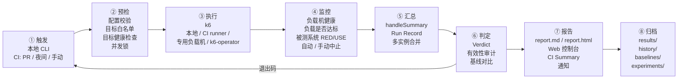
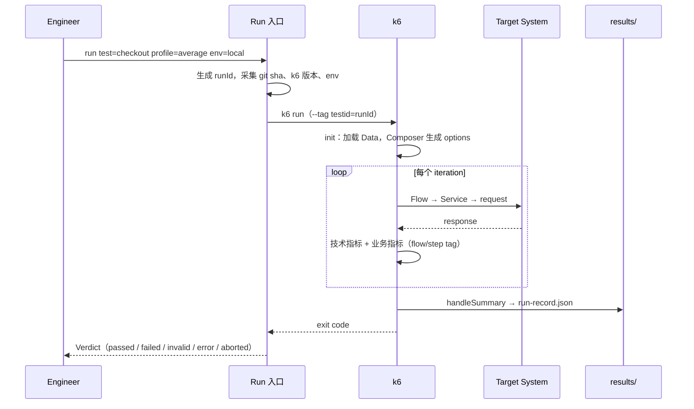
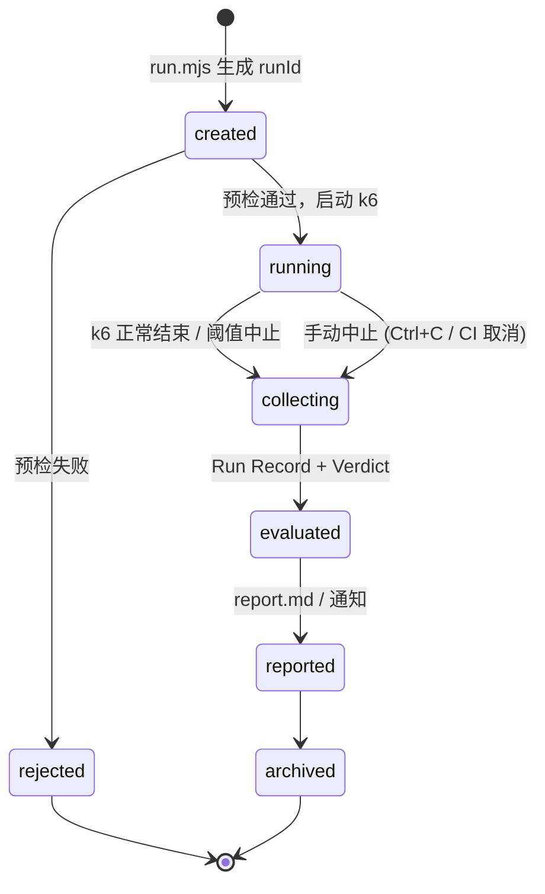
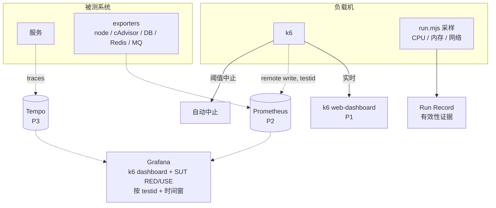
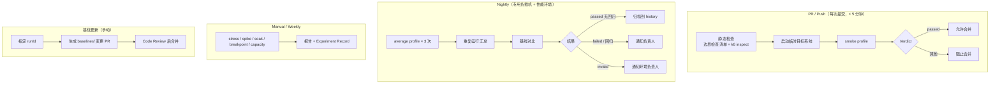
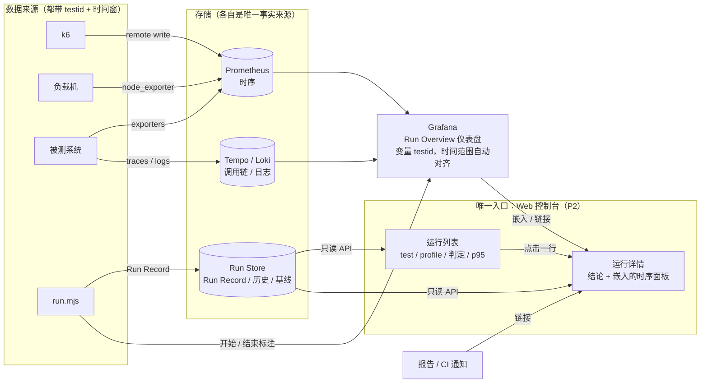
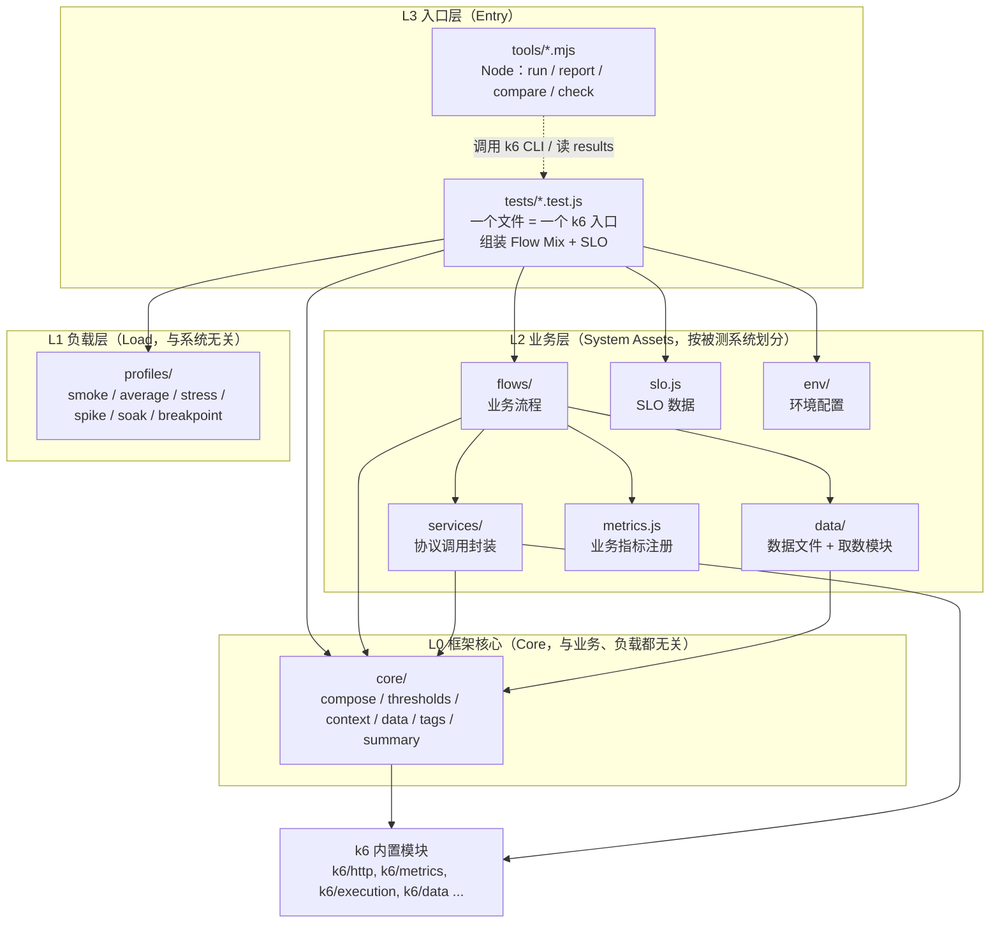
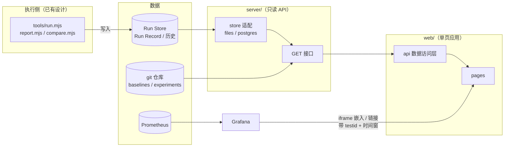
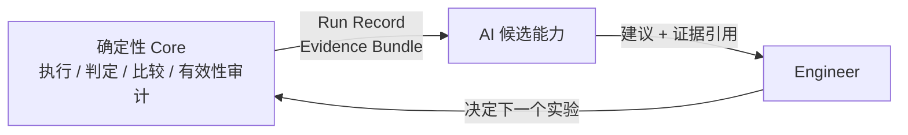

# AI Performance Engineering：架构与总体说明

> 本文是项目**唯一**的架构与总体说明文档。其他文档都是它的支撑材料（见 §13 文档分层）。
> 更新日期：2026-09-30 ｜ k6 基线：v2.3.0 ｜ 当前阶段：**Phase 0 完成（只有研究与设计，没有代码）**

---

## 1. 当前状态：能做什么 / 不能做什么

**诚实说明：项目目前只有理论和设计，没有任何可运行的代码。**

| 能力 | 当前状态 | 计划阶段 |
|---|---|---|
| 研究结论（k6、性能工程、Observability、AI + 性能测试） | ✅ 已完成（`research/`） | Phase 0 |
| 架构、边界、决策、路线图 | ✅ 已完成（本文 + `decisions/` + `plans/`） | Phase 0 |
| 代码分层与目录结构 | ✅ 已设计（§5），目录尚未创建 | Phase 0 设计 / Phase 1 创建 |
| 在真实目标系统上执行一个业务流压测 | ❌ 未实现 | Phase 1 |
| 同一业务流以不同负载形状运行（smoke/average/stress…） | ❌ 未实现 | Phase 1 |
| SLO → 阈值自动生成，Verdict 区分"系统失败"与"测试无效" | ❌ 未实现 | Phase 1 |
| 运行记录（runId、环境指纹、结果 JSON） | ❌ 未实现 | Phase 1 |
| 执行：预检、目标白名单、超时与手动中止 | ❌ 未实现 | Phase 1 |
| 监控：k6 web-dashboard 实时观察 + 负载机采样 | ❌ 未实现 | Phase 1 |
| 汇总与报告：Run Record → report.md + report.html（静态报告页） | ❌ 未实现 | Phase 1 |
| 多业务流混合、测试数据生命周期、基线与回归比较 | ❌ 未实现 | Phase 2 |
| CI：PR 冒烟门禁、Nightly 回归、通知、基线更新流程 | ❌ 未实现 | Phase 2 |
| 监控：Prometheus/Grafana（k6 + 被测系统 RED/USE） | ❌ 未实现 | Phase 2 |
| 前端：Web 控制台（首页、运行列表、运行详情、对比、基线、实验），只读 | ❌ 未实现（已规划，§8） | Phase 2 |
| Trace 关联、Evidence Bundle、趋势与变点检测 | ❌ 未实现 | Phase 3 |
| 前端：趋势与变点、证据视图、测试目录 | ❌ 未实现（已规划，§8） | Phase 3 |
| AI 能力 | ❌ 不实现，Phase 4 先做评估 | Phase 4–5（仅评估通过的） |
| 分布式执行 | ❌ 按需触发 | 条件触发 |
| 前端：从页面触发压测、登录与权限 | ❌ 按需触发（§8.8） | 条件触发 |

**运行前提（尚未具备）**：本机未安装 k6 与 Docker；Phase 1 第一步需安装 k6 v2.x 并启动目标系统 QuickPizza。

---

## 2. 项目是什么

**一个以 k6 为执行引擎的 Performance Engineering 工程框架。** 它把"写一个 k6 脚本"扩展为可重复、可比较、可归因的工程闭环：

```text
Hypothesis → Experiment（Flow × Load Profile × Data × Env × SLO）→ k6 Run → Run Record → Verdict → Baseline Comparison → Conclusion
```

**不是**：k6 的替代品；"AI 自动压测工具"；Observability 平台；在线压测 SaaS 平台。

项目有前端（§8），但它是**查看运行和结论的只读控制台**，不是在页面上编排和发起压测的平台。

### 和直接写 k6 脚本的区别

| 问题 | 直接写 k6 | 本项目 |
|---|---|---|
| 业务流与负载模型写在同一个 `options.scenarios` | 每种测试类型复制一份脚本 | **Flow ⟂ Load Profile**，同一 Flow 以任意 Profile 运行 |
| Open / Closed 模型隐式 | 默认 VU 模型，产生 Coordinated Omission | Profile **显式声明模型**，SLO 测试默认 arrival-rate |
| 阈值写死在脚本里 | 数字散落，无依据 | **SLO 是数据**，阈值由 SLO × Profile 生成 |
| exit code 99 分不清"系统不达标"与"测试无效" | VU 不足被当成系统失败 | **Verdict = passed / failed / invalid / error / aborted** |
| 运行没有身份 | 看完图就丢 | **runId + Run Record + 环境指纹** |
| 无回归比较 | 人工对比截图 | **Baseline + 统计比较** |
| 分布式下数据冲突 | 用 `__VU` 取数 | 数据选择只用 `*InTest` 字段 |
| 与系统内部遥测无关联 | 靠时间肉眼对齐 | **关联约定**：testid tag、请求头、baggage、时间窗 |
| 分布式下阈值/summary 分散 | k6 不合并 | **Result 层独立于 k6 进程** |

---

## 3. 总体架构

总体架构分两个视图：

- **逻辑视图**（§3.1）：由哪些组件组成、组件之间怎么依赖；
- **运行视图**（§3.2–3.9）：一次测试从触发到归档，经过执行、监控、汇总、判定、报告、CI 的完整链路。

### 3.1 逻辑架构

```mermaid
flowchart TB
    subgraph DEF["定义层（纯数据 + 纯函数，git 管理）"]
        direction LR
        SVC[Service<br/>做什么]
        FLOW[Flow<br/>业务流程顺序]
        DATA[Data<br/>数据集 / 唯一键 / 分片]
        PROF[Load Profile<br/>多少、多快、多久<br/>open / closed]
        SLO[SLO<br/>验收标准]
        ENV[Environment<br/>目标地址 / 凭据引用]
    end

    subgraph CORE["Performance Core（薄）"]
        TEST[Test Definition<br/>Flow Mix × Profile + SLO + Env]
        COMP[Composer<br/>生成 options.scenarios / thresholds<br/>+ 有效性阈值]
        RUNNER[Run 入口<br/>runId / 环境指纹 / tag 注入]
        SUM[Result Builder<br/>handleSummary → Run Record + Verdict]
    end

    K6[k6 v2.x<br/>Scenario → Executor → VU → Iteration]
    SUT[(Target System)]

    subgraph OBS["Observability（外部，Phase 2+）"]
        PROM[(Prometheus)]
        TR[(Tempo / Loki)]
    end

    subgraph RES["Result 层"]
        REC[(Run Records)]
        BASE[Baseline & Comparison]
        EXP[Experiment Record]
    end

    AIX[AI（未实现）<br/>只读消费 Result / Evidence]
    WEB[Web 控制台（P2，只读）<br/>运行 / 结论 / 对比 / 趋势]

    SVC --> FLOW
    DATA --> FLOW
    FLOW & PROF & SLO & ENV --> TEST
    TEST --> COMP --> K6
    RUNNER --> K6
    K6 -->|requests + run header| SUT
    K6 --> SUM --> REC
    K6 -.-> PROM
    SUT -.-> PROM
    SUT -.-> TR
    REC --> BASE --> EXP
    REC -.只读 API.-> WEB
    PROM -.嵌入面板.-> WEB
    REC -.只读.-> AIX
    PROM -.只读.-> AIX
    AIX -.建议 + 证据引用.-> EXP
```



实线 = Phase 1 范围；虚线 = 后续阶段。

### 3.2 运行架构总览

一次测试从触发到归档经过 8 个环节。每个环节都由确定性代码完成，**AI 不参与任何环节**。所有环节产生的数据最终从同一个入口查看（§3.9）。



| 环节 | 做什么 | 由谁完成 | Phase 1 | Phase 2 | Phase 3+ |
|---|---|---|---|---|---|
| ① 触发 | 选择 system / test / profile / env / 强度 | `tools/run.mjs`；CI 调用同一命令 | 本地 CLI | PR 冒烟、夜间、手动 | 发布门禁（可选） |
| ② 预检 | 配置校验、目标白名单、目标健康检查、并发锁 | `run.mjs` + `k6 inspect` | 配置校验 + 白名单 + 健康检查 | + 并发锁 + 边界检查 | — |
| ③ 执行 | 运行 k6，注入 runId / tag / 环境变量 | k6 | 本地单机 | CI runner、专用负载机 | k6-operator（条件触发） |
| ④ 监控 | 实时观察，异常时中止 | k6 web-dashboard、阈值中止、`run.mjs` | 终端进度 + web-dashboard + 负载机采样 | Prometheus + Grafana | Trace |
| ⑤ 汇总 | 把一次运行变成 Run Record | `core/summary.js` + `run.mjs` | 单实例 | 重复运行汇总 | 多实例合并 |
| ⑥ 判定 | Verdict、有效性审计、基线对比 | `core/summary.js`、`tools/compare.mjs` | Verdict | + 基线对比 | + 变点检测（CPD） |
| ⑦ 报告 | 人可读的结果与链接 | `tools/report.mjs`、k6 HTML 导出、Web 控制台（§8） | report.md + report.html | + Web 控制台 + CI Summary + 通知 | + 趋势、证据视图 |
| ⑧ 归档 | 保存结果、历史、基线 | 文件系统 / CI 制品 | `results/` | + `history/`、`baselines/`、`experiments/` | — |

### 3.3 k6 的位置

k6 负责：JS 运行时、VU 调度、Executor（负载模型实现）、协议客户端、客户端指标、单实例阈值、指标输出。项目**不重新实现、也不包装**其中任何一项，只在两个入口工作：

1. **输入端**：生成 `options`（scenarios、thresholds、tags），替代手写配置；
2. **输出端**：`handleSummary` + Run 入口，把一次运行变成可比较的 Run Record。

外加一个**约定层**：tag 词汇表、数据选择规则、关联请求头。

### 3.4 一次运行的数据流



### 3.5 执行架构

#### 执行环境

| 环境 | 用途 | 负载机 | 目标系统 | 阶段 |
|---|---|---|---|---|
| 本地开发 | 编写和调试 Flow，冒烟 | 开发机 | 本地 Docker（QuickPizza） | P1 |
| CI runner | PR 冒烟（功能正确性，**不做性能结论**） | 共享 CI runner | CI 内临时启动的目标系统 | P2 |
| 专用负载机 | 夜间 average-load 与回归比较；手动 stress/spike/soak/capacity | 固定规格的独立机器（CI 自托管 runner） | 固定、隔离的性能环境 | P2 |
| k6-operator | 单机负载不足时的分布式执行 | K8s Pod × N | 性能环境 | 条件触发 |
| Grafana Cloud k6 | 分布式的托管替代方案 | 云端 | — | 可选 |

**性能结论只能来自专用负载机 + 固定性能环境**。共享 CI runner 噪声大，只用于验证功能正确性。

#### 预检（run.mjs 在启动 k6 之前完成）

| 检查 | 失败时 |
|---|---|
| Profile / SLO / mix 结构合法（权重和为 1、model 已声明、阈值可生成） | 拒绝运行 |
| `k6 inspect` 能解析脚本并输出 options | 拒绝运行 |
| 目标地址在环境白名单内（`env/*.js` 声明允许的 host）；生产环境需显式 `--allow-prod` | 拒绝运行 |
| 目标系统健康检查通过 | 拒绝运行 |
| 同一目标环境没有其他压测在运行（锁文件；CI 中用 concurrency group） | 等待或拒绝（P2） |
| k6 版本与锁定版本一致 | 警告并写入 Run Record |

#### 一次运行的状态



#### 执行安全

- 每个 test 有**最大时长**上限（Profile 总时长 + gracefulStop），超时由 `run.mjs` 终止；
- 两次运行之间有**冷却时间**，避免上一次的残留负载影响下一次；
- 凭据只通过环境变量或 CI secrets 传入，不写入仓库和 Run Record。

### 3.6 监控架构

运行期间同时监控三个对象。只看被测系统，会把负载机的问题误判为系统问题。



| 监控对象 | 看什么 | 为什么 | Phase 1 手段 | Phase 2+ 手段 |
|---|---|---|---|---|
| **负载机** | CPU（< 80%）、内存、网络 | 负载机饱和会产生"假回归" | `run.mjs` 定时采样，写入 Run Record | node_exporter + Grafana |
| **负载本身** | 实际 vs 目标到达率、`dropped_iterations`、VU 使用量 | 负载没打出来，结论无效 | k6 终端进度 + web-dashboard | k6 dashboard 19665 / 18030 |
| **业务结果** | 各 Flow/Step 的 p95、错误率、业务成功率 | 是否满足 SLO | web-dashboard | Grafana，按 flow / step 过滤 |
| **被测系统** | RED（每个服务）、USE（每类资源） | 定位瓶颈 | 无 | exporters + Prometheus（P2）；Trace（P3） |

**中止机制**：

| 类型 | 触发 | 结果 |
|---|---|---|
| 自动（安全保护） | 错误率 > 50% 等失控阈值（`abortOnFail` + `delayAbortEval`） | exit code 99，Verdict 按阈值类别判定 |
| 自动（breakpoint） | SLO 阈值失败即停止 | 这是 breakpoint 的正常结束方式 |
| 自动（超时） | 超过最大时长 | `run.mjs` 终止，Verdict = `aborted` |
| 手动 | Ctrl+C / CI 取消 | Verdict = `aborted`，仍生成 Run Record |

**Phase 1 的实时监控**用 k6 内置 web-dashboard（`K6_WEB_DASHBOARD=true`），运行结束时导出 HTML（`K6_WEB_DASHBOARD_EXPORT`），不需要部署任何监控系统。

### 3.7 结果汇总与报告

#### 汇总层次

| 层次 | 输入 | 输出 | 由谁完成 | 阶段 |
|---|---|---|---|---|
| 单次运行 | k6 summary + 阈值结果 + 负载机采样 + 环境指纹 | `run-record.json` + Verdict | `core/summary.js` + `run.mjs` | P1 |
| 多实例合并 | 各负载机的 Run Record + Prometheus Native Histogram | 全局 Run Record + 全局 Verdict（**不平均百分位**） | Result Merger | 条件触发 |
| 重复运行 | 同一配置的 N 次 Run Record（N ≥ 3） | 各指标中位数、变异系数（CV） | `tools/compare.mjs` | P2 |
| 基线对比 | 本次（或重复运行的汇总）vs Baseline | 每个 flow/step 的差值 + 是否回归 | `tools/compare.mjs` | P2 |
| 趋势 | `history/` 中同一 test 的历史 | 变点（回归 / 改善发生在哪次） | Apache Otava | P3 |
| 实验结论 | 多个 Run + 对比 + 观察 | Experiment Record | 人 | P2 |

#### 报告

| 输出 | 内容 | 阶段 |
|---|---|---|
| `results/<runId>/report.md` | Verdict；按类别列出的阈值结果；每个 flow/step 的关键指标；有效性检查；与基线的差值（P2）；Grafana 链接（带 testid 与时间窗，P2） | P1 |
| `results/<runId>/report.html` | 与 report.md 内容相同的静态报告页：单文件、自包含、无后端，浏览器直接打开（§8.2） | P1 |
| `results/<runId>/dashboard.html` | k6 web-dashboard 导出的图表 | P1 |
| 终端输出 | Verdict + 失败阈值 + 报告路径 | P1 |
| CI Job Summary | report.md 的内容 | P2 |
| 通知（webhook） | 夜间任务出现 `failed` / `invalid` / 回归时发送，带运行详情页链接 | P2 |
| Web 控制台 | 运行列表、运行详情、对比、基线、实验（§8） | P2 |

报告由模板从 Run Record **确定性生成**，同一个 Run Record 永远生成同样的报告。

#### 存储

```text
results/<runId>/                 单次运行（git 忽略；CI 中作为制品上传）
├── run-record.json              项目 Run Record（报告、对比、未来 AI 的唯一输入）
├── k6-summary.json              k6 原始 summary（排查用）
├── report.md
├── report.html
├── dashboard.html
└── k6.log
history/<system>/<test>.<env>.jsonl   每次运行一行摘要，用于趋势和 CPD      [P2]
baselines/<system>/<test>.<env>.json  钉住的基线（git 管理，变更需要走 PR） [P2]
experiments/YYYY-MM-DD-<topic>.md     实验记录（引用 runId）               [P2]
```

CI 制品有保留期限，所以 `history/` 需要持久化的位置（专用 git 分支或对象存储）。Phase 2 开始时决定。

### 3.8 CI/CD 集成

**原则**：CI 只调用 `node tools/run.mjs`，不包含任何测试逻辑，所以任何 CI 平台都能接入。当前仓库没有远程仓库，CI 平台（GitHub Actions / GitLab CI / Jenkins）在 Phase 2 决定。

#### 流水线



| 流水线 | 触发 | 环境 | Profile | 门禁 | 阶段 |
|---|---|---|---|---|---|
| PR 冒烟 | 每次 PR / push | 共享 runner + 临时目标系统 | smoke | Verdict 必须为 `passed`，否则阻止合并 | P2 |
| Nightly 回归 | 每晚定时 | 专用负载机 + 性能环境 | average × 3 | 不阻塞；`failed` / 回归 / `invalid` 通知 | P2 |
| 手动 / 每周 | 手动或每周定时 | 同上 | stress / spike / soak / breakpoint | 不阻塞，产出报告与实验记录 | P2 |
| 基线更新 | 手动 | — | — | 通过 PR 修改 `baselines/`，需要人审 | P2 |
| 发布门禁 | 发布前 | 性能环境 | average | 相对基线无回归（可选） | P3 |

#### `run.mjs` 退出码（CI 按此判断）

| 退出码 | 含义 |
|---|---|
| 0 | `passed` |
| 1 | `failed`（SLO 不达标） |
| 2 | `invalid`（测试无效，结论作废） |
| 3 | `error`（脚本 / 配置 / 环境错误） |
| 4 | `aborted` |
| 5 | 预检被拒绝 |
| 6 | 相对基线回归（P2，仅在启用对比时） |

k6 自己的退出码（99、107 等）由 `run.mjs` 翻译成上表，CI 不直接依赖 k6 退出码。

### 3.9 统一查看入口（解决监控数据分散）

#### 问题

一次运行的数据天然分散在不同地方：

| 数据 | 类型 | 存放位置 |
|---|---|---|
| k6 指标（负载、延迟、错误） | 时序 | k6 实时仪表盘 → Prometheus |
| 被测系统指标（RED / USE） | 时序 | exporters → Prometheus |
| 负载机指标 | 时序 | `run.mjs` 采样 → node_exporter |
| 判定、阈值结果、报告 | 按运行存的记录 | `results/<runId>/` |
| 跨运行对比、历史 | 按运行存的记录 | `history/`、`baselines/` |
| 调用链、日志 | 链路 / 文本 | Tempo / Loki |

#### 原则

1. **不把所有数据搬进一个存储**。时序、运行记录、调用链的查询方式完全不同，强行合并只会多出一个需要维护的系统。
2. **统一关联键**：所有数据都带 `testid`（= runId）和运行时间窗；需要细分时再加 `flow`、`step`、`lg`。有了关联键，任何一处的数据都能定位到其他地方的对应数据。
3. **统一查看入口**：人只从一个地方进入，其余数据通过已经带好 testid 和时间窗的链接跳转。
4. **每类数据只有一个事实来源**：判定只在 Run Record 中；时序只在 Prometheus 中；调用链只在 Tempo 中。前端和 Grafana 都只负责展示，**不重新计算判定**。
5. **分工**：**Web 控制台**（§8）是运行和结论的入口；**Grafana** 是时序曲线的钻取工具，以嵌入或链接的方式出现在控制台里。

#### 架构



#### 运行详情页与 Grafana 仪表盘的分工

| 区块 | 内容 | 数据来源 | 展示位置 | 阶段 |
|---|---|---|---|---|
| 1 结论 | 判定、失败的阈值、有效性检查结果、与基线的差值、附件链接 | Run Record | Web 控制台 | P2 |
| 2 负载 | 目标 vs 实际到达率、VU、`dropped_iterations` | Prometheus（k6） | Grafana Run Overview，嵌入控制台 | P2 |
| 3 业务结果 | 每个 Flow/Step 的 p95/p99、错误率、业务成功率，SLO 线叠加显示 | Prometheus（k6） | 同上 | P2 |
| 4 负载机 | CPU、内存、网络（多台负载机按 `lg` 分开） | Prometheus（node_exporter） | 同上 | P2 |
| 5 被测系统 RED | 每个服务的请求量、错误、延迟 | Prometheus | 同上 | P2 |
| 6 被测系统 USE | CPU、内存、连接池、DB、Redis、MQ lag | Prometheus | 同上 | P2 |
| 7 调用链 / 日志 | 按 testid 过滤的慢调用链、错误日志 | Tempo / Loki | Grafana，从控制台跳转 | P3 |

时序面板的时间范围由运行时间窗决定，所有面板自动对齐，不需要手动对时间。

#### 各阶段的唯一入口

| 阶段 | 运行中 | 运行后 | 跨运行 |
|---|---|---|---|
| **P1** | k6 实时仪表盘（`localhost:5665`） | **`results/<runId>/report.html`**：判定、指标、负载机状态、有效性检查汇总在一个页面，并链接 `dashboard.html`（同内容的 report.md 供终端和 CI 使用） | 暂无（手动对照报告） |
| **P2** | Web 控制台运行详情（嵌入 Grafana 实时面板） | Web 控制台运行详情（报告和 CI 通知中都带链接） | Web 控制台：运行列表、对比、基线 |
| **P3** | 同上 + 调用链跳转 | 同上 + 证据视图 | + 趋势 / 变点 |

#### 实现要点（P2）

- `run.mjs` 在运行开始和结束时通过 Grafana HTTP API 写**标注**（annotation），内容包括 testid、test、profile 和判定。任何 Grafana 图表上都能看到"这段时间在跑哪次压测"。
- Run Record 通过只读 API 提供给控制台（§8.5）。之前设想的"用 Grafana Infinity 数据源读 JSON 文件"不再需要。
- Grafana 只保留一个 Run Overview 仪表盘（时序部分），JSON 放在 `infra/observability/dashboards/`，纳入 git 管理。
- Prometheus 的保留期有限（默认 15 天），过期后旧运行的时序曲线会消失，但 Run Record 中的汇总永久保留。长期对比只依赖 Run Record。
- Grafana 不可用时，控制台的结论部分照常可用，只是没有曲线。

#### 存储形态（未决）

当前设计是 Run Record 存文件（`results/`、`history/`）。已经提出"从 Phase 2 起把运行汇总存入 PostgreSQL、k6 原始样本压缩存文件"的方案（跨运行查询、趋势、Apache Otava 都可以直接读库），**尚未确认**。

控制台只通过只读 API 读取数据，存储从文件换成数据库时前端不用改。

#### 不做

- 不在控制台里重画 Grafana 已有的时序图表；
- 不把 trace_id、userId 放进 Prometheus 标签：基数会爆炸（§4.4）；
- 不在前端或 Grafana 中重新计算判定：避免出现两个"事实"。

---

## 4. 核心模型

### 4.1 术语

k6 的 `Scenario` = 执行函数 × executor 配置，同时包含"做什么"和"怎么加压"。为避免混淆，**业务场景一律称为 Flow，"Scenario" 只指 k6 Scenario**（Composer 的编译产物）。

| 项目术语 | 含义 | 对应 k6 |
|---|---|---|
| **Service** | 一个领域的协议调用封装 | 普通 JS 模块 |
| **Flow** | 一次完整业务流程 | `exec` 指向的函数 |
| **Load Profile** | 负载形状、强度比例、模型类型 | executor 配置 |
| **Workload** | Flow 权重混合 × Load Profile × 目标强度 | 一组 k6 Scenario |
| **k6 Scenario** | 一个 Flow 在一个负载配置下 | `options.scenarios.<name>`（生成） |

两条互不交叉的线，只在 Composer 交汇：

```text
业务线：  Service → Flow → Flow Mix               （做什么、按什么顺序、比例多少）
负载线：  Load Profile → Executor → VU            （多少、多快、多久、什么模型）
                         ↘         ↙
                          Composer
```

### 4.2 各概念职责

| 概念 | 负责 | 不负责 |
|---|---|---|
| **Service** | 构造请求；设置 `name`、`step` tag；协议级 check；提取响应字段返回给调用者 | sleep、循环、决定顺序、选数据、知道 VU/rate、上报业务指标 |
| **Flow** | 一次迭代中的步骤顺序与分支；从 Data 取数；think time；上报业务指标（`order_success` 等）；`flow` tag | 知道自己以什么负载运行；定义阈值 |
| **Load Profile** | `type`（smoke/average/stress/spike/soak/breakpoint）、**显式 `model: open/closed`**、以相对比例表达的形状、VU 估算参数 | URL、请求体、业务逻辑 |
| **Composer** | 纯函数：每个 Flow 生成一个 k6 Scenario；open 模型下 rate = 目标强度 × 权重；`preAllocatedVUs = ceil(rate × 迭代时长 × 余量)`；生成 SLO 阈值与有效性阈值；输出阈值分类元数据 | 业务逻辑 |

- **一次 Iteration = 一次 Flow**：到达率单位是"Flow/秒"；RPS = Flow/s × 每 Flow 请求数。
- **强度与形状分离**：Profile 只描述形状，Test 提供目标强度，所以 average 与 stress 可以是同一形状的不同倍数。
- **Open 模型下每个 Flow 一个 k6 Scenario**：在一个 iteration 内随机选 Flow 会让单个 Flow 的到达率不可控。
- 选择 Closed 模型（如 TOB 固定员工数）必须写明理由。

| Profile | model | 形状 |
|---|---|---|
| smoke | closed | 1–2 VU、少量迭代 |
| average | open | 爬坡 → 稳态 1.0× → 下降 |
| stress | open | 稳态 1.5–2.0× |
| spike | open | 基线 → 瞬间 N× → 回落 → 观察恢复 |
| soak | open | 1.0× 持续数小时 |
| breakpoint | open | 连续爬坡 + `abortOnFail` |

### 4.3 Data

| 类别 | 规则 | 阶段 |
|---|---|---|
| 只读数据集 | `SharedArray`（init 中加载），按 `scenario.iterationInTest % len` 选取 | 1 |
| 账户池 | 按 `vu.idInTest % len` 绑定到 VU | 1 |
| 唯一键 / 幂等键 | `${runId}-${vu.idInTest}-${scenario.iterationInTest}` | 1 |
| Session / Token | 每 VU 缓存，过期前刷新；登录打 `step: login` tag，与业务 SLO 分开 | 1 |
| 可消耗数据、租户分层、seed / cleanup（runId 前缀） | 独占取用；权重分配；按前缀清理 | 2 |

**禁止**：用 `__VU` / `idInInstance` 选数据（分布式不唯一）；在 VU 代码中 `open()`；ID 类数据进 tag。

### 4.4 Metrics

| 层 | 例子 | 来源 | 阶段 |
|---|---|---|---|
| Technical | `http_req_duration`、`http_req_failed`、`iterations`、`grpc_req_duration`、`ws_*` | k6 内置 | 1 |
| Business | `order_success`、`payment_success`、`business_error{reason}` | Flow 上报（集中注册） | 1 |
| Validity | `dropped_iterations`、`checks`、实际 vs 目标到达率、负载机 CPU | k6 + 计算 | 1–2 |
| System | CPU、内存、连接池、DB、Redis、MQ lag | exporters → Prometheus | 2–3 |

**固定 tag 词汇表**：`testid`（仅 Run 入口设置）、`env`、`flow`、`step`、`name`、`tenant_tier`、`lg`（分布式）。

### 4.5 SLO、阈值与 Verdict

SLO 是数据（每个 Flow/Step 的 p95/p99、错误率、业务成功率），Composer 生成两类阈值：

| 类别 | 例 | 失败含义 |
|---|---|---|
| **SLO** | `http_req_duration{flow:checkout,step:create_order}: p(95)<300`；`order_success: rate>0.99` | 系统不达标 |
| **Validity** | `dropped_iterations: count==0`；`checks: rate>0.99` | **本次测试不可信** |

压测验证的是"在负载水平 λ 下的 SLO"，而不是月度 error budget。

Verdict 规则（确定性，按顺序判断）：

| 条件 | Verdict |
|---|---|
| exit code ∈ {97,100,101,102,104,107,109} 或无 summary | `error` |
| exit code 108（`exec.test.abort()`） | `aborted` |
| 任一 validity 阈值失败 | `invalid`（优先于 failed） |
| 任一 SLO 阈值失败，或 exit code 110 | `failed` |
| 其他 | `passed` |

### 4.6 Run Record、Baseline、Experiment

- **Run Record**（JSON）：runId、test、profile、env、环境指纹（git sha、k6 版本）、时间窗、workload、指标摘要、按类别标注的阈值结果、exit code、verdict。它是项目自己的数据结构，未来可由多个负载机的记录合并产生。
- **Baseline**（Phase 2）：显式钉住的某个 `passed` Run Record。
- **Comparison**（Phase 2）：按 flow/step 比较差值，设实际显著性下限（如 Δp95 ≥ 5% 且 ≥ 20ms），重复 ≥ 3 次，剔除 warm-up；之后以 Apache Otava 做跨版本变点检测。
- **Experiment Record**（Phase 2）：假设 → 设计 → 多次 Run → 观察 → 结论 → 下一假设。

### 4.7 TOC / TOB 表达

| | TOC 电商 | TOB 多租户 |
|---|---|---|
| Services | auth、product、cart、order、payment | auth(SSO)、tenant、customer、order、approval、report |
| Flows | browse、search、checkout | order_approval、report（提交 + 轮询） |
| Mix | 按生产访问统计（如 70/20/10） | 按角色（销售/审批/管理员） |
| Profile | average、spike、soak（open） | 工作日 closed + think time；月底报表 open |
| Data | 用户池、关键词、幂等键、库存 | 租户分层（大租户倾斜）、每租户账户池 |
| 难点 | 下单幂等、token 生命周期、spike 恢复 | 租户隔离、数据倾斜、异步任务端到端时长 |

两者都不需要新的核心概念。

---

## 5. 代码分层与目录结构

> 这是 Phase 1 起的**目标结构**。Phase 0 不创建空目录；每个阶段只创建标注为该阶段的部分。

### 5.1 代码分层



| 层 | 目录 | 职责 | 可以依赖 | **禁止**依赖 |
|---|---|---|---|---|
| **L0 Core** | `perf/core/` | Composer、阈值生成、Verdict、tag 词汇、数据选择规则、请求上下文 | 仅 k6 内置模块 | profiles、systems、`k6/x/*`、`k6/experimental/*` |
| **L1 Load** | `perf/profiles/` | 负载形状（纯数据） | 无（纯数据） | 任何业务代码 |
| **L2 Service** | `perf/systems/<sys>/services/` | 一个领域的请求：构造、tag、check、字段提取 | core、k6 模块、扩展模块 | flows、profiles、data |
| **L2 Data** | `perf/systems/<sys>/data/` | 数据文件 + 按规则取数 | core | services、flows |
| **L2 Flow** | `perf/systems/<sys>/flows/` | 业务步骤顺序、think time、业务指标 | services、data、metrics、core | **profiles**、executor 配置 |
| **L2 SLO / Env / Metrics** | `perf/systems/<sys>/slo.js`、`env/`、`metrics.js` | SLO 数据、环境地址、业务指标注册 | core（metrics 仅 k6/metrics） | flows、services |
| **L3 Test** | `perf/systems/<sys>/tests/` | 组装：Flow Mix + SLO + 目标强度；导出 `options`、Flow 函数、`handleSummary` | 以上全部 | — |
| **Tools** | `tools/` | k6 之外：预检、调用 k6、负载机采样、补全 Run Record、报告、基线对比；CI 只调用这些脚本 | Node 标准库 | perf/ 下任何模块（只通过 CLI 和文件交互） |
| **Server** | `server/` | 只读 API：把 Run Store 中的运行记录、历史、基线、实验提供给前端 | Run Store、`schemas/` | perf/、tools/；不调用 k6；不写 Run Record |
| **Web** | `web/` | Web 控制台：展示运行、结论、对比、趋势 | 只读 API、Grafana（嵌入 / 链接） | 直接读文件或数据库；perf/、tools/ |

**依赖只能向下**。L0 不认识任何业务系统；L1 不认识任何 Flow；Flow 不认识任何 Profile。这三条是 Business Model ≠ Load Model 在代码层面的落地。

`web/` 和 `server/` 是展示侧，与执行侧（`perf/`、`tools/`）之间**只通过 Run Record 这一份数据契约**（`schemas/run-record.schema.json`）关联，互不 import。

### 5.2 仓库目录结构

```text
AI-Performance-Engineering/
├── README.md                          项目入口（指向 docs/ARCHITECTURE.md）
├── .gitignore                         忽略 results/                               [P1]
│
├── docs/                              文档（L1 架构 / L2 决策与计划 / L3 研究）
│
├── perf/                              所有由 k6 加载的代码（k6 运行时，无 npm、无构建）
│   ├── core/                          L0 框架核心：与业务、负载无关              [P1]
│   │   ├── compose.js                 Composer：Test → options.scenarios + thresholds + meta
│   │   ├── thresholds.js              SLO → SLO 阈值；附加 validity 阈值；阈值分类
│   │   ├── context.js                 ctx：baseUrl、公共 header（含 X-Load-Test-Run）、uniqueKey()
│   │   ├── data.js                    取数规则（*InTest）、每 VU token 缓存
│   │   ├── tags.js                    tag 词汇表常量（flow / step / name / env / tenant_tier）
│   │   ├── protocols.js               协议 → SLI 指标名映射表（HTTP 起步）
│   │   └── summary.js                 handleSummary：Run Record JSON + Verdict
│   │
│   ├── profiles/                      L1 负载模型（纯数据，所有系统共用）         [P1]
│   │   ├── smoke.js                   [P1]
│   │   ├── average.js                 [P1]
│   │   ├── stress.js                  [P1]
│   │   ├── spike.js                   [P2]
│   │   ├── soak.js                    [P2]
│   │   ├── breakpoint.js              [P2]
│   │   └── index.js                   按名称导出，供 test 按 PROFILE 环境变量选择
│   │
│   └── systems/                       L2/L3 按被测系统划分的业务资产
│       ├── quickpizza/                Phase 1 目标系统                           [P1]
│       │   ├── env/
│       │   │   └── local.js           baseUrl、账户引用（不含明文密钥）
│       │   ├── services/              L2 Service：每个领域一个文件
│       │   │   ├── auth.js            login / ensureSession
│       │   │   └── <domain>.js        按 QuickPizza 实测 API 确定
│       │   ├── flows/                 L2 Flow：每个业务流一个文件
│       │   │   └── <flow>.js
│       │   ├── data/                  L2 Data：数据文件 + 取数模块
│       │   │   ├── users.json
│       │   │   └── index.js
│       │   ├── metrics.js             业务指标注册（init 中创建）
│       │   ├── slo.js                 SLO 数据
│       │   └── tests/                 L3 入口：一个文件 = 一个可运行测试
│       │       └── <name>.test.js
│       ├── otel-demo/                 Phase 2–3 目标系统（TOC 微服务电商）        [P2]
│       └── <tob-system>/              TOB 目标系统，Phase 2 决定                  [P2]
│
├── tools/                             k6 之外的工具（Node.js，仅标准库）
│   ├── run.mjs                        ①–⑤ 触发、预检、执行、负载机采样、补全 Run Record、退出码  [P1]
│   ├── report.mjs                     ⑦ Run Record → report.md + report.html（模板，确定性）  [P1]
│   ├── check.mjs                      静态检查：边界检查清单 + k6 inspect         [P2]
│   ├── compare.mjs                    ⑥ 重复运行汇总 + 基线对比                   [P2]
│   └── baseline.mjs                   把指定 runId 提升为基线（生成 PR 变更）      [P2]
│
├── schemas/
│   └── run-record.schema.json         Run Record 的 JSON Schema：tools、API、前端共同遵守的契约  [P1]
│
├── web/                               前端：Web 控制台（§8）                      [P2]
│   └── src/
│       ├── pages/                     home / runs / run-detail / compare / baselines / experiments
│       │                              trends / catalog / evidence                 [P3]
│       ├── components/                VerdictBadge、ThresholdTable、FlowStepTable、DeltaCell、GrafanaPanel
│       ├── api/                       唯一的数据访问层：页面只通过它访问后端
│       └── models/                    Run Record 类型（与 schemas/ 保持一致）
│
├── server/                            只读 API（§8.5）                            [P2]
│   ├── routes/                        runs / compare / baselines / trends / experiments（只有 GET）
│   └── store/                         Run Store 适配：files；postgres（未决，§3.9）
│
├── ci/                                CI 流水线定义（平台 Phase 2 决定）          [P2]
│   ├── pr-smoke                       PR 冒烟门禁
│   ├── nightly                        夜间回归
│   └── manual                         手动 stress / spike / soak / breakpoint
│
├── results/                           运行输出（git 忽略，CI 中上传为制品）      [P1]
│   └── <runId>/
│       ├── run-record.json            项目 Run Record（含 Verdict）
│       ├── k6-summary.json            k6 原始 summary（排查用）
│       ├── report.md                  人读报告（终端、CI）
│       ├── report.html                静态报告页（单文件，浏览器直接打开）
│       ├── dashboard.html             k6 web-dashboard 导出
│       └── k6.log
│
├── history/                           每次运行一行摘要（趋势 / CPD），持久化位置 P2 决定  [P2]
│   └── <system>/<test>.<env>.jsonl
│
├── baselines/                         钉住的基线 Run Record（git 管理）           [P2]
│   └── <system>/<test>.<env>.json
│
├── experiments/                       Experiment Record（Markdown，引用 runId）   [P2]
│   └── YYYY-MM-DD-<topic>.md
│
├── journal/
│   └── pain-points.md                 Pain Point Log（AI 决策的数据来源）         [P1]
│
└── infra/                             外部依赖的配置（不自建平台）
    ├── quickpizza/compose.yaml        目标系统                                   [P1]
    └── observability/                 Prometheus / Grafana / Tempo 配置           [P2–3]
        └── dashboards/                Grafana 仪表盘 JSON，纳入 git               [P2]
            └── run-overview.json      一次运行的时序面板（变量 testid），嵌入 Web 控制台
```

### 5.3 目录设计说明

| 决定 | 理由 |
|---|---|
| `perf/` 与 `tools/` 分开 | `perf/` 在 k6 运行时（Sobek，无 Node API、无 npm）中加载；`tools/` 在 Node 中运行。两者**只通过 CLI 参数和 `results/` 文件交互**，互不 import |
| `core/`、`profiles/` 放在 `systems/` 之外 | 与被测系统无关，所有系统共用；保证新增被测系统时不改 Core |
| 业务资产按 `systems/<sys>/` 划分 | 真实项目会有多个被测系统（QuickPizza、OTel Demo、TOB 系统），它们的 Service、数据、SLO 互不相关 |
| Service、Flow 每个领域 / 流程一个文件 | 与 §4.2 职责一一对应；Code Review 时按目录检查边界 |
| 没有 `scenarios/` 目录 | k6 Scenario 是 Composer 的编译产物，不手写（§4.1） |
| Profile 由环境变量选择，而不是每个 Profile 一个 test 文件 | 同一 test 文件以任意 Profile 运行，避免 `smoke-x.js / load-x.js / stress-x.js` 式复制 |
| 没有 `lib/`、`utils/`、`common/` | 通用代码只有 Core 一个归宿，避免无边界的公共目录 |
| `results/` 不入 git，`baselines/` 入 git | 运行结果是临时产物；基线是被显式钉住的决策 |
| `infra/` 只放配置 | 项目不拥有平台（§6） |
| `web/`、`server/` 独立于 `perf/`、`tools/` | 展示侧有自己的 npm 依赖和构建步骤，不能污染"无构建"的执行侧；展示侧整体删除后，执行、判定、CI 不受影响 |
| `schemas/` 单独成目录 | Run Record 是执行侧和展示侧之间唯一的契约，带 `schemaVersion`；结构变更先改 schema |

### 5.4 一个测试如何组装（示意）

```js
// perf/systems/quickpizza/tests/shop.test.js（示意，API 以 Phase 1 实现为准）
import { compose } from '../../../core/compose.js';
import { summarize } from '../../../core/summary.js';
import profiles from '../../../profiles/index.js';
import slo from '../slo.js';
export { browse } from '../flows/browse.js';      // Flow 函数导出给 k6 的 exec
export { checkout } from '../flows/checkout.js';

const built = compose({
  test: 'shop',
  profile: profiles[__ENV.PROFILE || 'smoke'],
  targetRate: Number(__ENV.TARGET_RATE || 10),   // flows/s，强度由运行时给出
  mix: { browse: 0.8, checkout: 0.2 },
  slo,
});

export const options = built.options;             // scenarios + thresholds（SLO + validity）
export const handleSummary = (data) => summarize(data, built.meta);
```

```bash
# 运行（Phase 1）：同一个 test，换 profile 不改代码
node tools/run.mjs --system quickpizza --test shop --profile smoke   --env local
node tools/run.mjs --system quickpizza --test shop --profile average --env local --rate 50
# run.mjs 内部等价于：
# k6 run perf/systems/quickpizza/tests/shop.test.js \
#   -e PROFILE=average -e TARGET_RATE=50 -e ENV=local -e RUN_ID=<runId> --tag testid=<runId>
```

### 5.5 命名约定

| 对象 | 约定 | 例 |
|---|---|---|
| 测试入口 | `<name>.test.js` | `shop.test.js` |
| Flow 文件 / 导出函数 / k6 Scenario 名 | 同名 snake_case | `checkout.js` → `checkout` |
| Service 文件 | 领域名 | `auth.js`、`order.js` |
| `step` tag | `<动作>_<对象>` | `create_order`、`login` |
| `name` tag | `METHOD /归一化路径` | `POST /api/orders`、`GET /api/products/:id` |
| 业务指标 | `<对象>_<结果>` | `order_success`、`business_error` |
| runId | `YYYYMMDDTHHMMSSZ-<6 位 hash>` | `20260930T101500Z-a1b2c3` |

### 5.6 Phase 1 实际创建的最小集合

`perf/core/`（6–7 个文件）、`perf/profiles/`（smoke / average / stress + index）、`perf/systems/quickpizza/`（env、2–3 个 Service、1–2 个 Flow、data、metrics、slo、1 个 test）、`tools/run.mjs`、`tools/report.mjs`、`schemas/run-record.schema.json`、`infra/quickpizza/`、`journal/pain-points.md`、`.gitignore`。

**其他目录在对应阶段需要时再创建**。

---

## 6. 边界：Core / Extension / Infrastructure / Web / AI

依赖方向：**Extension → Core**，**Web → Run Record（只读）**，**AI → Core（只读）**。Core 绝不依赖 Extension、Web 或 AI。

| 区域 | 负责 | 不负责 / 约束 |
|---|---|---|
| **Core** | Composer（Flow 与 Profile 分离）、显式模型、SLO → 阈值、有效性规则、数据规则、tag 词汇表、Run 入口 / Run Record / Verdict、基线对比 | 协议抽象层、包装 k6 API、存储、UI、插件系统、任何 AI 调用 |
| **Extension** | 协议扩展（xk6-sql/redis/kafka/tcp）、输出配置、Trace 注入、Otava、k6-operator 适配 | 准入：有真实需求；k6 核心不满足；按"核心模块 → 官方扩展 → 活跃社区扩展 → 自建"选择；可移除；版本锁定；拒绝已归档扩展 |
| **Infrastructure** | 项目只拥有配置与约定 | 不拥有平台部署、目标系统部署、CI 平台 |
| **Web**（前端 + 只读 API） | 展示运行、结论、对比、趋势、实验；嵌入或链接 Grafana 面板 | **不计算判定和回归；不写 Run Record；不触发压测（§8.8 的条件满足前）；不编辑 SLO / Profile / 基线；可整体移除** |
| **AI** | 只读消费 Run Record / Evidence Bundle，输出带证据引用的建议或受约束产物 | **不决定 Verdict；不在 k6 运行路径中；不发起压测；不读原始时序；敏感数据不出域；可整体移除** |

**Code Review 检查清单**：

- [ ] Flow/Service 中出现 executor、VU、rate、duration？
- [ ] Profile 中出现 URL、请求体、业务逻辑？
- [ ] 用 `__VU` / `idInInstance` 选数据？
- [ ] 在 Run 入口以外设置 `testid`？
- [ ] ID 类数据进入 tag？
- [ ] Core import 了 `k6/x/*` 或 `k6/experimental/*`？
- [ ] 新增的抽象与当前 Test 无关？
- [ ] AI 代码写入 Verdict、调用 k6、或读取原始样本？
- [ ] 前端或 API 计算判定 / 回归、写入 Run Record、或调用 k6？
- [ ] 前端页面绕过 `web/src/api/` 直接读文件或数据库？

---

## 7. 扩展方式

**原则**：扩展点只有 Service 这一层；不设计统一 Protocol 接口；需求驱动。

### 协议

Core 唯一需要知道的协议信息是"延迟/错误指标叫什么"，用一张查表解决。新增协议 = 在表中加一行 + 写一个 Service 模块。

| 协议 | 延迟指标 | 来源 | 推荐模型 | 要点 |
|---|---|---|---|---|
| HTTP | `http_req_duration` / `http_req_failed` | 核心 | open | token、幂等、URL 归一化 |
| gRPC | `grpc_req_duration` | 核心 | open（unary） | `.proto` 在 init 加载 |
| WebSocket / 长连接 | `ws_*` + 自定义 Trend | 核心 | **closed**（VU = 连接数，消息速率由 Flow 控制） | 连接数与消息吞吐是两个维度 |
| SQL / Redis | 自定义 Trend | 官方扩展 | open | DB 直连只用于隔离验证 |
| Kafka | 扩展指标 + 自定义 Trend | 社区扩展 mostafa/xk6-kafka | open（生产） | 端到端延迟需在消息中带时间戳；消费侧看 lag |
| TCP / MQTT | 自定义 Trend | 官方扩展（早期版本） | 视协议 | — |
| AMQP | — | 官方扩展**已归档** | — | 需要时再评估自建 |

扩展二进制：本地可用 k6 自动扩展解析；CI / 内网关闭自动解析，使用固定版本 `grafana/xk6` 镜像。

### Observability

只加配置与约定，不改 Flow/Service：

| 阶段 | 增加 |
|---|---|
| 1 | `testid` tag、`X-Load-Test-Run` 请求头、Run Record 时间窗 |
| 2 | Prometheus remote write（Native Histogram）+ 官方 dashboard 19665/18030 + 按 `$testid` 的 SUT 面板 |
| 3 | `http-instrumentation-tempo` 注入 traceparent（受控采样）、baggage 携带 runId；**Evidence Bundle**（按 runId + 时间窗执行固定查询集，输出结构化 JSON） |

### 分布式执行（条件触发）

| 问题 | 方式 |
|---|---|
| 负载切分 | k6 execution segments（k6-operator 自动完成） |
| 数据不重复 | 只用 `*InTest` 字段（**Phase 1 起遵守**） |
| 统一 runId / 识别负载机 | Run 入口生成 runId；`lg` tag |
| 结果聚合 | Native Histogram 计算全局百分位；**禁止平均百分位** |
| 全局阈值 | Result Merger 重新评估 SLO；各实例 `abortOnFail` 仅作本地保护 |
| 全局初始化 | 放在 Run 入口（`setup()` 每实例各执行一次） |

触发条件：负载机 CPU > 80%、网络饱和、需要 > ~30k VU，或需要多区域来源。

### AI

只能经由只读接口接入：Run Record（Phase 1）、Comparison（2）、Experiment Record（2）、Evidence Bundle（3）、Pain Point Log（1 起）。

---

## 8. 前端规划

> 状态：规划，尚未实现。决策记录见 `decisions/ADR-004-frontend.md`。

### 8.1 定位与原则

前端是**查看运行、结论、对比、趋势和实验的统一入口**（§3.9）。它解决的问题是：压测结果散落在终端、Markdown 文件、Grafana 和 CI 日志里，除了跑压测的人，其他人很难看懂"这次到底怎么样"。

| 原则 | 含义 |
|---|---|
| **只读优先** | Phase 1–3 的前端不触发压测、不修改任何配置 |
| **不计算判定** | 判定、回归结论只来自 Run Record；前端只展示 |
| **不重复 Grafana** | 时序曲线嵌入或链接 Grafana 面板，不自己重画监控大盘 |
| **定义在 git** | SLO、Profile、Flow、基线的修改走代码和 PR；前端只展示它们 |
| **每个数字可追溯** | 页面上的每个结果都带 runId，并能打开原始 Run Record |
| **`invalid` ≠ `failed`** | 两者必须在视觉上明确区分；`invalid` 时 SLO 结果置灰并标注"不作为结论" |
| **可整体移除** | 前端和 API 停掉，不影响执行、判定和 CI |

### 8.2 分阶段

| 阶段 | 对应 Phase | 形态 | 内容 | 需要的基础设施 |
|---|---|---|---|---|
| **F0 静态报告** | Phase 1 | `results/<runId>/report.html`，单文件、自包含 | 一次运行的判定、阈值结果、Flow/Step 指标、有效性检查、附件链接 | 无：`tools/report.mjs` 直接生成，浏览器打开 |
| **F1 Web 控制台** | Phase 2 | 单页应用 + 只读 API | 首页、运行列表、运行详情、对比、基线、实验 | 一个 Web 服务（静态文件 + API）；Grafana 用于嵌入时序面板 |
| **F2 分析视图** | Phase 3 | 在 F1 上增加页面 | 趋势与变点、证据视图（Evidence Bundle）、调用链跳转、测试目录 | Tempo、Evidence Bundle |
| **F3 操作能力** | 条件触发（§8.8） | 在 F1 上增加写操作 | 从页面发起压测、登录与权限 | 登录系统、CI 触发接口、护栏 |
| **F4 AI 建议面板** | Phase 5，仅当评估通过 | 运行详情中的一个区块 | AI 给出的候选假设，每条带证据链接，明确标注为"建议" | Phase 4 评估通过的能力 |

F0 和 F1 的内容同源：都从 Run Record 生成，F0 是 F1 运行详情页的离线版本。

### 8.3 用户与使用场景

| 用户 | 要回答的问题 | 主要页面 |
|---|---|---|
| 性能工程师 | 这次跑得怎么样？哪个阈值失败？和基线比差多少？ | 运行详情、对比 |
| 开发人员 | 我的改动有没有引起回归？ | 运行详情（从 CI 通知的链接进入）、趋势 |
| 负责人 | 各系统当前的性能状态如何？夜间回归是否正常？ | 首页 |
| 环境 / 运维 | 这次测试有效吗？负载机和环境是否正常？ | 运行详情的有效性区块 |

### 8.4 页面规划

| 页面 | 路由 | 内容 | 数据来源 | 阶段 |
|---|---|---|---|---|
| 首页 | `/` | 每个 system × test × env 最近一次的判定；最近的 Nightly 状态；最近出现的回归；最近的运行 | Run Store | F1 |
| 运行列表 | `/runs` | 按 system / test / profile / env / 判定 / 时间筛选；列：时间、test、profile、判定、关键 p95、错误率、与基线的差值 | Run Store | F1 |
| 运行详情 | `/runs/:runId` | 见下方示意。运行中的测试显示状态和嵌入的实时面板 | Run Record + Grafana | F1 |
| 对比 | `/compare?a=&b=` | 两次运行按 Flow/Step 并排显示数值和差值 | Run Record | F1 |
| 基线 | `/baselines` | 每个 test × env 当前的基线、钉住的时间和对应 runId、历史变更 | `baselines/` | F1 |
| 实验 | `/experiments`、`/experiments/:id` | 实验记录列表与正文，引用的运行可以点击跳转 | `experiments/` | F1 |
| 趋势 | `/trends/:system/:test/:env` | 关键指标随运行的变化，标出基线和变点 | Run Store + 变点检测结果 | F2 |
| 证据 | `/runs/:runId/evidence` | Evidence Bundle：各服务 RED 差值、资源 Top-N、慢调用链摘要、错误分组 | Evidence Bundle | F2 |
| 测试目录 | `/catalog` | 有哪些被测系统、测试、Flow、Profile、SLO（从仓库定义导出，只读） | 仓库导出的 JSON | F2 |

对比页说明：任意两次运行并排显示差值只是展示。"是否回归"的结论只来自 `tools/compare.mjs` 写入的对比结果，前端不自己判断。

#### 运行详情页示意

```text
┌───────────────────────────────────────────────────────────────────────────┐
│ shop · average · local              20260930T101500Z-a1b2c3     [ FAILED ] │
│ k6 v2.3.0 · git a1b2c3d · 10:15–10:42 · 目标 50 flows/s                     │
├───────────────────────────────────────────────────────────────────────────┤
│ 有效性   ✔ 实际到达率 49.8 / 50    ✔ dropped_iterations 0    ✔ 负载机 CPU 41% │
├───────────────────────────────────────────────────────────────────────────┤
│ SLO 阈值                              结果       目标       与基线           │
│ ✘ checkout / create_order   p95      342 ms    < 300 ms    +18%            │
│ ✔ checkout / pay            p95      410 ms    < 500 ms    +2%             │
│ ✔ checkout   order_success           99.6%     > 99%       0               │
├───────────────────────────────────────────────────────────────────────────┤
│ Flow / Step 明细：p50 / p95 / p99 / 错误率 / 吞吐                            │
├───────────────────────────────────────────────────────────────────────────┤
│ 时序曲线：嵌入 Grafana 面板，testid 和时间窗已对齐        [在 Grafana 中打开] │
├───────────────────────────────────────────────────────────────────────────┤
│ 附件：report.md · run-record.json · dashboard.html · k6.log                │
└───────────────────────────────────────────────────────────────────────────┘
```

（数值仅为版式示意。）

页面从上到下的顺序固定：**先结论，再有效性，再阈值，再明细，最后曲线**。有效性不通过时，判定显示为 `INVALID`，下面的 SLO 阈值整体置灰。

### 8.5 前端架构



| 要点 | 说明 |
|---|---|
| 前端只和 API 通信 | 页面通过 `web/src/api/` 这一层访问后端，不直接读文件或数据库。存储从文件换成数据库时，前端不用改 |
| API 只读 | 只有 GET 接口；不调用 k6，不写 Run Record，不计算判定 |
| 时序数据不经过 API | 曲线由 Grafana 面板直接展示。API 不代理 Prometheus 查询 |
| 契约 | `schemas/run-record.schema.json` 是执行侧与展示侧之间唯一的契约，带 `schemaVersion` |
| 运行中的测试 | `run.mjs` 在启动时先写入一条状态为 `running` 的 Run Record，控制台据此显示正在运行的测试 |
| Grafana 嵌入 | 通过 iframe 嵌入面板，需要 Grafana 允许嵌入并解决访问认证；**Phase 2 开始时验证**，不可行就退回"带参数的链接" |

#### 只读 API

| 接口 | 返回 | 阶段 |
|---|---|---|
| `GET /api/runs?system=&test=&profile=&env=&verdict=&from=&to=` | 运行摘要列表（分页） | F1 |
| `GET /api/runs/:runId` | 完整 Run Record（含对比结果，如果有） | F1 |
| `GET /api/runs/:runId/artifacts/:name` | 附件：report.md、dashboard.html、k6.log | F1 |
| `GET /api/overview` | 每个 system × test × env 最近一次的判定与状态 | F1 |
| `GET /api/baselines` | 当前基线列表 | F1 |
| `GET /api/experiments`、`GET /api/experiments/:id` | 实验记录 | F1 |
| `GET /api/trends?system=&test=&env=&metric=` | 指标随运行的序列，带基线和变点标记 | F2 |
| `GET /api/runs/:runId/evidence` | Evidence Bundle | F2 |
| `GET /api/catalog` | 系统、测试、Flow、Profile、SLO 定义 | F2 |

### 8.6 技术选型

推荐方案，Phase 2 开始时复核后定稿。

| 项 | 推荐 | 理由 | 备选 |
|---|---|---|---|
| F0 静态报告 | `tools/report.mjs` 用模板字符串生成单文件 HTML，内联 CSS 和 SVG | 无依赖、无构建，可作为 CI 制品直接打开 | — |
| 框架 | React + TypeScript + Vite，单页应用 | 生态成熟；TypeScript 能对照 Run Record 契约做类型检查 | Vue 3 + Vite |
| 组件库 | Ant Design | 表格、筛选、描述列表等数据型页面的组件齐全 | 自己写少量组件 |
| 图表 | ECharts，只用于趋势、对比、分布 | 跨运行的图表 Grafana 不擅长；实时时序不自己画 | — |
| API | Node.js，只读 REST | 与 `tools/` 同语言，可复用读取 Run Record 的逻辑 | — |
| 部署 | 静态文件和 API 打成一个容器，内网访问 | 只读、无敏感操作，Phase 2 不做登录 | — |
| 测试 | 组件测试 + 少量端到端测试（运行列表 → 运行详情） | 保证判定状态的显示不出错 | — |

npm 依赖和构建步骤**只存在于 `web/` 和 `server/`**。`perf/` 和 `tools/` 仍然遵守"无构建、仅标准库"（ADR-003）。

### 8.7 目录结构

```text
schemas/
└── run-record.schema.json     Run Record 契约                                [P1]
web/                                                                          [P2]
└── src/
    ├── pages/                 home / runs / run-detail / compare / baselines / experiments
    │                          trends / catalog / evidence                    [P3]
    ├── components/            VerdictBadge、ThresholdTable、FlowStepTable、DeltaCell、GrafanaPanel
    ├── api/                   唯一的数据访问层
    └── models/                Run Record 类型
server/                                                                       [P2]
├── routes/                    只有 GET
└── store/                     Run Store 适配：files；postgres（未决）
```

### 8.8 前端不做什么

| 不做 | 原因 | 什么条件下再做 |
|---|---|---|
| 从页面发起、停止压测 | 爆炸半径：误对生产或错误目标加压 | 见下方 F3 条件 |
| 在线编辑 SLO / Profile / Flow / 基线 | 这些是代码和决策，应该走 git 和 PR 审核 | 不做；基线更新可以提供"生成 PR"的入口（F3） |
| 计算判定或回归 | 会出现两个互相矛盾的"事实" | 永不 |
| 重画时序监控大盘 | Grafana 已经做得很好 | 不做 |
| 在线脚本编辑器、录制 | k6 Studio 已提供 | 不做 |
| 登录、用户、权限 | 只读控制台部署在内网，没有敏感操作 | F3，或多团队共享时 |
| AI 聊天框 | AI 能力要先通过 Phase 4 评估，且形态是"带证据的建议"，不是聊天 | Phase 5 |

**F3（从页面发起压测）的引入条件**：非工程师需要自助发起压测，或 CLI / CI 触发已经成为明显的效率瓶颈。

**F3 必须具备的护栏**：

- 登录和权限，操作留下审计记录；
- 只能选择已有的 test / profile / env，强度有上限；
- 目标白名单和并发锁（与 `run.mjs` 的预检一致）；
- 生产环境需要二次确认；
- 页面**不自建执行器**：只是调用 CI 的触发接口，由 CI 运行 `run.mjs`。执行路径始终只有一条。

### 8.9 验收标准

| 阶段 | 验收 |
|---|---|
| F0 | 每次运行生成 `report.html`，不联网、不起服务就能打开；内容与 report.md 一致；`invalid` 与 `failed` 显示明显不同 |
| F1 | 从 CI 通知或报告里的链接一次跳转进入运行详情；不打开 Grafana 就能回答"判定是什么、哪个阈值失败、测试是否有效、和基线差多少"；停掉前端和 API 后，`run.mjs` 与 CI 照常工作 |
| F2 | 能在趋势页看出回归从哪一次运行开始；证据视图能支撑 Phase 3 的人工瓶颈定位 |

**停止条件**：F1 上线后如果实际访问量很低（大家只看 CI 通知和 report.html），不继续做 F2，保留 F0 和 F1 的现状。

---

## 9. AI 的位置与当前决策



| 候选 | 决策 |
|---|---|
| 瓶颈候选假设排序（基于精选证据） | **Phase 4 评估（首要）** |
| 错误 / 日志聚类 | Phase 4 评估（次要） |
| 自然语言 → 脚本、关联 | 使用现成工具（`k6 x mcp`、k6 Studio），不自建 |
| 语义测试数据、报告文字、下一实验建议 | 暂缓 |
| 负载建模、回归检测、有效性审计、需求 → SLO | 不用 AI（统计 / 规则 / 人工） |
| AI 判定 Pass/Fail、agent 发起压测 | **永不** |

为什么现在不做 AI：AI 的输入（Run Record、基线、证据）还不存在，也没有评估数据。研究显示有效的 AI 模式都是"确定性系统 + 受约束的 AI 产物 + 验证"。详见 `decisions/ADR-001` 与 `plans/ai-opportunity-map.md`。

---

## 10. 技术基线

| 项 | 决定 |
|---|---|
| 执行引擎 | k6 v2.x，锁定 minor，版本写入 Run Record |
| 测试代码（`perf/`） | JavaScript ES Module，无构建步骤 |
| k6 外部工具（`tools/`） | Node.js，仅标准库 |
| 静态报告（P1） | `tools/report.mjs` 用模板生成单文件 HTML：内联 CSS 和 SVG，不引入框架 |
| 前端（`web/`，P2） | React + TypeScript + Vite + Ant Design + ECharts（推荐，Phase 2 开始时复核）；npm 和构建步骤只存在于 `web/`、`server/` |
| 只读 API（`server/`，P2） | Node.js，只有 GET 接口 |
| 断言 | `check` + 阈值；需要时用 k6 2.0 Assertions（`k6-testing` jslib） |
| 禁用 | `k6/experimental/*` 不进 Core；不使用已删除 / 已归档功能 |
| 目标系统 | Phase 1：grafana/quickpizza；Phase 2–3：OpenTelemetry Demo（flagd 故障注入可作为 AI 评估的真实答案） |
| 结果存储 | 本地 `results/` JSON（git 忽略）；基线文件纳入 git |
| 缺口 | TOB 目标系统待 Phase 2 决定 |

---

## 11. 路线图摘要

| 阶段 | 目标 | 进入下一阶段的标准 |
|---|---|---|
| **0 Research & Architecture** ✅ | 研究、架构、决策 | 已完成 |
| **1 Minimal Executable Core** | QuickPizza 上执行 1–2 个 TOC Flow；3 种 Profile；Composer；预检；web-dashboard 监控；Run Record + Verdict + report.md / report.html | 同一 Flow 三种 Profile 零修改运行；VU 不足 → `invalid`；SLO 收紧 → `failed`；每次运行生成报告 |
| **2 Real Workflow & Baseline** | Flow Mix、数据生命周期、Baseline/Compare、Experiment Record、Prometheus/Grafana、CI（PR 冒烟门禁 + Nightly 回归 + 通知）、Web 控制台（只读） | 能检出人为引入的回归且不误报；PR 冒烟可阻止合并；至少一个完整实验闭环 |
| **3 Observability & Evidence** | Trace/系统指标关联、Evidence Bundle、规则化定位基线、标注故障数据集（≥ 30 样本）；控制台增加趋势、证据视图、测试目录 | 基线命中率已测得 |
| **4 AI Evaluation** | 离线对比 AI 与规则基线 | Go / No-Go（Go 条件：Top-3 命中率 ≥ 基线 + 15pp、证据引用 100%、幻觉 ≤ 5%、诊断时间 −30%、结果稳定） |
| **5 Valuable AI** | 只实现评估通过的能力并持续度量 | 连续两个周期不达标则下线 |

**停止条件**：AI 收益低于传统自动化 → 不继续开发并记录 ADR；抽象两个阶段内只有一个使用者 → 删除；能力被 k6 / Grafana 官方提供 → 迁移。详见 `plans/roadmap.md`。

---

## 12. 当前明确不做

| 不做 | 为什么 | 什么条件下再做 |
|---|---|---|
| 任何 AI（Agent / RAG / 向量库 / MCP / LLM 报告） | 没有输入、基线、评估数据 | Phase 4 评估通过 |
| 自建自然语言写脚本、录制、关联 | 现成工具已提供 | 不自建 |
| AI 判定 Pass/Fail、AI 发起压测 | 不可复现、爆炸半径 | 永不 / 需要基础设施级限制 |
| 统一协议接口、插件系统 | k6 模块即协议抽象 | ≥ 3 协议且大量重复 |
| 从页面触发压测、在线编辑 SLO / Profile / 基线、登录与权限 | 只读控制台已满足查看需求；页面触发有爆炸半径；定义和基线应走 git 与 PR | 非工程师需要自助发起压测，且 §8.8 的护栏就绪 |
| 在线脚本编辑器、录制、自建监控大盘 | k6 Studio、Grafana 已提供 | 不自建 |
| 数据库 | 存储形态未决（§3.9） | 确认后从 Phase 2 引入 PostgreSQL |
| 分布式执行 | Phase 1–3 单机足够 | 单机负载不足或多区域 |
| 自建 Observability 平台、自研回归算法 | Prometheus/Grafana、Otava 已成熟 | 不自建 |
| Flow 的 YAML DSL、TypeScript / 构建工具链 | 需要代码表达力；避免工具链 | 非开发人员大量编写 / 需要类型检查 |
| SQL / Kafka / TCP / AMQP | 目标系统尚不需要 | 目标系统需要时 |

---

## 13. 文档分层

```text
docs/
├── ARCHITECTURE.md                    L1 总体说明（本文，唯一的架构文档）
├── decisions/                         L2 决策：为什么这样设计
│   ├── ADR-001-architecture-direction.md   Architecture First，而不是 AI First
│   ├── ADR-002-core-model-separation.md    Flow ⟂ Load Profile，Verdict 区分 invalid
│   ├── ADR-003-technical-baseline.md       k6 v2、无构建步骤、目标系统
│   └── ADR-004-frontend.md                 前端：静态报告 + 只读 Web 控制台，分阶段
├── plans/                             L2 计划：接下来做什么
│   ├── roadmap.md                          各阶段范围、验收标准、停止条件
│   └── ai-opportunity-map.md               14 个 AI 候选的逐项评估与 Go/No-Go 条件
└── research/                          L3 研究：设计依据与来源（事实 / 判断 / 推测）
    ├── k6.md                               k6 v2 执行模型与边界
    ├── k6-ecosystem.md                     xk6、扩展、operator、社区项目、Gatling/Locust、k6 Studio
    ├── performance-engineering.md          测试类型、负载模型、SLO、回归、瓶颈、容量、测试数据
    ├── observability.md                    Prometheus、OTel、Trace 关联约定
    └── ai-performance-engineering.md       AI + 性能测试真实项目与论文
```

- **L1** 回答"是什么、怎么设计、能做什么"。其他文档与本文冲突时，以本文为准并修正其他文档。
- **L2** 回答"为什么"和"下一步"。
- **L3** 是研究记录，只作为依据，不随实现频繁更新。
