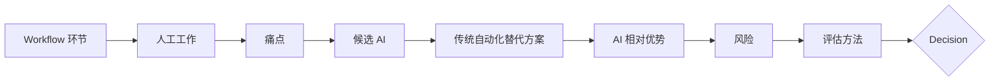

# AI Opportunity Map

> 状态：Phase 0 初版（2026-09-29）｜ 依据：`research/ai-performance-engineering.md`
> **重要**：本文中的"痛点"目前是**基于研究的假设**，不是本项目的实测数据。Phase 1–3 通过 Pain Point Log（§6）收集真实数据后，本文必须修订。
> 决策取值：**Reject**（不做）｜ **External**（使用现成工具，不自建）｜ **Defer**（证据不足，保持观察）｜ **Evaluate**（进入 Phase 4 评估）｜ **Never**（原则上禁止 AI）

---

## 1. 方法

判定一个 AI 候选"值得做"的**必要条件**：

1. 存在真实、可测量的人工成本（来自 Pain Point Log，而非想象）；
2. 传统自动化（规则、统计、模板、现成工具）**不能以可接受的成本**达到同等效果；
3. 输入可以是 Core 产出的**结构化、预聚合证据**；
4. 输出可以被**验证**（执行、回放、ground truth、人审）；
5. 错误的代价可控，且可以**回退到非 AI 路径**；
6. 可以与一个**确定性基线**做量化对比。

---

## 2. Workflow 环节与人工工作

| # | 环节 | 人工工作 | 假设痛点 | 候选 |
|---|---|---|---|---|
| W1 | 需求 → SLO | 把"要快"翻译为 p95/p99/错误率 | 需求模糊 | C1 |
| W2 | 负载建模 | 从生产日志得出 Flow Mix、强度、峰值系数 | 日志分析繁琐 | C2 |
| W3 | 编写 Service/Flow | 写请求、提取字段、关联 | 接口多、关联多 | C3、C4 |
| W4 | 测试数据 | 准备账户、商品、租户数据 | 数据语义一致性 | C5 |
| W5 | 执行 | 启动、监控、中止 | 低（已自动化） | C6 |
| W6 | 判定 | Pass/Fail/Invalid | 无（规则） | C7 |
| W7 | 有效性检查 | 检查负载机、dropped iterations、warm-up | 容易遗漏 | C8 |
| W8 | 回归比较 | 与基线比较，判断是否真的变差 | 噪声 | C9 |
| W9 | 瓶颈分析 | RED → USE → Trace → 日志，提出假设 | **耗时最长、跨信号、依赖经验** | C10、C11 |
| W10 | 报告 | 写结论 | 重复性写作 | C12 |
| W11 | 下一步实验 | 根据结论设计下一个实验 | 依赖经验 | C13 |
| W12 | 遗留资产迁移 | JMeter/LoadRunner → k6 | 一次性大量工作 | C14 |

---

## 3. 候选能力评估

每个候选回答：①为什么需要 AI ②为什么普通代码解决不了 ③输入 ④输出 ⑤AI 做了什么 ⑥错了会怎样 ⑦如何评价 ⑧如何回退 ⑨是否值得。

### C1. 需求文本 → SLO 草稿

| 问题 | 回答 |
|---|---|
| ① 为什么需要 AI | 需求文档是自然语言 |
| ② 普通代码 | 模板 + 与 PM 的一次讨论即可；SLO 数量少（每个系统几十条） |
| ③ 输入 / ④ 输出 | 需求文本 → SLO 数据草稿 |
| ⑤ AI 做了什么 | 抽取与格式化 |
| ⑥ 错了会怎样 | 错误的验收标准，**影响所有后续结论** |
| ⑦ 评价 / ⑧ 回退 | 人审 / 手写 |
| ⑨ 决策 | **Reject**：频率低、价值低、错误代价高。SLO 是需要人负责的承诺 |

### C2. 生产流量 → 负载模型（Mix、强度、峰值系数）

| 问题 | 回答 |
|---|---|
| ② 普通代码 | **可以**：访问日志 / APM 按路由聚合 → 比例、到达率分布、峰均比。这是统计问题 |
| ⑥ 错了会怎样 | 负载不真实，整个测试失去意义 |
| ⑨ 决策 | **Reject（AI）**；Phase 2 以统计脚本实现。研究中未发现 LLM 在此优于统计建模（ServeGen 也是统计方法） |

### C3. 自然语言 / OpenAPI → Service/Flow 代码

| 问题 | 回答 |
|---|---|
| ① | 减少样板代码 |
| ② 普通代码 | OpenAPI codegen 可生成请求骨架；业务顺序需要人理解 |
| ⑤ | 生成代码 |
| ⑥ | API 幻觉、错误关联、错误的数据使用；"能跑 ≠ 有效" |
| ⑦ | 1-VU 冒烟通过率、人工修改行数 |
| ⑨ 决策 | **External**：`k6 x mcp` / `k6 x agent`（k6 2.0 内置）+ 任意 coding agent 已提供此能力，并有文档 grounding 与冒烟验证。本项目只需保证代码结构（Service/Flow 约定、边界检查清单）对 agent 友好，不自建 |

### C4. 关联（动态值提取）

| 问题 | 回答 |
|---|---|
| ② 普通代码 | 录制 diff 启发式可覆盖大部分 |
| ⑨ 决策 | **External**：k6 Studio（确定性规则 + AI autocorrelation + 回放验证）。本项目的 Flow 基于 API 契约手写，关联较少 |

### C5. 语义一致的复杂测试数据

| 问题 | 回答 |
|---|---|
| ① | TOB 场景中客户、合同、审批链需要语义上自洽的数据 |
| ② 普通代码 | xk6-faker、模板、从脱敏生产数据抽样；多数情况足够 |
| ⑥ | 数据分布不真实（索引、缓存命中与生产不同） |
| ⑨ 决策 | **Defer**：只有在 Phase 2 TOB 场景中证实 faker/抽样不足时再评估。注意：数据分布（规模、倾斜）比语义更影响性能，而分布是统计问题 |

### C6. Agent 自动执行压测

| 问题 | 回答 |
|---|---|
| ② 普通代码 | Run 入口 + CI 已完全自动化 |
| ⑥ | **对错误目标施加负载**（生产事故）、资源浪费 |
| ⑨ 决策 | **Never**（在当前架构中）。若未来通过 MCP 暴露，默认只读，运行类工具需基础设施级目标白名单与 VU 上限 |

### C7. Pass / Fail 判定

**Never**。判定必须确定、可复现、可审计（`ARCHITECTURE.md` §6）。

### C8. 测试有效性审计

| 问题 | 回答 |
|---|---|
| ② 普通代码 | **完全可以**：dropped_iterations、负载机 CPU、实际 vs 目标到达率、checks 失败率、稳态窗口检测 |
| ⑨ 决策 | **Reject（AI）**；Core 以规则实现（Grafana Cloud Insights 与 NeoLoad 分段也都是非 LLM 方法） |

### C9. 回归检测

| 问题 | 回答 |
|---|---|
| ② 普通代码 | 非参数统计 + 实际显著性下限；跨版本 CPD（Apache Otava），有公开 P/R 数据 |
| ⑥ | 误报导致信任崩塌，漏报导致回归上线 |
| ⑨ 决策 | **Reject（AI）**；Phase 2–3 用统计方法实现 |

### C10. 瓶颈候选假设生成与排序（RCA 辅助）——**首要候选**

| 问题 | 回答 |
|---|---|
| ① 为什么需要 AI | 瓶颈分析需要同时阅读多类证据（RED、USE、慢 trace、错误日志文本、配置变更），在多个服务之间建立因果假设。这是性能工程中**最耗时、最依赖经验**的环节 |
| ② 为什么普通代码难以解决 | 规则可以回答"哪个服务的延迟增幅最大""哪个资源利用率最高"，但难以综合"慢 trace 中的 span 模式 + 错误日志文本 + 资源饱和"形成**跨信号的解释**；规则集随系统增长而爆炸 |
| ③ 输入 | **Evidence Bundle**（Phase 3，确定性生成）：各服务 RED 差值、USE Top-N、慢 trace 摘要（span 路径 + 耗时分布）、错误聚类结果、运行元数据。**不输入原始时序** |
| ④ 输出 | Top-3 候选假设，每条带：涉及组件、支撑证据 ID、反证、建议的下一个验证实验 |
| ⑤ AI 做了什么 | 跨信号关联与解释、假设排序、把假设翻译成可执行的下一实验 |
| ⑥ 错了会怎样 | 工程师被误导、浪费调查时间。**不影响 Verdict**，不影响系统 |
| ⑦ 如何评价 | 在**带标注的故障注入数据集**上（OpenTelemetry Demo flagd：`paymentFailure`、`kafkaQueueProblems`、`emailMemoryLeak`、`recommendationCacheFailure`、`adHighCpu` 等 15 个开关），对比：**确定性基线**（"RED 增幅最大的服务 + USE 最饱和资源"规则）vs AI。指标：Top-1/Top-3 命中率、证据引用完整率、无证据断言率（幻觉）、人工诊断时间（有/无 AI）、单次成本 |
| ⑧ 如何回退 | 删除该能力，Evidence Bundle + 规则基线仍然可用 |
| ⑨ 决策 | **Evaluate（Phase 4）**。前提：Phase 3 的 Evidence Bundle 已存在。研究警示：OpenRCA 上自由形式 LLM 仅 11.34%；RCACopilot 的有效性来自确定性收集流水线。因此评估对象是"**精选证据上的假设排序**"，而非自由 RCA |

### C11. 错误响应 / 日志聚类与解释

| 问题 | 回答 |
|---|---|
| ① | 压测中出现大量错误响应体、日志，需要归类为若干"问题" |
| ② 普通代码 | 按 status + error_code + 归一化消息分组；日志模板挖掘（Drain 类算法）可覆盖大部分 |
| ③ / ④ | 已被确定性检测器标记的错误样本（限量、脱敏）→ 问题簇 + 解释 |
| ⑥ | 误合并/误拆分；解释错误 |
| ⑦ | 人工标注的簇作为 ground truth，对比 Drain 基线的纯度/召回；解释的正确率 |
| ⑨ 决策 | **Evaluate（Phase 4，次要候选）**，仅当 Phase 1–3 的 Pain Point Log 显示错误归类是显著耗时环节。借鉴 BlazeMeter："确定性检测器在前，LLM 只处理被标记的证据" |

### C12. 报告 / 结论文字生成

| 问题 | 回答 |
|---|---|
| ② 普通代码 | 模板化报告可以覆盖事实部分（指标、判定、差值） |
| ⑥ | 非确定性、不可 diff；把无效测试叙述为回归 |
| ⑨ 决策 | **Defer**：若 C10 被采纳，结论文字作为其副产物；单独做文字摘要**价值低**（Azure 自己声明可能不准） |

### C13. 下一实验建议

| 问题 | 回答 |
|---|---|
| ① | 基于结论设计下一个实验（改变哪个变量） |
| ② 普通代码 | Playbook / 决策树（例如"DB CPU 饱和 → 连接池/索引实验"）可覆盖常见路径 |
| ③ | Experiment Records 历史 + 当前结论 |
| ⑨ 决策 | **Defer**：需要足够多的 Experiment Record 才能评估；与 C10 合并考虑 |

### C14. JMeter / LoadRunner 脚本迁移

| 问题 | 回答 |
|---|---|
| ② 普通代码 | 转换器只能做到部分 |
| ⑦ | 编译 + 冒烟 + 与原脚本请求序列对比 |
| ⑨ 决策 | **Reject（当前）**：本项目没有遗留资产。若将来有，是合适的 LLM 场景（Gatling 已提供类似 skill），使用外部 coding agent 即可 |

---

## 4. 决策汇总

| 候选 | 传统方案 | AI 潜在优势 | 主要风险 | 验证方式 | 决策 |
|---|---|---|---|---|---|
| C1 需求 → SLO | 模板 + 讨论 | 抽取 | 错误验收标准 | 人审 | Reject |
| C2 负载建模 | 日志统计 | 无明显 | 负载失真 | 与生产对比 | Reject（统计实现） |
| C3 写 Service/Flow | codegen + 手写 | 减少样板 | 幻觉、无效测试 | 冒烟 | External（`k6 x mcp`） |
| C4 关联 | 启发式 | 歧义判断 | 录制数据外泄 | 回放 | External（k6 Studio） |
| C5 语义测试数据 | faker / 抽样 | 语义自洽 | 分布失真 | 分布对比 | Defer |
| C6 Agent 执行压测 | Run 入口 / CI | 无 | 错误目标加压 | — | **Never** |
| C7 Pass/Fail | 阈值 | 无 | 不可复现 | — | **Never** |
| C8 有效性审计 | 规则 | 无 | — | — | Reject（规则实现） |
| C9 回归检测 | 统计 / CPD | 无 | 误报 | 标注序列 | Reject（统计实现） |
| **C10 瓶颈假设排序** | RED/USE 规则 | 跨信号解释 | 误导调查 | **故障注入 ground truth** | **Evaluate（Phase 4）** |
| C11 错误聚类 | Drain / 分组 | 语义合并与解释 | 误聚类 | 人工标注簇 | Evaluate（次要） |
| C12 报告文字 | 模板 | 可读性 | 非确定性 | — | Defer |
| C13 下一实验建议 | Playbook | 经验迁移 | 错误方向 | 实验结果 | Defer |
| C14 脚本迁移 | 转换器 | 半结构化转换 | 语义丢失 | 冒烟 + 对比 | Reject（当前无需求） |

---

## 5. 进入实现的 Go / No-Go 条件（适用于 C10、C11）

| 指标 | Go 条件（初始值，Phase 4 开始前可根据实际数据调整并记录在 ADR 中） |
|---|---|
| Top-3 命中率 | ≥ 确定性基线 + 15 个百分点 |
| 证据引用完整率 | 100%（每条断言都有证据 ID），否则视为失败 |
| 无证据断言（幻觉）率 | ≤ 5% |
| 人工诊断时间 | 有 AI 辅助比无 AI 减少 ≥ 30%（至少 2 名工程师 × 多个故障） |
| 单次成本 | 小于其节省的人工时间价值 |
| 稳定性 | 同一输入多次运行，Top-1 一致率 ≥ 80% |
| 数据安全 | 证据可脱敏；或可使用本地/私有部署模型 |

**任一条件不满足 → 不实现，记录结论**（这本身就是项目的有效产出）。

---

## 6. Pain Point Log（从 Phase 1 开始收集）

AI 决策需要真实数据。从 Phase 1 起，工程师在 `journal/pain-points.md`（仓库根目录，见 `ARCHITECTURE.md` §5.2） 中按以下格式记录：

| 日期 | 环节（W1–W12） | 做了什么 | 耗时 | 为什么慢 | 传统自动化能否解决 | 备注 |
|---|---|---|---|---|---|---|

Phase 4 开始前汇总：**按环节统计耗时占比**，只有耗时占比高、且传统自动化无法解决的环节才进入 AI 评估。
