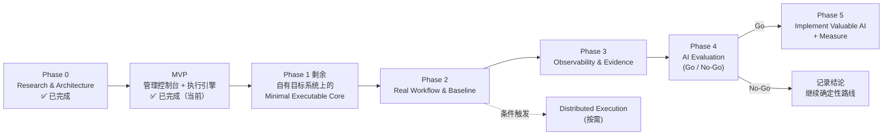

# Project Roadmap

> 状态：Phase 0 定稿（2026-09-29）；**MVP 已完成（2026-09-30）**，各阶段已按 MVP 的结果更新
> 原则：每个阶段必须产出**可执行、可验证**的结果；进入下一阶段需满足验收标准；任何方向满足停止条件即停止。

---

## MVP 已完成的内容（2026-09-30）

用户在 2026-09-30 决定先做一个能在浏览器里使用的最小可用版本（`decisions/ADR-005-mvp-management-console.md`、`plans/mvp-plan.md`）。它不是原路线图里的某个阶段，而是横跨了 Phase 1 和 Phase 2，并改变了其中几项的做法。

**做出来的东西**：

| 部分 | 内容 |
|---|---|
| 执行引擎 `perf/` | 通用 k6 脚本 `runner.js` 读取 plan 解释执行；`core/` 生成 scenarios、阈值（SLO + 有效性）、Run Record |
| 后端 `server/` | Python 3.12 + FastAPI + SQLite：5 类定义的增删改查、预检、启动和停止 k6、最终判定、存档、托管前端 |
| 前端 `web/` | Vue 3 + Element Plus，10 个页面：概览；业务（接口、业务流程、测试数据）；压测（施压配置、测试、运行记录、运行详情）；资源（被测环境、施压机） |
| 目标 | `https://www.baidu.com`，只允许冒烟级别流量（环境上限 2 并发、每秒 2 次、60 秒，预检强制执行） |

**与原 Phase 1 的对应**（编号是下文 Phase 1 范围里的序号）：

| Phase 1 原条目 | MVP 的结果 |
|---|---|
| 1) Service、2) Flow | **做法改变**：接口和业务流程是页面上维护的数据，不是 JS 模块。支持多步骤、变量提取、检查、等待时间；没有分支和循环。含登录的多步骤链路还没有在真实目标上验证 |
| 3) Profile | ✅ 四种形态（closed：固定迭代数、固定并发；open：固定到达率、阶梯到达率）。**没有做形状与强度分离**，施压配置里直接写绝对数值。对百度只跑过冒烟 |
| 4) SLO + Composer | ✅ SLO 是数据，生成 SLO 阈值和有效性阈值。SLO **只到测试级别**（全部请求的 p95 / p99、错误率、检查通过率） |
| 5) Data 规则 | 部分实现（2026-10-10，ADR-006）：数据集（按顺序 / 随机 / 每个 VU 固定一行，用完时循环或判 `invalid`）、账户池、唯一键（动态变量）、每 VU 登录一次（初始化段）；可消耗数据的独占取用、seed / cleanup 未实现 |
| 6) 业务指标、tag 词汇表 | tag（`testid`、`flow`、`step`、`name`）✅；业务指标 ❌ |
| 7) Run 入口 | **做法改变**：入口是后端接口 `POST /api/runs`，没有 Node 命令行。runId、环境指纹、`testid` tag ✅ |
| 8) Run Record + Verdict | ✅ 五种判定，`invalid` 优先于 `failed` |
| 9) 预检、最大时长、手动中止 | ✅ 预检（含被测环境的安全上限、生产环境二次确认）、手动停止；目标白名单和健康检查 ❌ |
| 10) 监控 | `dashboard.html` 导出 ✅；运行中的进度来自 k6 日志（浏览器连实时仪表盘会阻止 k6 退出）；施压机（负载机）CPU / 内存采样 ✅，只展示、不参与判定 |
| 11) 静态报告、`schemas/` | **取消**：由运行详情页替代；三方接口以 `plans/mvp-contract.md` 为约定，没有 JSON Schema 文件 |
| 12) README | ✅ |
| 13) Pain Point Log | ❌ 还没有开始记录 |

**与原 Phase 2 的对应**：

| Phase 2 原条目 | MVP 的结果 |
|---|---|
| 1) Flow Mix | ✅ 提前实现：测试里给流程设权重，每个流程编译成一个 k6 scenario |
| 11) 前端 F1（只读控制台） | **被取代**：MVP 是可维护的管理控制台。运行记录和运行详情已有；对比、基线、实验页面未实现；没有 Grafana |
| 存储形态（原未决项） | **已决定**：SQLite 单文件 `data/app.db` |
| 其余条目（目标系统升级、数据、基线与对比、实验记录、Prometheus、CI、TOB 目标系统） | 未开始 |

**MVP 带来的、原路线图里没有的事项**（见 ADR-005 的 Consequences 和 Reconsideration Conditions）：没有登录和权限；定义不经过 git 审核；流程没有分支和循环；没有命令行入口，CI 的接入方式要重新设计；还没有一个可以自由加压的自有目标系统。

**MVP 之后的增量（2026-10-09）**：接口调试与业务流程试跑（用真实 k6 跑一次迭代，页面上看请求、响应、检查、变量）、接口页改为 Postman 式工作台、从 cURL 导入接口。这是控制台的可用性补强，不属于 Phase 1 的剩余项；OpenAPI / Postman Collection 的文档导入未做。

**2026-10-10 的增量（ADR-006）**：测试数据与变量分层，属于 Phase 1 第 5 项 Data 规则的主体：数据集、流程变量、动态变量、业务流程的初始化段（每个 VU 一次，不计入业务 SLO）、表单与文件请求体、预检里的变量来源检查、调试时先跑上游接口。

读下文时注意：各阶段表格"验收标准"一栏里的 ✅ 是 Phase 0 原文的列表符号，**不表示已完成**。完成情况只看本节和 Phase 1 末尾的状态表。

---

## 总览

| 阶段 | 核心问题 | 主要产出 |
|---|---|---|
| 0 ✅ | 做什么、为什么、边界在哪 | docs/ |
| MVP ✅ | 能否在页面上维护定义、发起运行并得到判定？ | 管理控制台、执行引擎、后端、SQLite 存档 |
| 1 剩余 | 能否在**自有**目标上以正确模型执行并得出可信 Verdict？ | 自有目标系统、多步骤流程、按步骤的 SLO、数据规则 |
| 2 | 能否支撑真实工作流（数据、基线、回归）？ | 数据规则、Baseline、Experiment、CI |
| 3 | 能否把压测结果与系统内部证据关联？ | Prometheus/Trace 关联、Evidence Bundle |
| 4 | AI 是否优于确定性基线？ | 评估报告 + Go/No-Go |
| 5 | 实现被证明有价值的 AI，并持续度量 | 仅通过评估的能力 |

---

## Phase 0：Research & Architecture（已完成）

| 项 | 内容 |
|---|---|
| 目标 | 研究 k6、性能工程、Observability、AI + 性能测试；确定架构、边界、路线 |
| 输入 | 官方文档、源码、GitHub 项目、论文 |
| 输出 | `docs/ARCHITECTURE.md`、`docs/decisions/*`、`docs/plans/*`、`docs/research/*` |
| 验收标准 | 能通过 docs 回答：项目定位、k6 执行模型与边界、Test/Flow/Service/Load 划分、Data/Metrics/Threshold/Result 处理、扩展方式、AI 为何暂不做及何时做、下一步做什么 |
| 停止条件 | —（已完成） |

---

## Phase 1：Minimal Executable Core（大部分已由 MVP 完成，剩余项见下）

> 下表"范围"和"验收标准"保留 Phase 0 写下的原文，作为历史依据；每一条现在的状态见开头"MVP 已完成的内容"和本节末尾的"剩余工作"。原文里的 QuickPizza、`tools/report.mjs`、`schemas/`、"Run 入口（Node 标准库）"是当时的计划，**没有采用**。

| 项 | 内容 |
|---|---|
| 目标 | 在真实目标系统上，用正确的负载模型执行一个 TOC Flow，得到可信的 Run Record 与 Verdict |
| 前置条件 | ~~Docker 运行 QuickPizza~~ 本机没有 Docker 和 sudo，未采用。k6 v2.3.0 已由 `scripts/setup.sh` 安装到 `.tools/`。**新的前置条件：一个可以自由加压的自有目标系统（未决）** |
| 输入 | `ARCHITECTURE.md`、ADR-002、ADR-003、ADR-005 |
| 范围（只做这些） | 1) 2–3 个 Service（auth、业务查询/创建类） 2) 1–2 个 Flow（含登录 + 多步骤业务链路） 3) Profile：smoke、average、stress（open model）+ 1 个 closed 示例 4) SLO 数据 + Composer（scenarios + SLO 阈值 + validity 阈值） 5) Data 规则：账户池、唯一键、每 VU token 缓存 6) 业务指标注册（≥2 个）与 tag 词汇表 7) Run 入口（Node 标准库）：runId、环境指纹、唯一 tag 注入 8) `handleSummary` → Run Record JSON + Verdict 9) 预检（配置校验、目标白名单、健康检查）、最大时长与手动中止 10) 监控：k6 web-dashboard + HTML 导出、负载机 CPU 采样写入 Run Record 11) `tools/report.mjs`：Run Record → report.md + report.html（前端 F0：单文件静态报告页）；`schemas/run-record.schema.json` 12) README：如何运行 13) 开始记录 `journal/pain-points.md` |
| 明确不做 | 多协议、Prometheus、Grafana、分布式、CI、基线比较、任何 AI（原文还列了"Web 控制台"，已被 ADR-005 改变：MVP 做的就是控制台） |
| 输出 | 可运行代码（实际的目录结构见 `ARCHITECTURE.md` §5.2）、Run Record 示例、Pain Point Log |
| 验收标准 | ✅ 同一 Flow 以 smoke / average / stress 运行，**业务代码零修改** ✅ Flow/Service 中不出现 executor/VU/rate（边界检查清单通过） ✅ 人为设置过小的 `preAllocatedVUs` 时，Verdict = `invalid`（而不是 `failed`） ✅ 人为收紧 SLO 时，Verdict = `failed` ✅ 每次运行产生含 runId、k6 版本、git sha、阈值分类结果的 Run Record ✅ 所有 k6 指标带 `testid` tag ✅ 实测确认 `handleSummary` 数据结构（v2 summary 格式为研究中未验证项） |
| 停止条件 | 若 Composer 无法在不引入复杂抽象的前提下生成正确 scenarios → 回到 ADR-002 重新设计，而不是堆叠抽象 |

**验收标准现在的状态**：

| 原验收标准 | 状态 |
|---|---|
| 同一 Flow 以 smoke / average / stress 运行，业务代码零修改 | 机制已具备（同一个测试可以选任意施压配置）；百度上只跑过冒烟，average / stress 没有真实运行过 |
| Flow / Service 中不出现 executor / VU / rate | ✅ 由数据模型保证：接口和流程的表里没有这些字段 |
| `preAllocatedVUs` 过小时判定为 `invalid` | 机制已实现（open 模型下 `dropped_iterations` 是有效性阈值）；还没有端到端的真实运行得到过 `invalid` |
| 收紧 SLO 时判定为 `failed` | ✅ 联调时已验证 |
| Run Record 含 runId、k6 版本、git sha、阈值分类结果 | ✅ |
| 所有 k6 指标带 `testid` tag | ✅ |
| 实测 `handleSummary` 数据结构 | ✅ k6 v2.3.0 默认仍是旧结构（`research/k6.md` §9） |

**剩余工作**：

1. 确定并准备一个自有的、可以自由加压的目标系统（前提是解决本机没有 Docker 和 sudo 的问题，或使用别处已有的实例）；
2. 在它上面验证含登录的多步骤流程，以及 average / stress 级别的负载和 `invalid` 判定；
3. 按流程 / 步骤设置 SLO；业务指标；
4. Data 规则的剩余部分：可消耗数据的独占取用、seed / cleanup（数据集、账户池、唯一键、每 VU 登录一次已由 ADR-006 实现）；
5. 目标健康检查、`X-Load-Test-Run` 请求头；施压机采样已有，是否在过载时判 `invalid` 待定；
6. 开始记录 `journal/pain-points.md`。

---

## Phase 2：Real Workflow & Baseline

| 项 | 内容 |
|---|---|
| 目标 | 支撑真实性能工程工作流：多 Flow 混合、真实数据问题、基线与回归、实验记录 |
| 输入 | MVP、Phase 1 剩余工作的结果、Pain Point Log |
| 范围 | 1) ~~Flow Mix~~ ✅ 已由 MVP 实现 2) 目标系统：在 Phase 1 确定的自有目标系统上继续，或升级为 **OpenTelemetry Demo**（多服务 TOC 电商）——按 Phase 1 结论决定 3) 数据：可消耗数据、seed/cleanup（runId 前缀）、幂等键 4) spike / soak / breakpoint 负载；capacity 工作流（阶梯 + SLO 判定）。MVP 的"阶梯到达率"形态已经能表达爬坡和尖峰；breakpoint 需要 `abortOnFail`，未实现 5) Baseline（显式钉住）+ Compare（实际显著性下限；重复 ≥3 次；剔除 warm-up） 6) Experiment Record 模板（Hypothesis → Runs → Conclusion） 7) Prometheus RW（Native Histogram）+ 官方 k6 dashboard 8) CI：**先重新设计入口**（调用后端接口，还是"plan 文件 + 命令行"，见 `ARCHITECTURE.md` §3.8）；确定平台；PR 冒烟门禁、Nightly（专用负载机，average × 3 + 基线对比 + 通知）、手动 stress/spike/soak；基线更新需要人审 9) 从访问日志推导 Mix 的统计脚本（若有日志来源） 10) 决定 TOB 目标系统（自建最小多租户 mock 或真实系统） 11) 控制台：在 MVP 的管理控制台上增加对比、基线、实验页面；运行详情链接或嵌入 Grafana 面板（`ARCHITECTURE.md` §8.7）。原计划的"只读 Web 控制台 + 只读 API"已被 ADR-005 取代 12) 基线、历史、实验记录的存储形态：数据库还是 git 文件（`ARCHITECTURE.md` §3.7） 13) 按 ADR-005 的复议条件处理：多人使用前先做登录、权限和审计 |
| 输出 | 至少 3 个完整 Experiment Record（含假设与结论）；基线文件；dashboard |
| 验收标准 | ✅ 同一 Test 重复运行 3 次，关键 p95 的变异系数有记录且在可接受范围（阈值在本阶段确定） ✅ 人为引入延迟（例如目标系统故障开关或配置）后，Compare 能检出回归；未改动时不报回归 ✅ 数据规则保证并发下单无唯一键冲突 ✅ 至少一个 Experiment 形成"假设 → 结论 → 下一假设"的闭环 ✅ 从 CI 通知的链接一次跳转进入运行详情；不打开 Grafana 能看到判定、失败阈值、有效性、与基线的差值 |
| 停止条件 | 若运行噪声过大导致 Compare 无法区分 5% 级变化 → 先解决环境稳定性（隔离、固定资源），暂停后续分析类工作 |

---

## Phase 3：Observability & Evidence

| 项 | 内容 |
|---|---|
| 目标 | 把压测结果与系统内部 Metrics/Traces/Logs 关联，生成确定性的 Evidence Bundle |
| 输入 | Phase 2 的实验、OpenTelemetry Demo 的遥测 |
| 范围 | 1) SUT RED/USE 面板按 `$testid` 与时间窗 2) `http-instrumentation-tempo` 注入 traceparent（受控采样）；baggage 携带 runId 3) Grafana annotation（start/stop/阶段） 4) **Evidence Bundle**：固定查询集（各服务 RED 差值、USE Top-N、慢 trace 摘要、错误分组）→ JSON 5) 规则化瓶颈定位基线（"RED 增幅最大服务 + 最饱和资源"） 6) 按需增加协议（gRPC/Kafka 等，由目标系统决定） 7) Apache Otava CPD（若已有足够历史） 8) 控制台增加趋势与变点页、证据视图、调用链跳转（原计划的"测试目录"已由 MVP 的定义维护页面覆盖） |
| 输出 | Evidence Bundle 规格与实现；规则化定位基线；**带标注的故障数据集**（flagd 故障 × 负载 → Evidence Bundle + 真实根因标签） |
| 验收标准 | ✅ 任一 runId 可一键得到 Evidence Bundle ✅ 对 flagd 注入的故障，Evidence Bundle 中包含定位所需信号 ✅ 规则化基线在标注数据集上的 Top-1/Top-3 命中率已测得（这是 Phase 4 的比较基准） ✅ 标注数据集 ≥ 30 个样本（多种故障 × 多种负载） |
| 停止条件 | 若 Evidence Bundle 无法稳定生成（遥测缺失、采样不足）→ 不进入 Phase 4 |

---

## Phase 4：AI Evaluation（Go / No-Go）

| 项 | 内容 |
|---|---|
| 目标 | 用数据回答："AI 是否在某个环节显著优于确定性基线？" |
| 输入 | Pain Point Log 汇总（按环节耗时占比）、Evidence Bundle、标注数据集、`plans/ai-opportunity-map.md` |
| 范围 | 1) 汇总 Pain Point Log，更新 AI Opportunity Map（真实数据替代假设） 2) 对首要候选 **C10（瓶颈假设排序）**、次要候选 C11（错误聚类）做离线评估 3) 同一输入与确定性基线对比；多次运行测稳定性 4) 小规模人工对照实验（有/无 AI 的诊断时间） 5) 成本与数据安全评估 |
| 明确不做 | AI 的生产化实现、AI 界面、Agent 自动执行 |
| 输出 | `docs/plans/ai-evaluation-report.md` + ADR（Go 或 No-Go） |
| 验收标准 | 评估报告包含：数据集描述、基线结果、AI 结果、稳定性、成本、结论 |
| Go 条件 | 满足 `ai-opportunity-map.md` §5 全部条件 |
| **停止条件** | **若 AI 收益低于传统自动化方案，或无法满足证据引用 100% / 幻觉率上限，则不继续开发该能力，并以 ADR 记录结论** |

---

## Phase 5：Implement Valuable AI + Measure

| 项 | 内容 |
|---|---|
| 目标 | 只实现 Phase 4 中 Go 的能力，并持续度量其价值 |
| 范围 | 1) 以只读方式消费 Evidence Bundle / Run Record 2) 输出写入 Experiment Record 的"建议"部分，每条带证据 ID 3) 保留确定性基线并行输出，持续对比 4) 每月复核指标（命中率、采纳率、节省时间、成本） |
| 验收标准 | 线上使用数据维持 Phase 4 的 Go 条件 |
| **停止条件** | 连续两个复核周期指标低于 Go 条件 → 下线该能力（Core 不受影响） |

---

## 条件触发：Distributed Execution

| 项 | 内容 |
|---|---|
| 触发条件 | 单负载机无法达到目标负载（负载机 CPU > 80%、网络饱和、或 > ~30k VU），或需要多区域来源 |
| 范围 | k6-operator TestRun 生成；`lg` tag；Result Merger（Native Histogram 全局百分位、全局 SLO 重评估）；运行前全局初始化替代 `setup()` |
| 验收标准 | 分布式运行的全局 Verdict 与等效单机运行（在单机可达范围内）一致；数据无跨实例冲突 |
| 停止条件 | 若 Grafana Cloud k6 满足需求且成本可接受 → 采用 Cloud，不自建 Merger |

---

## 全局停止条件（适用于任何方向）

| 情况 | 行动 |
|---|---|
| 某抽象在引入后两个阶段内只有一个使用者 | 删除该抽象，内联 |
| 某扩展/依赖被上游归档 | 替换或移除 |
| 某 AI 功能经验证收益低于传统自动化 | 不继续开发，记录 ADR |
| 某能力已被 k6 / Grafana 官方提供 | 迁移到官方能力，删除自研实现 |
| 运行环境噪声使结论不可复现 | 暂停分析类工作，先解决环境 |
