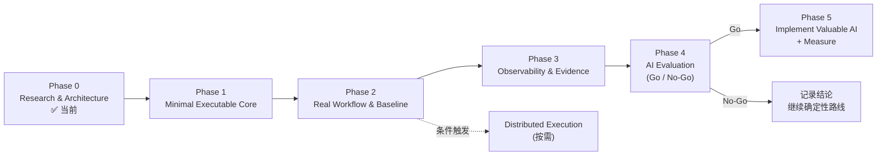

# Project Roadmap

> 状态：Phase 0 定稿（2026-09-29）
> 原则：每个阶段必须产出**可执行、可验证**的结果；进入下一阶段需满足验收标准；任何方向满足停止条件即停止。

---

## 总览

| 阶段 | 核心问题 | 主要产出 |
|---|---|---|
| 0 | 做什么、为什么、边界在哪 | docs/ |
| 1 | 能否在真实目标上以正确模型执行并得出可信 Verdict？ | 最小 Core + 1 个 TOC Flow |
| 2 | 能否支撑真实工作流（多 Flow、数据、基线、回归）？ | Mix、数据规则、Baseline、Experiment |
| 3 | 能否把压测结果与系统内部证据关联？ | Prometheus/Trace 关联、Evidence Bundle |
| 4 | AI 是否优于确定性基线？ | 评估报告 + Go/No-Go |
| 5 | 实现被证明有价值的 AI，并持续度量 | 仅通过评估的能力 |

---

## Phase 0：Research & Architecture（当前）

| 项 | 内容 |
|---|---|
| 目标 | 研究 k6、性能工程、Observability、AI + 性能测试；确定架构、边界、路线 |
| 输入 | 官方文档、源码、GitHub 项目、论文 |
| 输出 | `docs/ARCHITECTURE.md`、`docs/decisions/*`、`docs/plans/*`、`docs/research/*` |
| 验收标准 | 能通过 docs 回答：项目定位、k6 执行模型与边界、Test/Flow/Service/Load 划分、Data/Metrics/Threshold/Result 处理、扩展方式、AI 为何暂不做及何时做、下一步做什么 |
| 停止条件 | —（已完成） |

---

## Phase 1：Minimal Executable Core

| 项 | 内容 |
|---|---|
| 目标 | 在真实目标系统上，用正确的负载模型执行一个 TOC Flow，得到可信的 Run Record 与 Verdict |
| 前置条件 | 安装 k6 v2.x（锁定 minor）；Docker 运行 QuickPizza（或可访问的实例）；实测 QuickPizza API（登录/token、主要端点） |
| 输入 | `ARCHITECTURE.md`、ADR-002、ADR-003 |
| 范围（只做这些） | 1) 2–3 个 Service（auth、业务查询/创建类） 2) 1–2 个 Flow（含登录 + 多步骤业务链路） 3) Profile：smoke、average、stress（open model）+ 1 个 closed 示例 4) SLO 数据 + Composer（scenarios + SLO 阈值 + validity 阈值） 5) Data 规则：账户池、唯一键、每 VU token 缓存 6) 业务指标注册（≥2 个）与 tag 词汇表 7) Run 入口（Node 标准库）：runId、环境指纹、唯一 tag 注入 8) `handleSummary` → Run Record JSON + Verdict 9) 预检（配置校验、目标白名单、健康检查）、最大时长与手动中止 10) 监控：k6 web-dashboard + HTML 导出、负载机 CPU 采样写入 Run Record 11) `tools/report.mjs`：Run Record → report.md 12) README：如何运行 13) 开始记录 `journal/pain-points.md` |
| 明确不做 | 多协议、Prometheus、Grafana、分布式、CI、基线比较、任何 AI |
| 输出 | 可运行代码（目录结构见 `ARCHITECTURE.md` §5，Phase 1 只创建其中标注为 Phase 1 的部分）、Run Record 示例、Pain Point Log |
| 验收标准 | ✅ 同一 Flow 以 smoke / average / stress 运行，**业务代码零修改** ✅ Flow/Service 中不出现 executor/VU/rate（边界检查清单通过） ✅ 人为设置过小的 `preAllocatedVUs` 时，Verdict = `invalid`（而不是 `failed`） ✅ 人为收紧 SLO 时，Verdict = `failed` ✅ 每次运行产生含 runId、k6 版本、git sha、阈值分类结果的 Run Record ✅ 所有 k6 指标带 `testid` tag ✅ 实测确认 `handleSummary` 数据结构（v2 summary 格式为研究中未验证项） |
| 停止条件 | 若 Composer 无法在不引入复杂抽象的前提下生成正确 scenarios → 回到 ADR-002 重新设计，而不是堆叠抽象 |

---

## Phase 2：Real Workflow & Baseline

| 项 | 内容 |
|---|---|
| 目标 | 支撑真实性能工程工作流：多 Flow 混合、真实数据问题、基线与回归、实验记录 |
| 输入 | Phase 1 Core、Pain Point Log |
| 范围 | 1) Flow Mix（open model 下按权重多 scenario） 2) 目标系统升级为 **OpenTelemetry Demo**（多服务 TOC 电商）或在 QuickPizza 微服务模式上扩展——按 Phase 1 结论决定 3) 数据：可消耗数据、seed/cleanup（runId 前缀）、幂等键 4) spike / soak / breakpoint Profile；capacity 工作流（阶梯 + SLO 判定） 5) Baseline（显式钉住）+ Compare（实际显著性下限；重复 ≥3 次；剔除 warm-up） 6) Experiment Record 模板（Hypothesis → Runs → Conclusion） 7) Prometheus RW（Native Histogram）+ 官方 k6 dashboard 8) CI：确定平台；PR 冒烟门禁（静态检查 + 临时目标系统 + smoke）、Nightly（专用负载机，average × 3 + 基线对比 + 通知）、手动 stress/spike/soak、基线更新走 PR；`history/` 持久化位置 9) 从访问日志推导 Mix 的统计脚本（若有日志来源） 10) 决定 TOB 目标系统（自建最小多租户 mock 或真实系统） |
| 输出 | 至少 3 个完整 Experiment Record（含假设与结论）；基线文件；dashboard |
| 验收标准 | ✅ 同一 Test 重复运行 3 次，关键 p95 的变异系数有记录且在可接受范围（阈值在本阶段确定） ✅ 人为引入延迟（例如目标系统故障开关或配置）后，Compare 能检出回归；未改动时不报回归 ✅ 数据规则保证并发下单无唯一键冲突 ✅ 至少一个 Experiment 形成"假设 → 结论 → 下一假设"的闭环 |
| 停止条件 | 若运行噪声过大导致 Compare 无法区分 5% 级变化 → 先解决环境稳定性（隔离、固定资源），暂停后续分析类工作 |

---

## Phase 3：Observability & Evidence

| 项 | 内容 |
|---|---|
| 目标 | 把压测结果与系统内部 Metrics/Traces/Logs 关联，生成确定性的 Evidence Bundle |
| 输入 | Phase 2 的实验、OpenTelemetry Demo 的遥测 |
| 范围 | 1) SUT RED/USE 面板按 `$testid` 与时间窗 2) `http-instrumentation-tempo` 注入 traceparent（受控采样）；baggage 携带 runId 3) Grafana annotation（start/stop/阶段） 4) **Evidence Bundle**：固定查询集（各服务 RED 差值、USE Top-N、慢 trace 摘要、错误分组）→ JSON 5) 规则化瓶颈定位基线（"RED 增幅最大服务 + 最饱和资源"） 6) 按需增加协议（gRPC/Kafka 等，由目标系统决定） 7) Apache Otava CPD（若已有足够历史） |
| 输出 | Evidence Bundle 规格与实现；规则化定位基线；**带标注的故障数据集**（flagd 故障 × 负载 → Evidence Bundle + 真实根因标签） |
| 验收标准 | ✅ 任一 runId 可一键得到 Evidence Bundle ✅ 对 flagd 注入的故障，Evidence Bundle 中包含定位所需信号 ✅ 规则化基线在标注数据集上的 Top-1/Top-3 命中率已测得（这是 Phase 4 的比较基准） ✅ 标注数据集 ≥ 30 个样本（多种故障 × 多种负载） |
| 停止条件 | 若 Evidence Bundle 无法稳定生成（遥测缺失、采样不足）→ 不进入 Phase 4 |

---

## Phase 4：AI Evaluation（Go / No-Go）

| 项 | 内容 |
|---|---|
| 目标 | 用数据回答："AI 是否在某个环节显著优于确定性基线？" |
| 输入 | Pain Point Log 汇总（按环节耗时占比）、Evidence Bundle、标注数据集、`plans/ai-opportunity-map.md` |
| 范围 | 1) 汇总 Pain Point Log，更新 AI Opportunity Map（真实数据替代假设） 2) 对首要候选 **C10（瓶颈假设排序）**、次要候选 C11（错误聚类）做离线评估 3) 同一输入与确定性基线对比；多次运行测稳定性 4) 小规模人工对照实验（有/无 AI 的诊断时间） 5) 成本与数据安全评估 |
| 明确不做 | 生产化实现、UI、Agent 自动执行 |
| 输出 | `docs/plans/ai-evaluation-report.md` + ADR（Go 或 No-Go） |
| 验收标准 | 评估报告包含：数据集描述、基线结果、AI 结果、稳定性、成本、结论 |
| Go 条件 | 满足 `ai-opportunity-map.md` §5 全部条件 |
| **停止条件** | **若 AI 收益低于传统自动化方案，或无法满足证据引用 100% / 幻觉率上限，则不继续开发该能力，并以 ADR 记录结论** |

---

## Phase 5：Implement Valuable AI + Measure

| 项 | 内容 |
|---|---|
| 目标 | 只实现 Phase 4 中 Go 的能力，并持续度量其价值 |
| 范围 | 1) 以只读方式消费 Evidence Bundle / Run Record 2) 输出写入 Experiment Record 的"建议"部分，每条带证据 ID 3) 保留确定性基线并行输出，持续对比 4) 每月复核指标（命中率、采纳率、节省时间、成本） |
| 验收标准 | 线上使用数据维持 Phase 4 的 Go 条件 |
| **停止条件** | 连续两个复核周期指标低于 Go 条件 → 下线该能力（Core 不受影响） |

---

## 条件触发：Distributed Execution

| 项 | 内容 |
|---|---|
| 触发条件 | 单负载机无法达到目标负载（负载机 CPU > 80%、网络饱和、或 > ~30k VU），或需要多区域来源 |
| 范围 | k6-operator TestRun 生成；`lg` tag；Result Merger（Native Histogram 全局百分位、全局 SLO 重评估）；运行前全局初始化替代 `setup()` |
| 验收标准 | 分布式运行的全局 Verdict 与等效单机运行（在单机可达范围内）一致；数据无跨实例冲突 |
| 停止条件 | 若 Grafana Cloud k6 满足需求且成本可接受 → 采用 Cloud，不自建 Merger |

---

## 全局停止条件（适用于任何方向）

| 情况 | 行动 |
|---|---|
| 某抽象在引入后两个阶段内只有一个使用者 | 删除该抽象，内联 |
| 某扩展/依赖被上游归档 | 替换或移除 |
| 某 AI 功能经验证收益低于传统自动化 | 不继续开发，记录 ADR |
| 某能力已被 k6 / Grafana 官方提供 | 迁移到官方能力，删除自研实现 |
| 运行环境噪声使结论不可复现 | 暂停分析类工作，先解决环境 |
