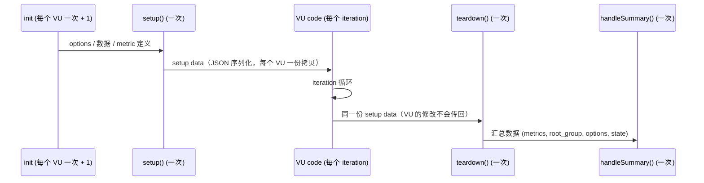
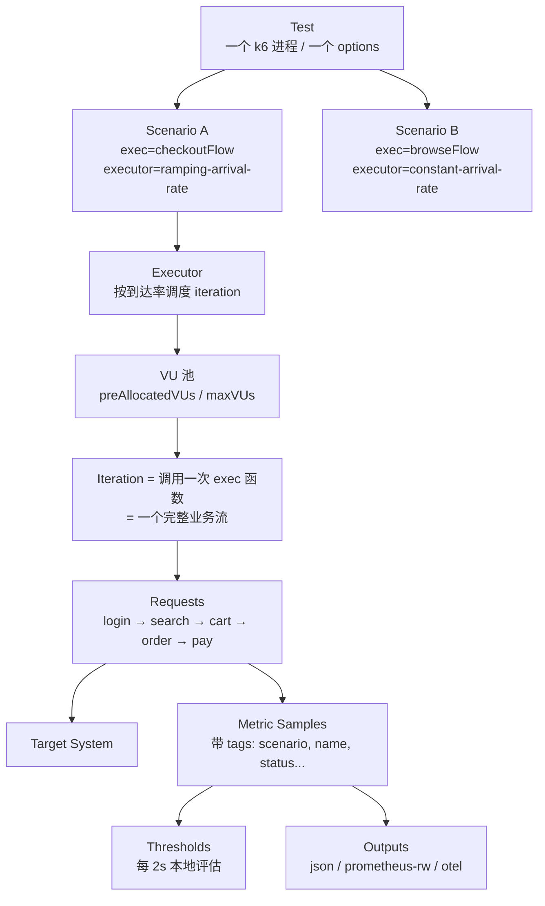

# Research：K6 工程架构

> 研究日期：2026-09-29 ｜ 研究对象版本：**k6 v2.3.0（2026-09-21）**
> 标记约定：**[事实]** 有来源；**[判断]** 本项目结论；**[推测]** 未完全验证。
> 简写：`REL(vX)` = `https://github.com/grafana/k6/releases/tag/vX`；`DOCS` = `https://grafana.com/docs/k6/latest`
> 本文不是 K6 入门，而是回答：**K6 的执行模型是什么？边界在哪里？对本项目的架构意味着什么？**

---

## 0. 版本基线（最重要的前置事实）

| 事实 | 来源 |
|---|---|
| **k6 当前主版本是 v2**：v2.0.0 发布于 2026-05-11，最新 v2.3.0（2026-09-21）；v1 维护线 v1.8.1（2026-08-12） | [releases](https://github.com/grafana/k6/releases) |
| v1.0.0 发布于 2025-05-06：SemVer、定义公开 API、TypeScript 一等支持、每个主版本至少 2 年关键修复 | REL(v1.0.0) |
| 发布节奏：每年 1 个主版本，约每 6 周 1 个次版本；维护当前 + 上一个主版本；`k6/experimental/*` 不受稳定性保证 | [versioning](https://grafana.com/docs/k6/latest/reference/versioning-and-stability-guarantees/) |
| Go module 路径 `go.k6.io/k6/v2`，所有 Go 扩展必须更新 import | [go.mod](https://raw.githubusercontent.com/grafana/k6/master/go.mod) |
| v2.0 删除：`externally-controlled` executor、`k6 pause/resume/scale/status`、`k6/experimental/redis`、`--no-summary`、legacy summary；REST API 默认不启动 | REL(v2.0.0) |
| 仓库活跃度：31.7k stars，772 open issues+PR，近 30 天 51 commits，近 12 个月 834 commits（42 位作者 / 90 天），AGPL-3.0 | [GitHub API](https://api.github.com/repos/grafana/k6) |

**[判断]** 网上大量 K6 资料是 v0.x / v1 时代的。本项目**以 k6 v2.x 为基线并锁定 minor 版本**，每年预留一次主版本迁移。

---

## 1. Runtime

| 维度 | 事实 | 来源 |
|---|---|---|
| 形态 | 单一 Go 二进制 + 内嵌 JS 引擎 **Sobek**（Grafana 维护的 goja fork；go.mod 中已无 goja） | go.mod |
| 模块系统 | ES Module，浏览器式解析：`k6/*`、本地文件、远程 HTTPS、`k6/x/*` 扩展。**无 Node.js 模块解析，无 npm**；依赖 Node API 的包不可用，需要预先 bundle | [modules](https://grafana.com/docs/k6/latest/using-k6/modules/) |
| TypeScript | `k6 run script.ts` 原生支持；内嵌 esbuild **只剥离类型，不做类型检查** | REL(v1.0.0) |
| VU 隔离 | **每个 VU 是独立 JS VM**；init 阶段的全局变量复制到每个 VU；VU 之间不共享状态；每个 VU 各自持有模块副本 | [SharedArray](https://grafana.com/docs/k6/latest/javascript-api/k6-data/sharedarray/) |
| 内存 | 简单测试约 1–5MB/VU（1000 VU ≈ 1–5GB）；大模块或文件上传可达数十 MB/VU；单实例约 30–40k VU、~300k RPS | [running-large-tests](https://grafana.com/docs/k6/latest/testing-guides/running-large-tests/) |
| Init vs VU context | Init：import、`open()`、`SharedArray`、创建自定义 metric，**不能发请求**；VU：发请求、上报指标，**不能加载文件或 import** | [test-lifecycle](https://grafana.com/docs/k6/latest/using-k6/test-lifecycle/) |
| `open()` 为什么只能在 init | k6 需要知道打包哪些本地文件（用于 archive / 分布式 / cloud） | [open()](https://grafana.com/docs/k6/latest/javascript-api/init-context/open/) |

**[判断]**
- init 代码至少执行 "VU 数 + 1" 次（额外一次用于读取 `options`），cloud 可能更多次，因此 **init 代码必须幂等、无副作用**。
- "无 npm" 意味着：项目若使用第三方 JS 库（如数据生成），要么选择 k6 兼容的 jslib，要么在构建阶段 bundle。Phase 1 **不引入构建步骤**，优先原生 ES Module。

---

## 2. Lifecycle

| 事实 | 来源 |
|---|---|
| setup data 必须可 JSON 序列化；每个 VU 拿到**独立拷贝**；VU 中的修改不会到达 teardown；`setup()` 抛错则不调用 `teardown()` | test-lifecycle |
| `SharedArray` 不能从 `setup()` 返回 | SharedArray |
| `setupTimeout` / `teardownTimeout` 默认 60s（超时 exit code 100/101）；`handleSummaryTimeout` 默认 120s，v2.2 起可配 | REL(v2.2.0), exitcodes |
| `handleSummary(data)` 返回 `{stdout / 文件路径 → 内容}` 映射 | [custom-summary](https://grafana.com/docs/k6/latest/results-output/end-of-test/custom-summary/) |

**[判断]** 对本项目的含义：
- `setup()` 适合**预置少量共享数据**（如管理员 token、测试租户 ID），不适合大数据集。
- 在分布式运行中，`setup()` **每个实例各执行一次**（没有主节点），不能依赖它做"全局唯一"的初始化 **[推测：k6-operator 中 setup 的具体位置未证实]**。
- `handleSummary` 是 Phase 1 生成 **Run Result 归档（JSON）** 的主要钩子。

---

## 3. Scenario / Executor：K6 的负载模型

### 3.1 事实

- **[事实]** v2 中共 **6 个 executor**：`shared-iterations`、`per-vu-iterations`、`constant-vus`、`ramping-vus`、`constant-arrival-rate`、`ramping-arrival-rate`（`lib/executor/*.go`）。`externally-controlled` 已在 v2.0 删除。
- **[事实]** Scenario 公共选项：`executor`、`startTime`（默认 0s）、`gracefulStop`（30s）、`exec`（默认 `default`，指向导出的函数名）、`env`、`tags`。**多个 scenario 默认并行**，通过 `startTime` 串行（[scenarios](https://grafana.com/docs/k6/latest/using-k6/scenarios/)）。
- **[事实]** CLI 快捷参数（`--vus/--duration/--iterations/--stage`）会**替换**脚本中所有 scenario 为单个 `default` scenario。
- **[事实]** v2.3 新增 `--scenario name` 只运行部分 scenario（被排除 scenario 的阈值被跳过）。
- **[事实]** 每个 scenario 自动产生 `scenario` system tag，可用于子指标阈值：`http_req_duration{scenario:checkout}`。

| Executor | 模型 | 控制变量 | 输出变量 | 适用 |
|---|---|---|---|---|
| `shared-iterations` | Closed | 总迭代数 | 时长、吞吐 | Smoke、数据初始化 |
| `per-vu-iterations` | Closed | 每 VU 迭代数 | 时长、吞吐 | 每用户固定操作 |
| `constant-vus` | Closed | 并发数 | 吞吐 | 固定员工数的 TOB 后台 |
| `ramping-vus` | Closed | 并发曲线 | 吞吐 | 并发容量探索 |
| `constant-arrival-rate` | **Open** | 到达率 | 所需 VU、延迟 | SLO 验证、Soak |
| `ramping-arrival-rate` | **Open** | 到达率曲线 | 所需 VU、延迟 | Load / Stress / Spike / Breakpoint |

### 3.2 执行链路

### 3.3 关键关系（回答 Phase 0 提出的问题）

| 问题 | 答案 | 类型 |
|---|---|---|
| Scenario 和业务场景是什么关系？ | K6 Scenario = **（一个 exec 函数）×（一个 executor 配置）**。它同时绑定了"做什么"和"怎么加压"。K6 原生没有独立的"业务场景"概念，**业务流只是一个被 `exec` 引用的 JS 函数**。 | 事实 + 判断 |
| Executor 和负载模型是什么关系？ | Executor 就是负载模型的**实现**：决定 iteration 何时开始、由哪个 VU 执行。 | 事实 |
| VU 和并发是什么关系？ | VU = 并发执行 iteration 的执行单元。Closed 模型下 VU 数 = 并发上限；Open 模型下 VU 只是资源池，实际并发 = 到达率 × 迭代时长（Little's Law）。 | 事实 + 判断 |
| Iteration 和 TPS/RPS 是什么关系？ | RPS = iterations/s × 每 iteration 请求数。Closed 模型下 RPS 是**输出**（随延迟下降）；Open 模型下 RPS 是**输入**（直到 VU 不足，此时 `dropped_iterations` 出现）。 | 判断 |
| Metrics 和业务指标是什么关系？ | 内置 metrics 全是**技术指标**；业务指标（下单成功率等）必须通过自定义 Counter/Rate/Trend 显式上报。 | 事实 |
| Thresholds 和性能验收是什么关系？ | Threshold = 验收规则的可执行形式；失败 → exit code 99。但它只看**本实例**的数据。 | 事实 |

**[判断] 本项目的关键架构推论**：K6 的 Scenario 把"业务流"和"负载模型"写在同一个配置对象里。因此项目应当：

> **分别定义 Business Flow 和 Load Profile，由一个很薄的组装层生成 `options.scenarios`**。
> 业务代码中永远不出现 executor、VU、rate；Load Profile 中永远不出现 URL、请求体。

这是本项目相对"直接写 K6 脚本"的第一个核心价值。

### 3.4 `dropped_iterations`

- **[事实]** 两种情况产生：arrival-rate executor 没有空闲 VU；iteration 类 executor 达到 `maxDuration`。早期出现说明 VU 预分配不足，后期出现说明 SUT 在变慢（[dropped-iterations](https://grafana.com/docs/k6/latest/using-k6/scenarios/concepts/dropped-iterations/)）。
- **[事实]** `maxVUs` 允许中途分配 VU，但官方不推荐（CPU/内存开销，干扰结果）。
- **[判断]** 在本项目中 `dropped_iterations` 属于 **Test Validity Threshold**。

---

## 4. Metrics

### 4.1 类型与内置指标

| 类型 | 聚合 | 例子 |
|---|---|---|
| Counter | count, rate | `http_reqs`, `iterations`, `data_sent`, `dropped_iterations` |
| Gauge | value (min/max/last) | `vus`, `vus_max` |
| Rate | rate（非零比例） | `http_req_failed`, `checks` |
| Trend | avg/min/max/med/p(N) | `http_req_duration`, `iteration_duration`, `group_duration` |

协议相关内置指标：HTTP（`http_req_duration/blocked/connecting/tls_handshaking/sending/waiting/receiving`）、WebSocket（`ws_connecting/ws_msgs_*/ws_session_duration/ws_sessions`）、gRPC（`grpc_req_duration/grpc_streams*`）、Browser（Web Vitals）（[metrics reference](https://grafana.com/docs/k6/latest/using-k6/metrics/reference/)）。

### 4.2 Tag 与基数

| 事实 | 来源 |
|---|---|
| 默认 system tags：`proto, subproto, status, method, url, name, group, check, error, error_code, tls_version, scenario, service, expected_response`；可选：`vu, iter, ip, ocsp_status` | [options reference](https://grafana.com/docs/k6/latest/using-k6/k6-options/reference/) |
| 动态 URL 会导致每个唯一 URL 一个 `url` tag 值；用 `tags: {name: ...}` 或 `http.url` 模板归一 | [http-requests](https://grafana.com/docs/k6/latest/using-k6/http-requests/) |
| Test-wide tags 来源（`--tag`、`K6_TAGS`、`options.tags`）**默认互相替换而不合并**；v2.2 实验 flag `merge-run-tags` 可合并 | REL(v2.2.0) |
| `exec.vu.metrics.tags` 设置动态 tag；`exec.vu.metrics.metadata` 存放**高基数数据，不能用于阈值** | [k6-execution](https://grafana.com/docs/k6/latest/javascript-api/k6-execution/) |
| 自定义 metric **必须在 init 中创建** | [custom metrics](https://grafana.com/docs/k6/latest/using-k6/metrics/create-custom-metrics/) |

**[判断]** 项目需要一个**固定的 tag 词汇表**（`flow`、`step`、`env`、`tenant` 等），并把 ID 类数据放入 metadata。这是框架层 guardrail，而不是每个脚本作者自觉遵守的约定。

### 4.3 Groups vs Tags

- **[事实]** `group()` 产生 `group` tag 与 `group_duration`；官方**不推荐**用 group 包裹单个请求，推荐 `name` tag、普通函数与 scenario。v2.3 前 `group()` 不支持 async 函数；v2.3 在 `--features async-metric-context` 下支持（[tags-and-groups](https://grafana.com/docs/k6/latest/using-k6/tags-and-groups/)）。
- **[判断]** 业务步骤归因使用**显式 tag（`step`）**，而不是 group。WebSocket/gRPC stream 等 async 场景尤其如此。

---

## 5. Thresholds 与 Checks

- **[事实]** 语法：`'metric{tag:value}': ['p(95)<500', {threshold:'rate<0.01', abortOnFail:true, delayAbortEval:'10s'}]`。
- **[事实]** **Checks 本身不会让测试失败**，需要对 `checks` 设置阈值。
- **[事实]** 本地每 **2s** 评估一次阈值（`internal/metrics/engine/engine.go`），Cloud 每 60s。
- **[事实]** Exit codes（[codes.go](https://raw.githubusercontent.com/grafana/k6/master/errext/exitcodes/codes.go)）：

| Code | 含义 | 本项目的 Run 状态 [判断] |
|---|---|---|
| 0 | 成功 | `passed`（仍需检查 validity） |
| **99** | ThresholdsHaveFailed | `failed` 或 `invalid`（取决于失败的是哪类阈值） |
| 100 / 101 | setup / teardown 超时 | `error` |
| 104 | InvalidConfig | `error` |
| 107 | ScriptException | `error` |
| 108 | ScriptAborted（`exec.test.abort()`） | `aborted` |
| 110 | MarkedAsFailed（`exec.test.fail()`） | `failed` |
| 97 | Cloud 非阈值中止 | `error` |

**[判断]** exit code 99 无法区分"SLO 失败"和"测试无效"。因此项目需要在 `handleSummary` 中读取每个阈值的结果，**按阈值类别**（SLO / Validity）得出最终 Verdict。

---

## 6. Data

- **[事实]** `SharedArray`：init 中构建一次、只读、以 JSON 形式存储，每次访问反序列化一个**拷贝**。1 万行以上收益明显（官方基准：10 万行共享约 250MB，不共享 8–9GB）；1000 行以下收益很小。不能用于 VU 间通信。
- **[事实]** `k6/experimental/csv`（Go 侧解析，仍为 experimental，v1.6 修复过内存泄漏）；papaparse jslib 为纯 JS 替代。
- **[事实]** 唯一标识：

| 字段 | 唯一范围 | 分布式安全 |
|---|---|---|
| `exec.vu.idInInstance` / `__VU` | 本实例 | ❌ |
| `exec.vu.idInTest` | 整个测试 | ✅ |
| `exec.scenario.iterationInInstance` | 本 scenario × 本实例 | ❌ |
| `exec.scenario.iterationInTest` | 本 scenario × 所有实例（可能有空洞） | ✅ |

- **[事实]** Execution segment 让多个实例无重叠地分担每个 scenario 的负载。

**[判断]** 数据分片规则：**只使用 `*InTest` 字段做数据选择**，从 Day 1 就保证未来分布式执行时无需改脚本。

---

## 7. Extensions（xk6）

- **[事实]** 四类扩展：JavaScript（`k6/x/...`）、Output（`--out`）、Secret Source、Subcommand（`k6 x <cmd>`）（[extensions](https://grafana.com/docs/k6/latest/extensions/)）。
- **[事实]** **Automatic Extension Resolution**：v1.2 起 `k6 run` 默认开启；检测 `k6/x/*` import 或 `"use k6 with k6/x/foo <constraint>"` pragma，从 Grafana 构建服务获取匹配二进制并重新执行。**不支持 Output 扩展、私有扩展、stdin 脚本**；`K6_AUTO_EXTENSION_RESOLUTION=false` 关闭（REL(v1.2.0)、REL(v2.0.0)、[extensions/run](https://grafana.com/docs/k6/latest/extensions/run/)）。
- **[推测]** 自动解析依赖网络访问 Grafana 构建服务；离线/内网环境的自建方案未验证。

**已并入核心 / 已变化的模块** [事实]（[jsmodules.go](https://raw.githubusercontent.com/grafana/k6/master/internal/js/jsmodules.go)）：

| 原模块 | 现状 |
|---|---|
| xk6-browser | `k6/browser`（v1.0 稳定） |
| gRPC streaming | `k6/net/grpc` |
| xk6-websockets | **`k6/websockets`（v1.6 稳定）**，优于 legacy `k6/ws` |
| xk6-dashboard | v2.0 内置 `--out web-dashboard` |
| `k6/experimental/tracing` | 已移除 → jslib `http-instrumentation-tempo` |
| `k6/experimental/redis` | **v2.0 移除** → `k6/x/redis` 扩展 |
| 仍为 experimental | `k6/experimental/csv`、`fs`、`streams` |

**[判断]** `k6/experimental/redis` 被移除是一个先例：**框架 Core 代码不直接依赖 `k6/experimental/*`**；若必须使用，封装在单一适配文件中。

---

## 8. 协议支持现状

| 协议 | 方式 | 状态 | 来源 |
|---|---|---|---|
| HTTP/1.1, HTTP/2 | `k6/http` | 核心，稳定 | DOCS |
| WebSocket | `k6/websockets` | 核心，稳定（v1.6） | REL(v1.6.0) |
| gRPC（unary + stream） | `k6/net/grpc` | 核心，稳定 | DOCS |
| Browser | `k6/browser` | 核心，稳定 | REL(v1.0.0) |
| SQL（MySQL/Postgres…） | xk6-sql + driver | 官方扩展 v1.0.5 | [registry](https://registry.k6.io/registry.json) |
| Redis | xk6-redis | 官方扩展 v0.3.6 | registry |
| TCP | xk6-tcp | 官方扩展 v0.2.0（早期版本） | registry |
| MQTT | xk6-mqtt | 官方扩展 v0.2.0 | registry |
| Kafka | mostafa/xk6-kafka | 社区，活跃，兼容 k6 v2 | [GitHub](https://github.com/mostafa/xk6-kafka) |
| AMQP / RabbitMQ | grafana/xk6-amqp | **2026-06-05 归档，无维护** | [GitHub](https://github.com/grafana/xk6-amqp) |
| Fault injection | xk6-disruptor | **已归档** | registry |

**[判断]** HTTP/WS/gRPC 零成本；SQL/Redis/Kafka/TCP 需要扩展二进制；AMQP 无可用维护方案（真有需求时需自建扩展或经由 HTTP 管理接口 / MQTT 间接覆盖）。

---

## 9. Outputs 与 Summary

- **[事实]** 内置 output：`json`、`csv`、`cloud`、`influxdb`、`experimental-prometheus-rw`、`opentelemetry`（v1.4 稳定）、`web-dashboard`（v2.0 内置）。`statsd` v0.55 移除。
- **[事实]** Summary 模式：`compact`（默认）、`full`、`disabled`；默认 `summaryTrendStats` = `avg,min,med,max,p(90),p(95)`。
- **[事实：实测，2026-09-30，k6 v2.3.0]** v1.5 引入的新 machine-readable summary 格式**没有成为 v2 的默认**（文档曾称"will become the default in k6 v2"）。k6 v2.3.0 默认传给 `handleSummary(data)` 的仍是旧结构：顶层 `metrics`、`root_group`、`options`、`state`；`data.metrics[<指标名>]` 为 `{ type, contains, values, thresholds? }`。新结构要显式加 `--new-machine-readable-summary`（`k6 run --help` 里有这个参数；加上之后的数据结构没有实测）。本项目的 `perf/core/summary.js` 依赖旧结构。此条原为 [推测]（"v2 可能默认启用新结构"），实测后不成立。

---

## 10. 分布式执行

| 事实 | 来源 |
|---|---|
| "k6 does not provide the functionality of a 'primary' instance"；"Each k6 instance evaluates Thresholds independently" | running-large-tests |
| 原生集群 issue #140 自 2017 年开启至今，无关联 PR | [#140](https://github.com/grafana/k6/issues/140) |
| grafana/k6-operator：`TestRun` / `PrivateLoadZone` CRD；`parallelism: N` 使用 execution segment 切分；initializer / starter / runner pods；ConfigMap 脚本 1MiB 限制；v1.6.0（2026-08-18），v1.5 起基于 k6 v2 | [k6-operator](https://github.com/grafana/k6-operator/releases) |
| Grafana Cloud k6 为托管分布式方案 | DOCS |

**[判断]** 分布式执行下：阈值、`abortOnFail`、summary、`handleSummary` **都是每个实例各自的**。全局 SLO 判定必须：
(a) 在外部 TSDB（Prometheus + Native Histogram）上评估，或
(b) 由项目合并各实例的原始数据/直方图（**百分位不能取平均**）。

这决定了本项目的 **Result 层必须独立于 k6 进程存在**。

---

## 11. K6 的边界（总结）

```mermaid
flowchart LR
    subgraph K6["K6 负责"]
        A1[JS 执行 / VU 调度]
        A2[负载模型 Executor]
        A3[协议客户端]
        A4[客户端指标采集]
        A5[单实例阈值 + exit code]
        A6[指标输出]
    end
    subgraph P["本项目负责"]
        B1[Business Flow 与 Load Profile 分离]
        B2[SLO → Threshold 生成]
        B3[测试数据规则]
        B4[Run 身份 / 元数据 / 归档]
        B5[Verdict: passed/failed/invalid]
        B6[Baseline / 回归比较]
        B7[分布式结果合并]
        B8[与 Observability 关联约定]
    end
    subgraph X["外部系统"]
        C1[Prometheus / Grafana]
        C2[OTel / Tempo / Loki]
        C3[k6-operator / CI]
    end
    K6 --> P
    P --> X
```

---

## 12. 对本项目的架构启示

1. **以 k6 v2.x 为基线，锁定 minor**；不参考 v0.x/v1 时代资料中已删除的功能。
2. **Business Flow 与 Load Profile 分离**，由薄组装层生成 `options.scenarios`（`exec` = flow 函数）。这是项目的第一核心价值。
3. **SLO 验证默认 arrival-rate**；`preAllocatedVUs` 按 Little's Law 估算；`dropped_iterations` 作为有效性阈值。
4. **init 代码纯净、幂等**；数据与自定义 metric 全部在 init 中声明。
5. **数据选择只用 `*InTest` 字段**，天然兼容分布式。
6. **固定 tag 词汇表**；ID 进入 metadata；参数化 URL 必须有 `name`。
7. **Verdict ≠ exit code**：在 `handleSummary` 中按阈值类别得出 `passed / failed / invalid / error`。
8. **Result 层独立于 k6**：分布式下 k6 不合并结果，项目必须负责。
9. **不依赖 `k6/experimental/*`**；必要时单点封装。
10. **协议扩展优先核心模块**（HTTP/WS/gRPC），其次官方扩展（SQL/Redis/TCP/MQTT），再次社区扩展（Kafka）；AMQP 当前无可用方案。
11. **扩展二进制供应链**：CI 中关闭自动解析，使用固定版本的 xk6 构建镜像。
12. **`--scenario`（v2.3）** 可直接支持"只跑某个业务流"，框架 CLI 无需重写脚本。
