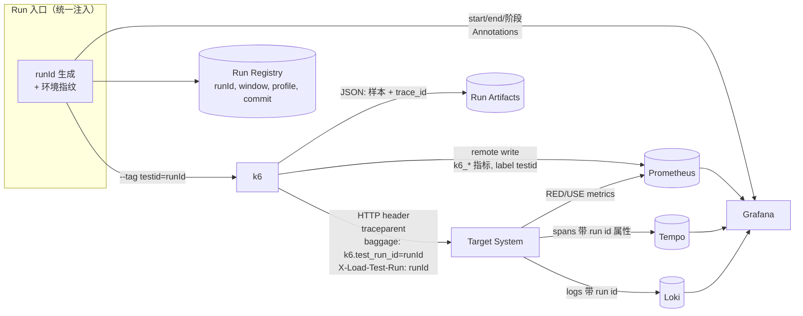

# Research：Observability 与性能测试关联

> 研究日期：2026-09-29
> 标记约定：**[事实]** 有来源；**[判断]** 本项目结论；**[推测]** 未完全验证。
> 本文回答：**性能测试结果如何与系统内部的 Metrics / Logs / Traces 建立关联？边界在哪里？**

---

## 0. 结论先行

| # | 结论 | 类型 |
|---|---|---|
| 1 | K6 只产生**客户端视角**指标。没有服务端 Metrics/Traces，任何"瓶颈分析"（包括 AI）都只能猜测。 | 判断 |
| 2 | 关联的主键是 **runId（`testid` tag）+ 时间窗口**，其次才是 trace_id。 | 判断 |
| 3 | k6 → Prometheus 使用 `experimental-prometheus-rw`；分布式场景必须开启 **Native Histogram**，否则多个负载机的 p95 **无法正确聚合**。 | 事实 + 判断 |
| 4 | `k6/experimental/tracing` 已在 **v0.55.0 移除**，替代为 jslib `http-instrumentation-tempo`（注入 W3C `traceparent`）。`xk6-distributed-tracing` 已于 2026-06-05 归档。 | 事实 |
| 5 | OpenTelemetry output 在 k6 **v1.4.0** 转为稳定（`--out opentelemetry`）。 | 事实 |
| 6 | trace_id **不能**进入 Prometheus label（基数爆炸），只能存在于 k6 JSON 输出的 metadata 或 exemplar 中。 | 事实 + 判断 |
| 7 | 负载机本身必须被监控。负载机饱和会产生"假回归"。 | 判断 |
| 8 | 当前阶段只需确定**关联约定**（tag、header、baggage、时间窗），不建设 Observability 平台。 | 判断 |

---

## 1. 信号与职责

| 信号 | 来源 | 在性能工程中的作用 | 当前阶段 |
|---|---|---|---|
| k6 client metrics | k6 | SLI 判定、客户端 RED | Phase 1 必须 |
| k6 summary / JSON | k6 `handleSummary` / `--out json` | 每次运行归档、回归比较 | Phase 1 必须 |
| Service metrics（RED） | 应用 / Service Mesh / Gateway | 定位哪个服务慢 | Phase 2 |
| Resource metrics（USE） | node_exporter、cAdvisor、DB/Redis/Kafka exporter | 定位哪类资源饱和 | Phase 2 |
| Traces | OTel SDK → Collector → Tempo/Jaeger | 定位调用链中的慢段 | Phase 3 |
| Logs | Loki 等 | 错误文本、异常 | Phase 3 |
| Profiles | Pyroscope | 代码级热点 | 未来可选 |

---

## 2. k6 → Prometheus → Grafana

- **[事实]** 内置 output：`json`、`csv`、`cloud`、`influxdb`（v1）、`experimental-prometheus-rw`、`web-dashboard`、`opentelemetry`（[outputs.go](https://raw.githubusercontent.com/grafana/k6/master/internal/cmd/outputs.go)）。`statsd` 在 v0.55 移出核心，`kafka`/`datadog` 在 v0.34 移除。
- **[事实]** `experimental-prometheus-rw` 关键配置（[docs](https://grafana.com/docs/k6/latest/results-output/real-time/prometheus-remote-write/)）：
  - 指标前缀 `k6_`；推送间隔 `K6_PROMETHEUS_RW_PUSH_INTERVAL`（默认 5s）；
  - `K6_PROMETHEUS_RW_TREND_STATS`（默认 `p(99)`），Trend 被预聚合为 gauge；
  - `K6_PROMETHEUS_RW_TREND_AS_NATIVE_HISTOGRAM`（默认 false）；
  - Prometheus 需开启 `--web.enable-remote-write-receiver`；
  - 文档明确承认：gauge 形式的百分位"**impossible to aggregate**"。
- **[事实]** Prometheus Native Histogram 自 **3.8.0（2025-11-28）**稳定（[release](https://github.com/prometheus/prometheus/releases/tag/v3.8.0)）。k6 文档仍称其为 experimental（文档滞后）。
- **[事实]** 官方 Dashboard：**19665**（k6 Prometheus）、**18030**（Native Histograms），均以 `testid` 变量筛选运行（[k6 dashboards](https://grafana.com/docs/k6/latest/results-output/grafana-dashboards/)）。
- **[事实]** Test-wide tag 的不同来源**不合并**：高优先级来源整体替换低优先级（例如 `--tag` 会覆盖 `options.tags`）（[tags-and-groups](https://github.com/grafana/k6-docs/blob/main/docs/sources/k6/next/using-k6/tags-and-groups.md)）。

**[判断]** 由此得出两条硬约束：

1. **runId/testid 只能在一个地方设置**（运行入口统一注入），否则会被覆盖。
2. **分布式运行必须用 Native Histogram**，或者以原始 JSON 为准做离线聚合。

---

## 3. OpenTelemetry 与 Tracing

- **[事实]** OTel 状态：Traces API/SDK/协议稳定；Metrics API/协议稳定；Logs、Baggage 稳定；Profiles 开发中（[status](https://opentelemetry.io/docs/specs/status/)）。
- **[事实]** W3C Trace Context 为 W3C Recommendation：`traceparent = 00-<trace-id 32hex>-<parent-id 16hex>-<flags>`（[W3C](https://www.w3.org/TR/trace-context/)）。
- **[事实]** k6 OTel output（`--out opentelemetry`，v1.4.0 稳定）：协议通过 `K6_OTEL_EXPORTER_PROTOCOL`（grpc | http/protobuf）；Trend → Float64Histogram，Rate → 带 `condition` 属性的 Int64Counter，k6 tag → OTel attribute（[docs](https://grafana.com/docs/k6/latest/results-output/real-time/opentelemetry/)）。v2.0 删除了 `exporterType` 选项（[v2.0.0 release](https://github.com/grafana/k6/releases/tag/v2.0.0)）。
- **[事实]** `k6/experimental/tracing` 于 v0.55.0 移除（[issue #3212](https://github.com/grafana/k6/issues/3212)）；替代品为 jslib [`http-instrumentation-tempo`](https://grafana.com/docs/k6/latest/javascript-api/jslib/http-instrumentation-tempo/)：`instrumentHTTP({propagator:'w3c'})`，每个请求注入 `traceparent`，并把 `trace_id` 写入 k6 输出 metadata。
- **[事实]** jslib `http-instrumentation-pyroscope` 通过 W3C `baggage` 传递 scenario、request name、test run id；但 `K6_CLOUDRUN_TEST_RUN_ID` **仅在 Grafana Cloud k6 中自动设置**（[docs](https://grafana.com/docs/k6/latest/javascript-api/jslib/http-instrumentation-pyroscope/)）。

**[判断]**
- 采样：压测下 100% 采样会显著增加 SUT 开销与 Tempo 成本。建议 1–10% 头部采样，或在 OTel Collector 中基于错误/延迟做 tail sampling。SUT 必须使用 parent-based sampler 才会尊重 `traceparent` 的采样标志。
- trace_id 放在 JSON 输出 metadata，通过"慢样本 → trace_id → Tempo"的方式关联；不进入 Prometheus label。

---

## 4. 关联模型（本项目约定）

| 关联键 | 载体 | 用途 | 状态 |
|---|---|---|---|
| `testid` / runId | k6 test-wide tag | 所有 k6 指标按运行筛选 | Phase 1 |
| 时间窗口 `[start, end]` + 阶段 | Run Registry + Grafana Annotation | SUT 面板对齐压测窗口 | Phase 1（记录）/ Phase 2（annotation） |
| `X-Load-Test-Run` header | HTTP header | 日志过滤、WAF 豁免、区分压测流量 | Phase 1 约定 |
| `baggage: k6.test_run_id` | W3C baggage | Span/Profile 按运行筛选（需 SUT 侧 baggage span processor） | Phase 3 |
| `traceparent` | W3C trace context | 单个慢请求 → 完整链路 | Phase 3 |
| Exemplar | Prometheus（需 `exemplar-storage`） | 从 SUT 延迟直方图跳转 trace | 未来 |

---

## 5. 系统指标来源（USE）

| 对象 | Exporter | 关键指标 | 来源 |
|---|---|---|---|
| 主机 | node_exporter | CPU、内存、磁盘 IO、网络 | [GitHub](https://github.com/prometheus/node_exporter) |
| 容器 | cAdvisor（内嵌 kubelet） | 容器 CPU、throttling、内存、OOM | [GitHub](https://github.com/google/cadvisor) |
| K8s 对象 | kube-state-metrics | Pod 状态、副本数（**不是**资源使用） | [GitHub](https://github.com/kubernetes/kube-state-metrics) |
| MySQL | mysqld_exporter | QPS、慢查询、连接、锁 | [GitHub](https://github.com/prometheus/mysqld_exporter) |
| PostgreSQL | postgres_exporter | 连接、锁、缓冲命中 | [GitHub](https://github.com/prometheus-community/postgres_exporter) |
| Redis | redis_exporter | ops、延迟、驱逐、内存 | [GitHub](https://github.com/oliver006/redis_exporter) |
| Kafka | kafka_exporter | consumer lag、分区 | [GitHub](https://github.com/danielqsj/kafka_exporter) |

**[判断]** 最小 USE 面板：CPU 利用率 + throttling、内存 + OOMKill、网络、磁盘 IO、应用池（DB 连接池、线程池、GC）、DB、Redis、MQ lag，**以及负载机**（CPU < ~80%）。

---

## 6. 不推荐的方向

| 方向 | 原因 | 来源 |
|---|---|---|
| `k6/experimental/tracing` | 已移除 | v0.55.0 |
| `xk6-distributed-tracing` | 2026-06-05 归档 | [GitHub](https://github.com/grafana/xk6-distributed-tracing) |
| `xk6-output-timescaledb` | 2026-06-05 归档 | [GitHub](https://github.com/grafana/xk6-output-timescaledb) |
| InfluxDB v1 output | 仅用于遗留环境；v2 需扩展 | [docs](https://grafana.com/docs/k6/latest/results-output/real-time/influxdb/) |
| gauge 形式 trend stats 做分布式聚合 | 百分位不可聚合 | k6 PRW 文档 |
| trace_id / userId 作为 metric label | 基数爆炸 | Prometheus 数据模型 |

---

## 7. 对本项目的启示

1. Phase 1 只需要：runId 注入、`--out json` 归档 + `handleSummary` 摘要、可选 Prometheus RW。
2. **关联约定先于平台**：runId、header、时间窗口在 Phase 1 就固定下来，后续接入 Observability 时不需要改业务脚本。
3. Prometheus ≥ 3.8 + Native Histogram 是分布式聚合的前提。
4. OTel output 作为厂商中立路径；Prometheus RW 仍是 k6 指标的主路径。
5. Trace 关联放在 Phase 3，且需要 SUT 侧配合（parent-based sampling、baggage 处理）。
6. **AI 在分析环节的价值上限，由这里能提供多少结构化证据决定**。Observability 没到位之前，讨论 AI RCA 没有意义。
