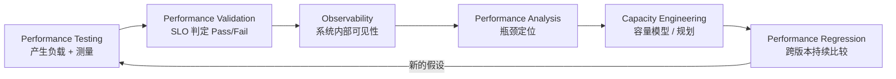
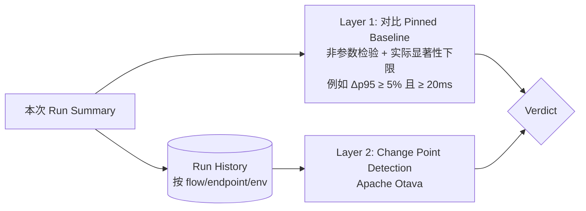
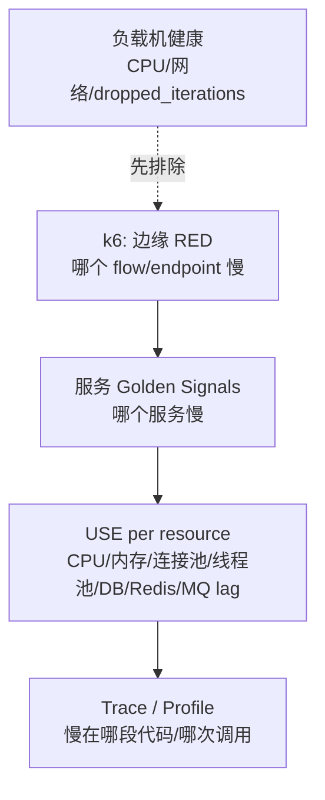
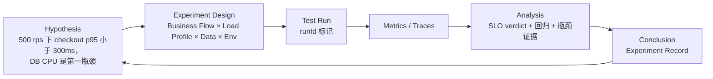

# Research：现代 Performance Engineering

> 研究日期：2026-09-29
> 标记约定：**[事实]** 有来源支撑；**[判断]** 本项目的分析结论；**[推测]** 未完全验证 / 需后续实验确认。
> 本文回答：**一个真正的 Performance Engineering 系统是什么？除了 K6 之外还需要哪些核心概念？**

---

## 0. 结论先行

| # | 结论 | 类型 |
|---|---|---|
| 1 | Performance Testing 只是"产生负载并测量"；Performance Engineering 是**以假设驱动、可重复、可比较、可归因**的工程闭环。K6 只覆盖其中"产生负载 + 客户端测量 + 本地判定"一段。 | 判断 |
| 2 | 测试类型（Load/Stress/Spike/Soak/Breakpoint）本质上是**同一个业务模型在不同负载模型下的运行**，不应该写成不同脚本。 | 判断 |
| 3 | 负载模型必须区分 Open / Closed。Closed 模型存在 Coordinated Omission，会系统性低估尾延迟。SLO 验证默认使用 Arrival-rate（Open）。 | 事实 + 判断 |
| 4 | Threshold 是 SLO 在"某一负载水平"下的可执行表达，而不是 SLO 本身。SLO 应作为数据存在，Threshold 由其生成。 | 判断 |
| 5 | 需要区分两类阈值：**SUT SLO Threshold**（系统是否达标）与 **Test Validity Threshold**（这次测试本身是否有效）。后者是绝大多数框架缺失的。 | 判断 |
| 6 | 回归检测有成熟的非 AI 方法：单次对比（非参数统计 + 实际显著性下限）+ 跨版本 Change Point Detection（Apache Otava）。这两者都有公开算法与评估数据。 | 事实 + 判断 |
| 7 | 瓶颈分析有成熟方法论：RED（服务视角）→ Golden Signals → USE（资源视角）→ Traces/Profiles。这是 AI 若要介入 RCA 时必须依赖的"结构化证据"。 | 事实 + 判断 |
| 8 | 真实 TOC/TOB 场景的主要难点常常不是"并发多大"，而是**测试数据**：唯一性、幂等、Token 生命周期、多租户倾斜、分布式下的数据分片。 | 判断 |

---

## 1. 从 Testing 到 Engineering

| 层次 | 核心问题 | 需要的能力 | K6 是否覆盖 |
|---|---|---|---|
| Testing | 能不能打出指定负载？ | 负载生成、协议、脚本 | ✅ 核心能力 |
| Validation | 达标了吗？ | SLI/SLO、Threshold、Exit code | ✅ 部分（本地 Threshold） |
| Observability | 系统内部发生了什么？ | Metrics/Logs/Traces 关联 | ⚠️ 仅输出客户端指标，需要外部栈 |
| Analysis | 为什么慢？瓶颈在哪？ | RED/USE、Trace、Profile | ❌ |
| Capacity | 能扛多少？还剩多少余量？ | Breakpoint、USL、Knee | ⚠️ 提供负载，不提供建模 |
| Regression | 比上次变差了吗？ | Baseline、统计比较、CPD | ❌ |

**[判断]** 本项目的价值正是 K6 不覆盖的这几层：把 K6 放在一个"实验 → 结果 → 基线 → 比较 → 结论"的闭环中。

---

## 2. 测试类型（Test Types）

来源：[k6 Test types](https://grafana.com/docs/k6/latest/testing-guides/test-types/)、[Breakpoint testing](https://grafana.com/docs/k6/latest/testing-guides/test-types/breakpoint-testing/)、[ISTQB CT-PT](https://istqb.org/certifications/certified-tester-performance-testing-ct-pt/)

| 类型 | 回答的问题 | 负载形状 | 推荐 Executor | 典型持续时间 | 关键观察 |
|---|---|---|---|---|---|
| Smoke | 脚本和系统是否基本可用？ | 极低（1–5 VU） | `shared-iterations` / `constant-vus` | 1–3 min | 功能错误、脚本错误 |
| Average-load | 常规负载下是否满足 SLO？ | 稳态 + 爬坡 | `ramping-arrival-rate` | 10–60 min | p95/p99、错误率 |
| Stress | 高于常规（促销/峰值）时表现如何？ | 高于均值的稳态 | `ramping-arrival-rate` | 10–60 min | 降级方式 |
| Spike | 突发流量能否存活并恢复？ | 无爬坡的瞬时尖峰 | `ramping-arrival-rate` | 数分钟 | 恢复时间、错误突增 |
| Soak / Endurance | 长时间运行是否漂移、泄漏？ | 均值负载长期运行 | `constant-arrival-rate` | 数小时 | 内存、连接池、磁盘、GC |
| Breakpoint | 极限在哪？ | 连续爬坡，无平台 | `ramping-arrival-rate` + `abortOnFail` | 直到失败 | 失败点 |
| Scalability（本项目定义） | 资源 ×N 吞吐是否 ×N？ | 固定形状 × 多组资源 | 同一负载模型重复 | — | USL 拟合 α/β |
| Capacity（本项目定义） | **满足 SLO 的前提下**最大吞吐？ | 阶梯式 Breakpoint | `ramping-arrival-rate` 阶梯 | — | 最后一个全绿阶梯 |

- **[事实]** k6 的 Breakpoint 指南建议：使用 `ramping-arrival-rate`、连续爬坡、用 `abortOnFail` 停止；**避免在自动扩缩容环境**进行（"system may scale with your bill"）；应在其他测试通过后再做。
- **[事实]** k6 没有定义 "Scalability test"。
- **[判断]** Capacity ≠ 崩溃点。Capacity 应定义为 "SLO 仍然满足的最大到达率"，这是可以被自动化判定的。

**架构启示 [判断]**：测试类型 = **Load Profile**（数据），而不是脚本。同一个 `checkout` 业务流，应能以 `smoke / average / stress / spike / soak / breakpoint` 任意 Profile 运行，且不修改业务代码。

---

## 3. 工作负载模型：Open vs Closed、Coordinated Omission、Little's Law

### 3.1 Open vs Closed

- **[事实]** Schroeder, Wierman, Harchol-Balter, *Open Versus Closed: A Cautionary Tale*, NSDI '06（[PDF](https://www.usenix.org/legacy/event/nsdi06/tech/full_papers/schroeder/schroeder.pdf)）：Closed 模型中新请求只在上一个完成后产生；Open 模型中到达与完成独立；两者在响应时间与调度策略影响上存在"巨大差异"；推荐 **Partly-open** 模型（会话按 Open 到达，会话内请求按 Closed 执行）。
- **[事实]** k6 中 `constant-vus / ramping-vus / per-vu-iterations / shared-iterations` 是 Closed 模型；`constant-arrival-rate / ramping-arrival-rate` 是 Open 模型（[k6 open-vs-closed](https://grafana.com/docs/k6/latest/using-k6/scenarios/concepts/open-vs-closed/)）。

| 真实系统 | 更接近的模型 | 原因 |
|---|---|---|
| TOC 互联网入口（App、H5） | Open / Partly-open | 用户不会因为系统慢而"停止到达" |
| TOB 后台（固定员工数） | Closed（有 think time） | 用户数有上限，慢了大家都等 |
| 批处理 / 定时任务 | Closed | 固定 worker 数 |
| MQ 消费者 | Closed（消费侧） / Open（生产侧） | 取决于测量对象 |

**[判断]** TOC 场景的 user journey 最适合 Partly-open：用 arrival-rate 控制"会话到达率"，每个 iteration 内顺序执行业务步骤并加入 think time。

### 3.2 Coordinated Omission（CO）

- **[事实]** Gil Tene / [HdrHistogram](https://github.com/HdrHistogram/HdrHistogram)：负载发生器与卡住的系统"协调"，从而遗漏本应发送的请求样本。例：100s 每次 1ms 后 100s 卡死，朴素统计显示 99.99% 良好，校正后约 50% 为坏样本。
- **[判断]** Arrival-rate executor 仅在 **VU 充足时**消除 CO。VU 不足时 k6 发出 `dropped_iterations`，此时实际已退化为 Closed 模型。因此：
  - `dropped_iterations` 必须作为 **Test Validity Threshold**（`count==0` 或极小比例）；
  - 触发时结论是"**测试无效**"，而不是"系统失败"。

### 3.3 Little's Law 与 VU 规划

- **[事实]** L = λW（J.D.C. Little, 1961，标准结论，本次未取原文）。
- **[事实]** k6 建议：`preAllocatedVUs ≈ 迭代时长中位数 × 到达率 + 余量`，不要依赖 `maxVUs` 动态分配（中途分配会干扰结果）（[arrival-rate VU allocation](https://grafana.com/docs/k6/latest/using-k6/scenarios/concepts/arrival-rate-vu-allocation/)）。

示例：目标 200 iter/s，单次迭代（含 5 个请求 + think time）中位数 1.5s → 需要约 300 并发 VU，预分配 350。

**架构启示 [判断]**：Load Model 层应能**根据目标到达率与历史迭代时长自动估算 preAllocatedVUs**。这是纯计算问题，不需要 AI。

---

## 4. SLI / SLO / SLA 与 Threshold

- **[事实]** Google SRE Book（[SLO 章节](https://sre.google/sre-book/service-level-objectives/)）：SLI 是服务水平的量化度量；SLO 是 SLI 的目标值；SLA 是包含违约后果的契约。应使用百分位而非平均值。
- **[事实]** Error budget = 1 − SLO（[SRE Workbook](https://sre.google/workbook/implementing-slos/)）。
- **[事实]** k6 文档："testers use thresholds to codify their SLOs"；Threshold 失败时 exit code = **99**（[thresholds](https://grafana.com/docs/k6/latest/using-k6/thresholds/)，[exitcodes](https://raw.githubusercontent.com/grafana/k6/master/errext/exitcodes/codes.go)）。

| 概念 | 时间尺度 | 在本项目中的表达 |
|---|---|---|
| SLA | 月/季度，合同 | 不直接建模 |
| SLO | 月度滚动窗口 | `slo` 数据（YAML/JSON） |
| **Load-level SLO** | 单次测试（分钟~小时） | "在 λ=500 rps 时，checkout p95<300ms" |
| k6 Threshold | 单次测试 | 由 Load-level SLO **生成** |

**[判断]** 一次压测几十分钟，不可能验证月度 error budget，它验证的是"**在负载水平 λ 下 SLI 是否达标**"。因此 Threshold 必须和 Load Profile 绑定，而不是和脚本绑定。

**两类阈值 [判断]**：

| 类别 | 例子 | 失败含义 |
|---|---|---|
| SUT SLO Threshold | `http_req_duration{flow:checkout} p(95)<300`、`http_req_failed rate<0.01`、`order_success rate>0.99` | 系统不达标 |
| Test Validity Threshold | `dropped_iterations count==0`、`checks rate>0.99`、负载机 CPU<80%、实际到达率 ≥ 目标 95% | **本次测试不可信**，结论作废 |

---

## 5. Baseline 与 Performance Regression

- **[事实]** Daly et al., *The Use of Change Point Detection to Identify Software Performance Regressions in a Continuous Integration System*, ICPE '20（MongoDB，[arXiv](https://arxiv.org/pdf/2003.00584)）：使用改进的 E-Divisive Means，用 t-test 替代随机置换以获得确定性。
- **[事实]** Fleming et al., *Hunter: Using Change Point Detection to Hunt for Performance Regressions*, ICPE '23（[arXiv](https://arxiv.org/abs/2301.03034)）。
- **[事实]** Apache Otava = Hunter 更名（2025-02），仍在 Apache Incubator，0.8.0-incubating 于 2026-05-08 发布；Python CLI，支持 CSV/JSON/PostgreSQL 等输入（[GitHub](https://github.com/apache/otava)）。
- **[事实]** Mozilla 研究（[arXiv 2606.18377](https://arxiv.org/abs/2606.18377)）：在 174 条由 11 位性能工程师标注的序列上评估 25 种 CPD 方法，现有 t-test 方案 12.5% 误报，ensemble 投票 F1 +11%。

**两层回归检测 [判断]**：

**噪声控制前提 [判断]**：固定环境、剔除 warm-up、≥3 次重复、记录环境指纹（build SHA、实例规格、数据量、k6 版本）。没有这些，任何回归判断（包括 AI）都没有意义。

---

## 6. 瓶颈分析方法论

| 方法 | 视角 | 内容 | 来源 |
|---|---|---|---|
| RED | 服务（用户视角） | Rate / Errors / Duration | [Grafana blog, Tom Wilkie](https://grafana.com/blog/2018/08/02/the-red-method-how-to-instrument-your-services/) |
| Four Golden Signals | 服务 | Latency / Traffic / Errors / Saturation；失败请求的延迟要单独统计 | [SRE Book](https://sre.google/sre-book/monitoring-distributed-systems/) |
| USE | 资源（机器视角） | 对每个资源检查 Utilization / Saturation / Errors | [Brendan Gregg](https://www.brendangregg.com/usemethod.html) |
| USL | 容量模型 | C(N) = N / (1 + α(N−1) + βN(N−1))，α=竞争，β=一致性开销 | [Neil Gunther](http://www.perfdynamics.com/Manifesto/USLscalability.html) |

**分析路径 [判断]**：

**[判断]** 这个路径的前三步是**确定性查询**，可以完全由规则/模板完成。只有当证据多、跨信号、需要"读 Trace/日志文本并形成假设"时，才可能是 AI 的候选位置（见 `plans/ai-opportunity-map.md`）。

---

## 7. Capacity Planning

- **[判断]** Knee point：响应时间偏离平坦区的负载点。排队论（M/M/1，R = S/(1−U)）表明利用率 50% 时响应时间翻倍，90% 时 ×10 **[推测：教科书结论，本次未取原文]**。
- **[事实]** 饱和在 100% 利用率之前就开始（SRE Book Golden Signals）。

**容量工作流 [判断]**：

1. 在**非自动扩缩容**环境做阶梯式 Breakpoint；
2. 每个阶梯判定：实际吞吐 ≥ 目标 95%？SLO 全绿？
3. Capacity = 最后一个全绿阶梯的到达率；
4. 多资源规格重复 → 拟合 USL（α, β, N*）→ 外推；
5. 给出余量建议（如运行在 ≤70% capacity）。

全部为确定性计算。

---

## 8. 实验驱动（Experiment-driven）

- **[事实]** Woodside, Franks, Petriu, *The Future of Software Performance Engineering*, FOSE 2007：SPE = 模型驱动（早期预测）+ 测量驱动（后期验证），两者应收敛。
- **[事实]** MongoDB *Creating a Virtuous Cycle in Performance Testing*（[arXiv 2101.10231](https://arxiv.org/pdf/2101.10231)）：CI 中持续性能测试 + CPD 分诊闭环。

**[判断]** 每次实验应保存为结构化 **Experiment Record**（JSON）：假设、设计、环境指纹、结果摘要、判定、结论。这是后续回归比较的基础，也是未来 AI 唯一可靠的数据来源。

---

## 9. 真实 TOC / TOB 场景的测试数据问题

- **[事实]** `exec.vu.idInTest` 在整个测试（含分布式）中全局唯一；`exec.vu.idInInstance` 跨实例不唯一；`exec.scenario.iterationInTest` 在单个 scenario 内唯一且跨分布式一致（可能有空洞）（[k6-execution](https://grafana.com/docs/k6/latest/javascript-api/k6-execution/)）。
- **[事实]** Execution segment（`--execution-segment` + `--execution-segment-sequence`）可以无重叠地切分测试（[k6 options](https://grafana.com/docs/k6/latest/using-k6/k6-options/reference/)）。

| 问题 | TOC 典型 | TOB 典型 | 规则 [判断] |
|---|---|---|---|
| 唯一性 | 注册、下单、优惠券 | 客户、合同、审批单 | 唯一键 = `${runId}-${vu.idInTest}-${scenario.iterationInTest}` |
| 可消耗数据 | 库存、优惠券 | 审批额度 | 按 `iterationInTest` 取数，保证分布式不冲突 |
| 幂等 | 支付、下单 | 审批、提交 | 写请求携带 Idempotency-Key |
| Token/Session | 登录 Token 过期 | SSO、租户 Token | 每 VU 缓存 + 过期前刷新；登录单独打 tag，不混入业务 SLO |
| 多租户 | — | 大租户倾斜（whale tenant） | tenant 作为 tag；按权重分配；按租户设阈值 |
| 数据量 | 商品数、用户数 | 客户、报表数据量 | SUT 数据量需接近生产（影响索引/缓存） |
| 清理 | 测试订单 | 测试单据 | 以 runId 前缀清理 |
| Tag 基数 | URL 中带 ID | 同 | 使用 `name` tag 分组，禁止 userId 进 tag |

---

## 10. 对本项目的启示（汇总）

1. 测试类型实现为 **Load Profile 数据**，业务流不感知测试类型。
2. SLO 验证默认使用 **arrival-rate**；Little's Law 估算 VU；`dropped_iterations` 作为有效性阈值。
3. **SLO 作为数据**，Threshold 由（SLO × Load Profile）生成。
4. 区分 **SUT Threshold 与 Validity Threshold**，区分 "Fail" 与 "Invalid"。
5. 每次运行有 **runId + Experiment Record + 环境指纹**。
6. 回归检测：Pinned Baseline 统计比较 + CPD（Otava）——**不需要 AI**。
7. 瓶颈分析：RED → Golden Signals → USE → Trace 的**确定性证据收集**是前提；AI（若介入）只消费这些证据。
8. Capacity：阶梯 Breakpoint + SLO 判定 + USL 拟合——**不需要 AI**。
9. 测试数据规则（唯一性、幂等、Token、多租户、清理）是 Core 的一部分，而不是扩展。
